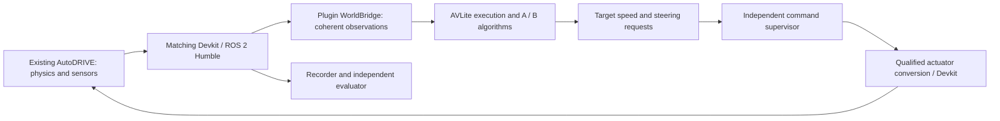

# RoboRacer Community Plugin Development Plan

Version: **1.0 — approved**, 2026-09-28. Status updated 2026-09-29: **the user reconfirmed complete PRE before S1; S1a/deferral is not adopted**. Continue the reviewed [source-build route](simulator-build-amendment.md) to close PRE capability gaps, starting with scoped SIM0 and retaining subsequent stage-entry gates. See the [PRE report](../stages/PRE.md). Original acceptance/dependencies remain in force; the concrete pre-motion protocol remains a separate confirmation gate.

**Latest checkpoint, 2026-10-05:** SIM0 complete ([report](../stages/SIM0-completion.md)); SIM1 entered; **SIM1-01 and SIM1-02 pass** ([provenance report](../stages/SIM1-provenance.md), [guard report](../stages/SIM1-guard.md)). **Sequencing amendment 1.2 adopted:** the user postponed the remaining PRE work and started **S1 on the SIM1-02 build** ([amendment](s1-first-amendment.md)). PRE-03/04 now gate S1 acceptance rather than S1 entry. The numerical motion protocol is S1's first gate before any motion. **S1-01 passes** (plugin loading/settings/command consumers). **S1-02 observation half passes** ([report](../stages/S1-observation.md)): coherent snapshots, scan convention/mount/order and source timestamps; command signs/units await the motion protocol. **S1 supervisor skeleton passes without motion** ([report](../stages/S1-supervisor.md)): AVLite → bridge → separate supervisor → guard, 233/233 guard acceptances traced end to end. [Motion protocol v0.1](s1-motion-protocol.md): D1 A, D2, D3 approved; **M0 (steering only, braked) passed** on the SIM1-03 player ([report](../stages/S1-M0-steering.md)): +1 = 30° left, Ackermann angles exact, slew 183°/s, expiry returns steering to 0, no translation. **M1 (forward throttle pulses) passed** ([report](../stages/S1-M1-throttle.md)): throttle + = forward, 21.4 N·m × throttle per wheel, peak ≈ 4.7 m/s and travel ≈ 0.95 m per unit throttle for a 0.2 s pulse, stop ≤ 0.58 s, D1 release verified. M2 not authorized. Original acceptance **3/34**.

Quick review: [approval summary](approval-summary.md). This approved version incorporates both substantive planning reviews and all five R2 decisions, followed by the user's explicit final approval.

Inputs: [confirmed decisions and probe results](../research/decision-follow-up.md), [original research report](../research/report.md), [existing AutoDRIVE inspection](../research/autodrive-local-installation.md), and the [official AVLite plugin guide](/home/a2rl/Workspace/avlite/docs/plugin-development.md).

**Confirmed revision:** use the existing AutoDRIVE installation at `/home/a2rl/Workspace/AutoDRIVE Simulator [Linux]` as the first closed-loop backend. Gym is a later candidate, with no first-release implementation, dependency or acceptance obligation. The user authorized PRE + S1; simulated motion and later stages retain the agreed approval gates. PRE-01/02 have passed; the remaining 32 todos are unchecked, and S1 feature work has not started.

**Further user-confirmed decisions:** dynamic obstacles and multi-car interaction are not mandatory first-release acceptance; localization will reuse/extend AVLite's built-in ICP. Imported maps/reference paths, initial Pure Pursuit tracking, target-speed/steering commands and an independent command-supervision process are approved design choices. Native particle-filter development and AMCL integration are no longer first-release proposals. The user has also confirmed simulation-only first-release acceptance, avoidance of passable static obstacles with stopping when fully blocked, and operator-supplied initial pose/manual recovery after localization loss. Physical-car integration/calibration/testing is a later separate stage. The user has now confirmed one qualified track, five reproducible initial conditions, left-pass/right-pass/fully-blocked static cases, and unattended operation using a qualified graphical session or virtual display. Display-free operation and multi-track generalization are not first-release requirements.

## 1. Outcome, revision and approval sequence

Deliver a native AVLite plugin for physical RoboRacer development: map-based driving, AutoDRIVE validation, a Humble driver boundary, explicit command supervision and reproducible evaluation. The future event/year/category remains open. Using AutoDRIVE for development does not select its virtual competition rules.

**Confirmed first-release scope:** AutoDRIVE simulation qualification of known-map ICP driving, Pure Pursuit tracking and static-obstacle avoidance when a traversable corridor exists, with stopping when fully blocked. Dynamic obstacles and multi-car interaction are excluded from mandatory acceptance. Physical-car integration, calibration and testing follow in a separate stage. Operator/configuration initial pose and stop/manual reinitialization after localization loss are accepted; automatic global initialization/recovery is not required.

| Current revision / retained change | Reason / benefit | Cost / unresolved risk |
| --- | --- | --- |
| AutoDRIVE is the first simulator. | Follow the user's direction and use the available F1TENTH application. | The exact release, matching Devkit and runtime compatibility are still unknown. Existing files do not prove a working integration. |
| Humble transport and command supervision enter S1. | The first demonstration exercises the intended simulator connection through AVLite. | More integration work precedes the first lap; no ROS-free first loop is promised. |
| S2 delivers unattended episodes, recording and fault recovery. | Shorten repeated modification → run → diagnosis cycles on the selected simulator. | Automated reset, startup and the selected display-backed sensor mode need qualification. |
| Gym-specific step/seed/map/opponent assumptions are removed. | Acceptance must match demonstrated AutoDRIVE capabilities. | Repeatability, scene diversity and throughput need measurements; unsupported capabilities can block dependent stages. |
| Recorded-input regression is the proposed fast inner loop. | Check transformations and algorithms without launching Unity for every small change. | Offline replay cannot establish closed-loop stability or race performance. |
| Reuse/extend built-in ICP; retain the AVLite localization contract. | Follow the confirmed direction and reuse source behavior/tests where applicable. | Stock ICP targets the first scan; known-map input, validity and recovery behavior need plugin-level extensions. |
| Dynamic obstacles/multi-car are not mandatory in release 1. | Bound initial delivery and remove an unqualified simulator capability from required acceptance. | First-release evidence will not establish moving-opponent racing performance. |

| Gate | Required interaction | Current status |
| --- | --- | --- |
| Research direction | Select goal, route and environment. | Physical racing, B, Humble, Build reference, labelled early GT, independent hardware stop and eventual private GitHub hosting confirmed. |
| Planning review 1 | Review scope, stages and architectural tradeoffs. | Principal design/scope choices confirmed, including simulation-only release 1, static avoidance/blocked-track stop and manual ICP initialization/recovery. Dynamic/multi-car acceptance excluded. |
| Planning review 2 | Review revised todos, acceptance, permission scope and risks. | User confirmed R2-01–05 through the delivery/recovery and coverage/display exchanges. The consolidated todos, run protocol, qualification gates and permission scope were subsequently approved as v1.0. |
| Final plan approval | Explicit approval of the final revision before implementation. | Granted by the user's explicit “Approved” response on 2026-09-28; scoped PRE + S1 authorized. |
| Implementation stage gates | Review evidence and next-stage risks. | Stop after every stage; proceed only on explicit confirmation. |

The user's original requirement already establishes the policy for unknown numerical thresholds: bounded baseline → proposed thresholds → user confirmation → separate acceptance runs. That principle does not need another approval. The final approval covers the concrete measurement protocol and the staged qualification gates below. Simulator-specific operational limits remain a named pre-motion approval gate, since the installed API and stop behavior are not yet qualified. A capability or acceptance criterion that remains unresolved is a blocker, not a pass.

## 2. Fixed inputs and proposed architecture

| Topic | Status | Contract / tradeoff |
| --- | --- | --- |
| AVLite | Source/probe baseline verified | Target commit `50dcd0043db0cc17efbe82bda81cd0e8875810a0`; follow community structure and current profile APIs. No core-interface modification is authorized. |
| Hardware | User-selected documentary basis | Use the official [Build follow-up](../research/decision-follow-up.md). Keep geometry, calibration and delays configurable. Host measurements do not predict onboard performance. |
| Environment | Humble confirmed; host inventoried | Retain Ubuntu 22.04 / Python 3.10 / ROS 2 Humble. Qualify dependencies against this environment; no automatic Jazzy migration. |
| Simulator | User-confirmed direction; runtime unverified | Existing AutoDRIVE first. Its Unity `2021.3.9f1` marker does not identify the AutoDRIVE release. Pin local fingerprints and a matching official Devkit revision. |
| Transport | Proposed; qualification required | Prefer the matching official ROS 2 Devkit/API with a plugin-owned AVLite bridge. Topic names, QoS, ports, frames and units come from that qualified version. Do not borrow the 2026 competition API or physical `/drive` contract without checking. |
| Strategy B | User confirmed | Known-map localization, prepared corridor/reference trajectory with speed profile, local obstacle handling and tracking. A is a small reactive integration baseline/comparator, without automatic emergency handover. |
| Localization | User confirmed | Reuse/extend AVLite's built-in `LidarLocalization` ICP within the plugin. Retain `LocalizationStrategy`; add a validated known-map target and explicit match-validity/loss handling. Operator/configuration initialization and stop/manual reinitialization are accepted. Do not implement PF/AMCL or automatic global recovery for release 1. Stock behavior is source-verified, not AutoDRIVE-qualified. |
| Maps/tracking | User approved | Import validated occupancy maps and prepared reference paths/corridors; begin with Pure Pursuit-style tracking and bounded speed profiles. Online SLAM, optimal raceline generation and MPC remain later candidates. |
| Commands | Semantics user approved; adapter qualification pending | Target speed in m/s and steering angle in radians; use the existing command extension without misusing stock Ackermann `acceleration`. Test factory/GUI compatibility and backend conversion. |
| Truth | Early allowance confirmed | Label GT integration profiles. Later driving code uses only approved sensor/motion observations; evaluator truth is isolated. Availability and coordinate correctness of AutoDRIVE truth are unverified. |
| Stop | Independent hardware stop and separate software supervision approved | An independent command-supervision process owns final simulator commands. Freshness/limit guards, expiry and disarmed/ready/running/stopped/fault behavior require the concrete acceptance protocol. Physical stop remains independent of plugin, Python, ROS and simulator behavior. |
| Distribution | Intent confirmed; routine naming delegated | Standalone plugin and eventual private GitHub repository. Use `roboracer` as the local registry identifier unless a discovered conflict requires adjustment. No separate naming approval, remote creation, push or public registry submission now. |

### ICP reuse boundary

Source inspection of [built-in ICP](/home/a2rl/Workspace/avlite/avlite/c10_perception/c16_localization_algs.py:85) confirms that it stores the first valid scan as a fixed reference, seeds from the current ego pose and updates only planar position/heading. It declares an occupancy-map capability requirement but does not consume a loaded occupancy grid in that implementation. The existing [unit-test source](/home/a2rl/Workspace/avlite/test/c10_perception/test_c16_lidar_localization.py:56) covers synthetic scan alignment, mounts and missing inputs; it is not whole-track validation and was not executed during this planning revision.

Keep extensions in the community plugin: derive/validate matching targets from the imported map, handle frame/mount/timestamp semantics, reuse suitable ICP matching routines, expose match diagnostics and define loss behavior. Do not assume a public map setter or overwrite another component's private map state. Any dependency on inherited non-public helpers must be isolated, tied to the source revision and covered by meaningful contract fixtures. No AVLite core-interface change is authorized; if a viable extension requires one, present alternatives and impact before proceeding.

Measure overlap/inlier/residual behavior, runtime and externally scored pose error; an ICP residual is not calibrated pose uncertainty. The user permits operator/configuration initialization and requires stopping with manual reinitialization/rearm after detected localization loss. Local ICP can yield a plausible wrong match in ambiguous geometry; it does not guarantee detection of every incorrect global initial pose. Freeze the permitted initialization envelope and detectable fault cases, and retain residual ambiguity as a limitation. Automatic global initialization/recovery is outside the required first release; online SLAM and additional sensor-fusion algorithms are not assumed approved. Stock ICP may be a comparator on shared synthetic/recorded overlap cases; do not presume that it can complete a full course unchanged.

**Normal batches versus loss recovery:** the operator may define initial-pose configurations before a healthy unattended batch; the runner applies only qualified configurations and checks each episode's initialized state. Detected localization loss ends that episode as a failure and pauses further driving for operator review/reinitialization/rearm. A process restart must not conceal that failure or silently act as autonomous localization recovery. Deliberate localization-loss tests are separate from the healthy unattended-batch acceptance and record any manual intervention. Do not count queued, unstarted episodes as completed or as attempted laps.

**Velocity ownership:** the plugin state adapter must populate and validate `PerceptionModel.ego_vehicle.velocity` from approved timestamped motion observations when GT copying is disabled. Built-in ICP only updates planar pose, while the existing [Pure Pursuit implementation](/home/a2rl/Workspace/avlite/avlite/c30_control/c35_pure_pursuit.py:164) consumes velocity. Qualify the selected controller's speed dependency as well. Backend speed feedback alone does not populate AVLite state. Reject stale/invalid motion observations; do not assume perfect simulator global pose is an allowed source. This state adaptation does not by itself authorize an additional fusion algorithm.

**Pure Pursuit reuse boundary:** the stock controller computes steering and then returns an Ackermann command containing **acceleration**, not target speed. Reuse compatible lateral geometry/path utilities through a plugin controller that explicitly emits the approved target-speed/steering command. Its target speed comes from the bounded speed profile; do not relabel acceleration as speed or retain a second longitudinal PID when backend conversion already owns speed feedback. Validate factory, executor and standard GUI consumers with this payload before accepting the integration.

### First closed-loop data flow

The following is the proposed integration, not a claim that the local API already works:



**Execution and time:** treat AutoDRIVE as an externally advancing simulator unless its matching API proves a supported step contract. A command publication is not evidence of one physics step. Start with stock `SyncExecuter` behind a paced runner only if source and integration tests support it. The bridge's `control_ego_state` submits requests; it must not pretend to advance Unity by the supplied `dt`. Do not equate AVLite `elapsed_sim_time`, ROS publication time and actual simulator time.

Observe source timestamps/sequences where available, receipt time, sample age and control-generation time separately. Freeze snapshot coherence, cadence and discontinuity policies during qualification. Reusing a held command or receiving another publication of the same sensor sample must not reset computation/sensor freshness. If the public executor cannot enforce the required contract, present a scoped plugin-executor alternative for review; do not copy private scheduling internals or patch core interfaces.

The bridge must supply atomic, buffer-stable observation snapshots with a documented scan/odometry/pose skew policy; a later GT getter must not silently mix another generation into the same tick. Missing acquisition timestamps remain unknown. AVLite's `LOCALIZATION` capability gate does not establish current pose validity: the publication boundary must also reject stale/invalid localization, with explicit GT-filter settings. Stock control invocation passes `sim_dt`, not necessarily the elapsed interval between control updates; any integration or speed-feedback logic must use its qualified time basis. These constraints follow from the inspected [Sync executor](/home/a2rl/Workspace/avlite/avlite/c40_execution/c44_sync_executer.py:69), [control hook](/home/a2rl/Workspace/avlite/avlite/c40_execution/c42_execution_strategy.py:352) and [snapshot contract](/home/a2rl/Workspace/avlite/avlite/c40_execution/c41_world_bridge.py:158).

**Actuator conversion:** confirm whether the local API accepts target speed/steering, acceleration, or normalized throttle/steering. If normalized inputs are required, keep measured speed feedback, conversion, saturation, rate limits and calibration in the backend actuation layer. Measure response before increasing the motion envelope. Zero throttle is not presumed to brake or hold the car. The first motion demonstration requires a validated simulated stop behavior; conversion uncertainty blocks it.

**Failure ownership:** the algorithm sends requests to a supervisor in a separate OS process from both the algorithm and runner. It owns the only final command path and keeps expiry independent of blocked algorithm/runner execution. Define bounded I/O and runner-liveness lease behavior so runner loss also expires authorization to move. The supervisor expires requests using their original generation time, validates sensor/control freshness, and requests the verified stop behavior. If a speed-feedback controller is needed, it also stops on stale feedback. Repeated forwarding must not make an old request fresh. Qualify the downstream Devkit/socket command retention and disconnect behavior. A qualified downstream receiver timeout complements the independent supervisor; it does not replace that user-approved process in release 1. Replacing it would require explicit approval of an architecture change.

The runner detects supervisor/Devkit/simulator exit or hang. It inhibits further algorithm requests, records a failed episode and terminates only processes it owns when recovery cannot be verified. A dead or hung sole publisher cannot deliver a new stop command: the surviving downstream receiver must enforce qualified expiry, or the stop-on-supervisor-failure acceptance case remains blocked. Process termination can contain a failed simulation session but is not evidence of braking or a physical stop. Never kill a pre-existing user simulator session to implement cleanup.

**Stop/reset transaction:** disarm publication first, request and observe the qualified stop, invalidate old command/observation generations, perform the supported reset or checked manual initialization, await fresh post-reset observations and explicitly rearm. Stock `stop()` neither brakes nor closes the bridge; a later Sync tick clears its stopped flag. Stock reset calls `world.reset()` before clearing the held command, so the publication guard must already be disarmed. The evaluation runner owns terminal failure, pacing and cleanup; the built-in headless loop's catch-and-continue behavior does not satisfy this contract. See the [lifecycle source](/home/a2rl/Workspace/avlite/avlite/c40_execution/c42_execution_strategy.py:129) and [headless loop](/home/a2rl/Workspace/avlite/avlite/plugins/p60_headless_mode/p61_headless.py:423).

**Odometry and truth:** inspect provenance before accepting any odometry topic. A message containing perfect global pose must not be passed through as sensor-only localization. Define the allowed motion observations and any synthetic noise/drift model explicitly. If required sensing or evaluator truth is absent, stop the affected acceptance work and propose a bounded alternative.

## 3. Ownership, structure and experiment management

The main agent owns contracts, integration, acceptance and the log. Delegated implementation, after approval, receives distinct file/module ownership. Delegated conclusions require source review and integrated checks.

Proposed plugin tree, created only after final approval:

```text
roboracer/
  __init__.py              # AVLite exports; no launch side effects
  settings.py              # PluginSettings and validated schema
  roboracer.yaml           # Optional root profile; this plugin only
  requirements.txt         # Qualified runtime dependencies
  README.md
  integration/             # AutoDRIVE/ROS bridge and conversion
  runtime/                 # Observations, command supervision, lifecycle
  localization/            # Built-in ICP reuse, map target and validity handling
  planning/                # Map/corridor preparation and local behavior
  control/                 # A comparator and B tracking
  evaluation/              # Guarded shared runner, scoring and replay
  experiments/             # Declarative scenario and A/B data
  tests/                   # Contract/unit/integration tests and small fixtures
  docs/                    # Decisions, usage and concise stage reports
  artifacts/               # Ignored outputs, logs and diagnostic traces
```

Follow root exports/settings/profile conventions; ship no `config/` directory or `plugin_*.yaml`. Persist settings through AVLite's current profile API. Experiment configurations never change production defaults or become implicit runtime dependencies.

AVLite recursively imports non-test Python modules, including tooling directories. All modules must be import-safe; defer optional ROS/simulator dependencies and guard tool execution. Use fresh evaluation processes/profiles because the isolated probe reproduced incomplete registry cleanup.

One parameterized evaluation entrypoint selects live AutoDRIVE or recorded-input mode, algorithm, qualified scenario, configuration and supported randomization. Batch, fault injection, replay and A/B share that entrypoint/result schema. Replay is explicitly open-loop unless it drives a live simulator. No new per-experiment script or nonexistent working CLI is advertised.

Per-run manifest: plugin/AVLite/Devkit revisions and dirty state; AutoDRIVE binary fingerprints and identified release, if known; imported paths/dependency lock; resolved configuration; scene/map/reference hashes or recorded identity limits; start conditions; supported seeds plus uncontrolled randomization; clock/rate policy; observation/GT provenance; invocation, process ownership and host/GPU/display details. Record whether initialization used an API reset, process restart or manual setup.

Large logs, bags, video, caches and dependencies remain outside Git. Keep small reviewed fixtures, configuration and summaries versioned. Environments/Devkit checkouts stay outside the scanned plugin tree. Under current writable roots, `/tmp/roboracer-work/<lock-id>/` is a disposable option; record how to rebuild it. Do not modify the borrowed A2RL venv or the existing AutoDRIVE installation.

## 4. Permission and simulator qualification

Concentrated preflight runs **after final-plan approval and before S1 feature work**, unless the user separately approves an exact research-validation scope. Final approval is recorded. The [PRE report](../stages/PRE.md) distinguishes the initial access failures from successful scoped host checks, installation, graphical startup, one passive telemetry frame and recorded-message transport. Continuous API/stop/scoring qualification remains open; no S1 acceptance or simulated motion is inferred.

Preflight evidence distinguishes startup/import checks from a qualified live API. The user's approval covers scoped PRE + S1 work: workspace/scratch documentation, code and fixtures; retrieval/build of required official dependencies in isolated environments; and owned local simulator/Devkit startup, shutdown and disarmed observation under the table below. Resolve and record exact source revisions, commands, launch arguments, ports, write paths and process ownership before execution. Routine actions within that approved scope need no repeated permission question.

**Motion hold:** first use source/API evidence and disarmed observations to prepare a concrete bounded simulated-motion protocol with numerical operational limits. Submit that protocol for confirmation before any motion command; then execute its qualification and S1 runs within the approved limits. Unknown command semantics or an unverified downstream stop path must not be guessed. This is the only additional planned pre-motion approval gate; numerical performance thresholds and later stage-entry gates remain as required by the user's original process. Environment-enforced denials may still block an authorized operation.

| Need | Scope / purpose | Proposed verification after approval |
| --- | --- | --- |
| Repository/results writes | Workspace and selected scratch/results paths. | `git status --short --branch`; create/read/delete a small probe in chosen paths. Preserve existing changes. |
| Source/dependency retrieval | Matching official Devkit and required package indexes; isolated venv/overlay. | `git ls-remote <verified-official-url>`, fetch pinned revision, record resolver/import paths and `python -m pip check`. No global Python or borrowed-env changes. |
| Existing executable | Read/execute the supplied application; isolated writable logs/preferences where supported. | Recheck selected `sha256sum` values; determine matching documented arguments; then bounded startup/exit with explicit log path. Inspect runtime write locations first; no chmod, install-file edits or unsupported flags. |
| Graphics/display | Only resources required by the identified build; graphical or virtual-display operation is user-accepted. | Read `nvidia-smi -L` and display/device availability as applicable; test the chosen supported display mode and actual sensor production; display-free operation is optional. A packaged GPU library neither proves nor removes a GPU requirement. |
| Humble transport | Existing `/opt/ros/humble`, isolated overlay and local DDS domain. | `ros2 doctor --report`; build only required packages; local message smoke check, then actual API subscriptions/publication under the bounded motion protocol. Record QoS/domain/interface settings. |
| Ports/processes | Only identified local API endpoints and required DDS communication. | Inspect listeners with `ss -ltnup`; reserve verified ports, use loopback where supported and record ownership. No blanket port exposure, privileged container or global display-access change. |
| Containers/system packages | Not assumed required; native installed application first. | Report exact missing package/access if native qualification fails. Do not silently migrate ROS or substitute another simulator. Scoped host-command approval is available; global installation or privileged containers are outside the approved scope. |
| Devices/GitHub | No vehicle access or publishing in simulation scope. | No VESC/serial/physical actuation, remote creation or push. Physical and publication gates remain separate. |

- [x] PRE-01 — Record repository/import/binary identities, process ownership and permitted write paths; verify isolated output/profile locations. **Passed:** fresh AVLite 0.6.3 import/profile checks, owned-process cleanup and unchanged source/binary baselines. Unity also uses a shared temporary graphics cache; complete write tracing is not claimed. Evidence: run `20260928T120809Z` and [recheck report](../stages/PRE-permission-recheck.md).
- [x] PRE-02 — Identify and pin a compatible AutoDRIVE Devkit/API; qualify its isolated Humble dependencies and bounded startup/shutdown. **Passed for disarmed integration:** pinned Devkit with recorded attrdict/loopback/TF/lifecycle overlays; two colcon builds, continuous live data across NumPy 1/2, and corrected owned-process shutdown. Exact installed release/source equivalence and control semantics are not implied. Evidence: run `20260928T124339Z`, [interface report](../stages/PRE-interface-qualification.md).
- [ ] PRE-03 — Verify actual sensor/control transport, frames, units, timestamps, command retention and stop response within an approved bounded simulated-motion envelope. **Blocked: PRE-B05/B07/B08.** Continuous disarmed telemetry passed; actual acquisition identity/time and receiver expiry are unqualified, and no numerical motion protocol is approved. Evidence: [capability decision](../stages/PRE-interface-qualification.md).
- [ ] PRE-04 — Freeze the S1 scene/start/geometry and qualify clocks, the selected display mode, evaluator inputs and reset method. **Blocked: PRE-B07/B09.** Two static Reset/reconnect observations and installed collider extraction passed; full geometry/frame/scoring, acquisition clocks and requested start/scenario controls remain unqualified. The user retained full PRE before S1 and did not adopt S1a. Continue the [source-build qualification route](simulator-build-amendment.md); original acceptance is unchanged. **2026-10-05:** postponed by [amendment 1.2](s1-first-amendment.md); this item now gates S1 acceptance, not S1 entry.

**Before any simulated motion:** obtain confirmation of and freeze the conservative speed/steering/slew/duration envelope, maximum observation/request age, expiry deadline and stop-observation window in the concrete qualification protocol. These operational limits are prerequisites to S1 motion and F1 acceptance, not performance targets deferred to S2. Disarmed observations can inform the proposal; unresolved limits block motion. Later baseline-driven optimization must not retroactively change S1's pass criteria.

| Capability to qualify | Evidence needed | Dependent work if unavailable |
| --- | --- | --- |
| Sensor/command exchange on Humble | Real payloads, rates, units, response and freshness traces. | S1 blocked. Review a matching Devkit/build or explicit transport alternative. |
| Independent GT/geometry for scoring | Verified frame transform, footprint, track boundary and progress reference. | Lap/contact/off-track acceptance blocked; images or estimated pose cannot silently replace truth. |
| Episode initialization | Reset/restart clears commands and establishes checked initial conditions; separately prove how every requested start/heading is set and measured. | Manual setup may support S1 only if explicitly recorded; unattended S2 remains blocked. A single fixed spawn does not qualify M3's five initial conditions. |
| Unattended display/sensor operation | The selected graphical session or virtual display produces required sensors over repeated runs. | S2 blocked if no permitted mode supports unattended sensing. Display-backed operation already satisfies the agreed requirement; display-free operation is optional and `-nographics` is not presumed valid. |
| Maps and additional scenarios | Identified assets and supported loading/export or validated external map construction. | S3/multi-scenario acceptance blocked where required. Gym maps are not presumed loadable. |
| Static obstacles | Verified placement/representation, sensing and initialization for approved S4 cases. | Affected static-obstacle acceptance blocked if unavailable; supported fixed-scene obstacles may suffice. |
| Moving opponents / multiple cars | Only needed if separately scoped later. | Not a mandatory release-1 capability or blocker; do not spend release effort qualifying programmable opponents by default. |
| Random seeds/manual stepping | Documented mechanism plus observed behavior, if present. | Record unsupported controls. No bitwise repeatability, fixed-step or faster-than-real-time claim. |

Qualification failures require a report with alternatives, cost and impact. There is no automatic Gym fallback. A changed simulator build, transport architecture or reduced release acceptance needs user confirmation.

## 5. Feature stages and todos

### S1 — AVLite–plugin–AutoDRIVE closed loop

**Goal/demonstration:** AVLite loads the plugin and drives the reactive A baseline around a qualified bounded circuit in the existing AutoDRIVE application, then stops and exports a traceable result.

**Scope:** matching Humble/Devkit integration, labelled GT localization capability, ordered LiDAR, coherent snapshots, explicit command conversion, command supervisor, paced execution, basic runner/scorer and root profile. **Dependencies:** final-plan approval and PRE-01–04. **Amended 2026-10-05 ([1.2](s1-first-amendment.md)):** S1 is entered on the SIM1-02 build. PRE-03/04 and the postponed SIM1-03–06 must pass before S1 acceptance, and the numerical motion protocol must be confirmed before any motion. **Non-goals:** estimated-pose B, race pace, automatic batch reset, a second simulator or physical actuation.

- [x] S1-01 — Load/register exports through the AVLite factory; round-trip settings, reject invalid configuration and verify command-consumer compatibility without import-time launch. **Passed 2026-10-05** (AVLite 0.6.3 isolated venv; each case in a fresh process with isolated AVLite/XDG directories):
  - `roboracer/` exports `TargetSpeedSteeringCommand` (m/s and rad, a `ControlCommandBase` subclass), `AutoDriveBridge`, `HoldController` and a validated `PluginSettings`.
  - Importing through AVLite's loader adds no thread, socket, child process or ROS/Socket.IO module.
  - The factory loads the community plugin itself. Without a localization source it never actuates; a test-only GT bridge delivers the command through the real execution path. *(2026-10-05, plugin-guide conformance: the bridge itself now advertises ground-truth `LOCALIZATION` as a static class attribute, like `BasicSim`; the same cases are covered with AVLite's own GT filter: filtered → never actuates, default → zero requests reach the bridge through the real execution path.)*
  - Settings round-trip, and 7 invalid values are rejected with the prior values kept.
  - The bridge refuses the GUI's manual Ackermann commands and every invalid request.
  - The visualizer gauge contract is satisfied by a display mirror. The headless dashboard shows acceleration 0.0, and BasicSim fails loudly on the plugin command; both are recorded limitations.
  - The Tk GUI itself was not launched.

  Evidence: `artifacts/s1/20261005T074139Z-s1-01/`, [plugin README](../../roboracer/README.md).
- [ ] S1-02 — Deliver the AutoDRIVE/Humble bridge; verify scan/mount/order/masks, source timestamps and command signs/units against qualified fixtures and observed simulator response.
  - **Observation half passed 2026-10-05** ([report](../stages/S1-observation.md)): the bridge commits one checked snapshot per telemetry frame (240/240 live, interlocked; scan and pose identity verified against independent records); the scan convention, mount and beam order were confirmed by ray-casting against the built scene. **Open:** command signs/units against observed response, which needs motion under the confirmed protocol.
- [ ] S1-03 — Deliver A through AVLite's actual execution path with visible GT labels, paced sampling and measured command-to-response behavior. Do not count executor ticks as physics steps.
- [ ] S1-04 — Deliver independent command expiry, stop/disarm/rearm and command clearing; demonstrate missing/invalid observations, stale/non-finite requests, algorithm exit/hang and runner failure outcomes under the pre-motion operational limits before circuit acceptance.
- [ ] S1-05 — Deliver the parameterized single-episode runner, independent lap/contact/off-track bookkeeping and manifest export. Record initial-state setup, including any manual step; do not call it unattended reset.
- [ ] S1-06 — Run M1, preserve failures and publish first timing/resource/episode measurements against the frozen S1 operational limits. Propose later performance budgets for review before S2 acceptance; the initial expiry/stop limits must already be defined.

**Acceptance:** all mandatory interface/fault cases pass; three independent bounded-circuit demonstrations complete without contact/off-track under the frozen S1 protocol. Explicit stop/disarm prevents new motion requests and produces the qualified simulated stop response. Required scoring and motion bounds must be established before these runs. Report measured timing without an invented speed target. **Evidence:** `artifacts/s1/<run-id>/`, `docs/stages/S1.md`.

**Gate:** review compatibility, motion/stop traces, simulator limitations and measured budgets. Stop for explicit S2 confirmation. An unavailable scorer, valid stop response or compatible public execution path blocks S1 acceptance.

### S2 — Unattended episodes, diagnosis and fault recovery

**Goal/demonstration:** one invocation runs repeated AutoDRIVE episodes, validates each initial state, records results and recovers or fails cleanly after defined faults.

**Scope:** qualified reset or owned-process restart, readiness/cleanup, sensor/command recording, recorded-input replay, timing attribution and process/transport faults. **Dependencies:** accepted S1 and S2 authorization. **Non-goals:** bitwise Unity replay, performance equivalence with another simulator, physical braking certification.

- [ ] S2-01 — Deliver unattended episode initialization using the verified reset/restart mechanism; check initial pose/motion, command clearing and readiness before every arm.
- [ ] S2-02 — Own simulator/Devkit/supervisor lifecycle explicitly; detect hangs/exits, retain failure evidence and release owned resources without altering user sessions.
- [ ] S2-03 — Deliver bounded recording and offline sensor/command replay through the same transformations/algorithms; reproduce analytical output fixtures within frozen tolerances and mark replay as open-loop.
- [ ] S2-04 — Demonstrate duplicate/out-of-order/stale input, clock discontinuity, sensor/Devkit disconnect/reconnect and algorithm/supervisor/simulator failure policies, including downstream command retention.
- [ ] S2-05 — Run the bounded M2 baseline; propose initialization tolerances, timeouts, age/latency budgets and observation windows with evidence; obtain confirmation before acceptance.
- [ ] S2-06 — Freeze and run the separate M2 acceptance matrix, including an unattended batch and fault recovery. No manual intervention may be hidden inside successful batch results.

**Acceptance:** batch initialization/termination and all expected fault outcomes pass; no old command is reapplied after reset/reconnect/rearm. Recorded-input regression passes without making a closed-loop replay claim. Approved measured budgets are met. Healthy batches must run unattended with the required sensors in a qualified graphical session or virtual display, as accepted under R2-05. Display-free operation is not mandatory. Unsupported automated initialization, required runtime mode or fault-stop behavior remains blocked unless explicitly rescoped. **Evidence:** `artifacts/s2/<run-id>/`, `docs/stages/S2.md`.

**Gate:** review achieved experiment cycle time and remaining automation limits. Stop for S3 authorization and the concrete ICP initialization-envelope/measurement protocol. Manual initialization and stop/manual recovery are settled; do not reopen the estimator direction or those outcomes without a material reason.

### S3 — B: known-map driving with reused/extended ICP

**Goal/demonstration:** B localizes by matching allowed scans to a qualified map target, follows the imported reference with Pure Pursuit and completes valid laps without recurring privileged pose entering the driving stack.

**Scope:** validated map/corridor conversion, plugin-level reuse/extension of built-in ICP, match diagnostics/loss behavior, operator/configuration initialization, stop/manual recovery and bounded tracking/speed control. **Dependencies:** S2 accepted; suitable scene/map/observations and the permitted initialization envelope qualified. **Non-goals:** PF/AMCL implementation, online SLAM, optimal raceline generation or unapproved global-relocalization/sensor-fusion development.

- [ ] S3-01 — Import maps/reference paths and derive a validated ICP matching target with verified origin/yaw/row direction/scale/footprint semantics; reject inconsistent assets and record provenance/hashes.
- [ ] S3-02 — Deliver the ICP extension through AVLite's localization contract, including operator/configuration initialization, stop/manual recovery and explicit match-validity/loss reporting and source-reuse fixtures; measure cost and quality without equating residuals with calibrated covariance.
- [ ] S3-03 — Deliver B with Pure Pursuit and bounded target-speed control; populate stack velocity from qualified motion observations and demonstrate the agreed response to stale/invalid velocity, localization or path data.
- [ ] S3-04 — Enforce observation provenance and record initialization provenance; prove that changing/removing scorer-only truth does not affect driving outputs for identical permitted input streams and initial conditions.
- [ ] S3-05 — Run the bounded M3 AutoDRIVE baseline with paired A/B configurations using the same qualified ICP/motion-state provider, GT filters disabled, and external pose/tracking scores. Compare stock/extended ICP on appropriate shared fixtures; retain failures and distinguish fixture evidence from full-course performance.
- [ ] S3-06 — Propose ICP validity, localization-error, robustness and runtime thresholds from the baseline and obtain approval before freezing the acceptance set.
- [ ] S3-07 — Run the separate M3 acceptance matrix with approved criteria, retained failures and the agreed loss/recovery protocol; no retrospective threshold adjustment.

**Acceptance:** map/ICP/control contracts and truth isolation pass; completion, pose/tracking error and resource budgets meet pre-approved criteria within the agreed initialization envelope. The defined detectable initialization/overlap/match faults and stale/invalid motion inputs produce the specified state and control inhibition. Geometrically ambiguous wrong matches remain an explicitly evaluated limitation; no universal global-pose validation is claimed. Detected loss ends the episode as a failure; driving remains inhibited until operator reinitialization/rearm. Missing independent truth, required map coverage or thresholds blocks the affected acceptance. **Evidence:** `artifacts/s3/<run-id>/`, `docs/stages/S3.md`.

**Gate:** report A/B outcomes, the exact ICP reuse boundary and remaining simulator/map limitations. Stop for S4 entry confirmation.

### S4 — Static-obstacle response

**Goal/demonstration:** B avoids static obstacles where a qualified traversable corridor exists, resumes reference-path progress and stops predictably when the track is fully blocked.

**Confirmed behavior:** corridor-constrained avoidance when sufficient space exists, plus stopping when fully blocked. **Dependencies:** S3 accepted and exact supported static-obstacle scenes qualified under the approved acceptance protocol. **Non-goals:** mandatory dynamic-obstacle/multi-car acceptance, scripted opponents, overtaking strategy or simulator scene-editor development by default.

- [ ] S4-01 — Deliver scan-derived static-obstacle representation with freshness and quality checks; no privileged obstacle state enters driving code.
- [ ] S4-02 — Deliver corridor-constrained avoidance with whole-footprint clearance checking and the fully blocked-track stop outcome.
- [ ] S4-03 — Configure supported static-obstacle/blocked-track fixtures through the shared scenario interface; record obstacle geometry, initialization and sensing/scoring provenance.
- [ ] S4-04 — Demonstrate passing the qualified traversable obstacles and stopping at full blockage, with controlled rearm and stale-input/planning-failure cases. Stopping on every passable case does not meet completion criteria.
- [ ] S4-05 — Run the bounded M4 static-obstacle baseline, reporting contacts, off-track, clearance, stopping/progress outcomes and costs; obtain approval of scenario-specific numerical criteria.
- [ ] S4-06 — Freeze and run the separate M4 acceptance matrix for avoidance and blocked-track stopping against approved numerical criteria, retaining every attempt.

**Acceptance:** analytical clearance/fault cases and the agreed static-obstacle matrix pass. A blocked-track stop is scored independently of lap completion. Required unsupported static scenes remain blocked until an alternative or explicit scope revision is agreed. Dynamic-obstacle/multi-car results are not required and are not claimed. **Evidence:** `artifacts/s4/<run-id>/`, `docs/stages/S4.md`.

**Gate:** review static-obstacle coverage and remaining limitations; stop for S5 confirmation.

### S5 — Reproducible AutoDRIVE-qualified release

**Goal/demonstration:** a clean plugin environment connects to the identified AutoDRIVE distribution, reproduces the frozen qualification suite and exports a reviewable comparison through one entrypoint.

**Scope:** packaging, dependency reproducibility, recommended profile, unattended run/replay, standard AVLite GUI registration/settings checks required by the plugin guide, held-out cases and limitations. **Dependencies:** accepted scoped stages and frozen release criteria. **Non-goals:** redistributing simulator binaries without license review, GitHub publication, real-car certification or future-event compliance.

- [ ] S5-01 — Rebuild plugin/Devkit dependencies from recorded locks in a fresh permitted environment; verify the separately provided simulator's identity and demonstrate installation/registration/example.
- [ ] S5-02 — Freeze algorithm/configuration choices before held-out M5 evaluation; run the approved cases and retain all attempts.
- [ ] S5-03 — Demonstrate single-entrypoint recorded-input replay, live result export and A/B comparison without changing production defaults.
- [ ] S5-04 — Complete supported-version, launch/reset, calibration-boundary and limitation documentation; demonstrate plugin/strategy visibility in the standard AVLite GUI and settings/profile editing/loading in an isolated profile. No custom dashboard is required.
- [ ] S5-05 — Audit todos/evidence, actual metrics and deviations; prepare a private-repository-ready working tree without publishing.

**Acceptance:** fresh-environment demonstration and all frozen release criteria pass. Required unavailable GUI, unattended-sensing or scene cases are unverified, not silently skipped. Distinguish reconstructing plugin/Devkit dependencies from acquiring the separately distributed simulator. **Evidence:** `artifacts/s5/<run-id>/`, small versioned summaries and `docs/stages/S5.md`.

**Gate:** stop. The confirmed release-1 boundary is simulation qualification. Physical-car integration, calibration and testing require a later separate approved stage with actual inventory/calibration, independent-stop evidence, controlled test area and operator authorization.

## 6. Measurement and acceptance protocol

This is the approved protocol, not completed testing. Counts define coverage, not statistical-confidence guarantees. The approved scope decisions fix the layout and case families. Unknown simulator-specific operational limits and numerical performance criteria follow the explicit qualification/baseline gates; they are not silently delegated or treated as already passed. All failed, crashed and timed-out attempts remain visible.

**Environment:** inventoried Ubuntu 22.04.5 / Python 3.10 / x86_64, 16 logical CPUs and approximately 31.3 GiB RAM. Record CPU model/affinity/load, simulator/Devkit/plugin processes, GPU/driver/display mode and exact versions when measured. Use one live episode at a time initially. Compare only matching rendering/sensor/scene/rate settings. Separate cold start and warm-up. Do not assume fixed physics dt, available seeds, accelerated time or Jetson-equivalent performance.

**Confirmed minimum coverage, R2-04:** one qualified track/layout C0, five reproducible start/heading cases and the three static-obstacle cases below. Multi-track generalization is later scope. All counts below use this single layout. Additional maps are not presumed loadable from Gym.

For each required layout, freeze actual scene/map IDs and hashes, scoring geometry, start/finish gates, footprint and initialization bounds. Define five distinct start/heading cases from supported, checked initialization methods; do not treat a fixed spawn or arbitrary numerical pose command as proof of that capability. The operator supplies initial pose, and permitted initial error is bounded by the qualified ICP initialization envelope. Unavailable required layout/start diversity blocks that matrix until an alternative or explicit revision is agreed. Select held-out start/perturbation cases before final tuning and label same-layout evidence honestly.

**Static-obstacle catalog:** T1 leaves a qualified path to the left of an obstacle; T2 leaves a qualified path to the right; T3 fully blocks the drivable corridor. The geometry and vehicle turning/footprint limits must establish actual traversability before algorithm acceptance. Freeze obstacle dimensions/position, approach state, speed envelope and an independent passing/stopping gate. T1/T2 require passage and resumed reference-path progress; T3 requires the defined stop before contact and explicit rearm after clearance. Normal completion and blocked-track stopping have separate success labels.

**Confirmed runtime requirement, R2-05:** unattended sensor-producing batches may use a qualified graphical session or virtual display. Display-free operation is not mandatory. Permission to use these modes is not evidence that the installed build works in either mode. Compare performance only within a fixed qualified mode; successful rendering is not proof of required sensor output.

**Episode boundaries:** M1 circuit demonstrations, M2 healthy episodes and M3 A/B episodes each require one valid full lap followed by the qualified stop. T1/T2 end successfully only after the independently scored passing and resumed-progress gates; T3 ends successfully only after a contact-free stop held for the frozen observation window. A separate disarmed clearance/rearm check must pass. Contact, off-track, detected localization loss, an unrecovered required-input/process fault or the scenario's hard wall-time limit terminates a driving episode as a failure. Deliberate fault cases have their own expected-stop/failure labels and do not count as successful laps.

Freeze every scenario's progress gates, terminal rules, initial-pose bounds and hard wall-time horizon before its baseline. Derive numerical horizons from qualified geometry, the approved motion envelope and bounded preliminary observations; obtain confirmation with the scenario protocol. Retain all baseline attempts if the protocol needs revision, and repeat affected baselines under the final protocol before comparing acceptance results. Timing/resource windows are separate benchmark runs; their duration does not redefine a lap or excuse a behavioral failure. An attempted episode starts when its runner begins recorded initialization, so failed initialization counts; queued episodes that never started do not count, and missing scheduled coverage keeps the matrix incomplete.

**Sampling protocol:** the dedicated M1/M2 timing/resource benchmark uses five independent runs per configuration, each with a separate 10-second warm-up followed by a 120-second wall-time measurement window, with one live worker. M3/M4 also collect timing/resources throughout each behavioral episode; they do not imply another unstated set of timing runs. Record startup and warm-up separately, individual sample counts and all interruptions. These durations specify the experiment, not a promised rate or performance threshold. Initial bounded-motion qualification is a separate prerequisite; it is not authorized to run for these durations merely by proposing a measurement window. Retain rate/age/latency percentiles and maxima plus per-process CPU/RSS and available GPU observations. A run that stops early is incomplete for the timing window and remains in the evidence.

**Fault suites:** F1/S1 covers missing/invalid scans, stale/non-finite requests, disarm/rearm, algorithm exit/hang and runner error/exit/hang. F2/S2 adds reset/reconnect, duplicate/out-of-order observations, clock jumps, stale speed feedback where applicable, Devkit/socket loss, and supervisor/simulator exit or hang. F3/S3 adds invalid maps, incorrect initialization, insufficient scan/map overlap, localization loss, approved recovery behavior and forbidden truth. F4/S4 adds static blocked paths, stale obstacle observations and planning failure. Freeze injection timing, expected states, observation windows and downstream command checks before acceptance. A simulator process exiting can satisfy a failure-detection/containment case; it cannot satisfy an observed braking case. Missing downstream expiry leaves stop-on-supervisor-failure unverified and blocked.

Retain the accepted fault catalog for M5 regression. Applicability follows the qualified architecture, such as whether backend speed feedback exists; it cannot be changed after a failed test to remove required coverage.

**Baseline subsets:** M2: three initialization cycles, each F2 case once and five equal-duration timing runs. M3: C0, one qualified start, three repetitions per A/B configuration (six baseline episodes). M4: three repetitions per approved static-obstacle case. Label these baseline-only; seek numerical-threshold approval and freeze a separate acceptance set afterward. Missing required scenario coverage is reported, not omitted.

| ID / stage | Approved acceptance runs and configuration | Baseline / measurements | Target and evidence |
| --- | --- | --- | --- |
| M1 / S1 | C0; A; GT-labelled; three independent bounded-circuit runs; each F1 case three times; five timing windows under the sampling protocol. | Analytical conversion fixtures plus observed A loop; unique sensor/control rates, age, command-to-observed-response timing, stop response, CPU/RSS and GPU use where available, contact/off-track and completion. | All contract/fault outcomes and three circuit demos pass. No invented lap-time/throughput threshold. Freeze duration, bounds and tolerances before runs. `artifacts/s1/<run-id>/`. |
| M2 / S2 | C0; same A envelope; ten consecutive healthy unattended episodes; each F2 case separately three times; five timing windows; three fresh-process replays per selected fixture. | M1 and bounded M2 baseline; reset/startup/cleanup time, modification-to-result cycle components, queue/sample age, inter-process timing, failure detection and replay outputs. | Correct initialization/ownership/fault outcomes, no stale reapplication, approved time/age budgets and replay tolerances. Replay does not count as a live lap. `artifacts/s2/<run-id>/`. |
| M3 / S3 | C0 × five start/heading cases × ten repetitions for each A/B configuration (50 episodes per algorithm, 100 total); F3 cases separately three times. Initial poses are configured; detected loss requires manual recovery. Record supported seeds/uncontrolled randomness. | A versus B with the same qualified ICP/motion-state provider, GT filters off and identical observation/actuation limits; external pose/yaw/tracking error, ICP match diagnostics/loss events, completion, valid laps, contact/off-track and resources. Stock/extended ICP fixture comparison is separately labelled. | Approved ICP validity, localization/performance/robustness criteria and truth isolation. Record initialization provenance/deviations. `artifacts/s3/<run-id>/`. |
| M4 / S4 | T1/T2/T3 on C0, ten repetitions per case with B (30 episodes); F4 cases separately three times. Record geometry, clearance and approach conditions. | S3 B without added obstacles plus bounded static-obstacle baseline; contact/off-track, stop response, clearance, progress/completion when required and planner/control costs. | Approved avoidance/blocked-stop criteria; invalid-command rejection passes every fault case. No moving-opponent or multi-car criterion. `artifacts/s4/<run-id>/`. |
| M5 / S5 | Regression: three nominal C0 B laps, T1/T2/T3 once each, and every applicable F1–F4 case once with B; rerun frozen interface/map/truth/replay fixtures. Add two held-out C0 start/perturbation cases × five B repetitions (10 held-out episodes). Three fresh-environment smoke runs include the three nominal laps, without counting them twice. | Accepted stage summaries and locked release candidate; environment reconstruction, qualification outcomes and evidence completeness. | All release thresholds agreed before M5. Held-out starts on the same layout are labelled as such, not as unseen-map evidence. `artifacts/s5/<run-id>/`. |

For M3 live A/B, both configurations use the same qualified map-based ICP and timestamp-validated motion-state provider, with GT localization filters disabled. Hold permitted sensing, map target, initialization policy and physical command limits constant. A uses reactive steering without reference-path/corridor planning; B additionally uses the imported reference/corridor and speed profile. Thus the comparison measures driving strategies sharing a localizer, not map-free versus map-based localization. S1/S2 GT-backed A results remain separately labelled and are not substituted into M3. B must meet its approved performance criteria; A provides the retained comparator results, without an assumed requirement that B beat A on every metric. Use paired start definitions, alternate order where practical, retain initialization deviations and do not promise identical simulator randomness. Reuse recorded-input fixtures for controlled algorithm regression; do not use those results as closed-loop comparisons.

Each run directory contains a manifest, metrics, structured episode/sample data, bounded failure traces and invocation. Definitions: completion = valid completions / all attempts; report valid-lap distributions alongside failures. Deduplicate contact events and retain duration. Score off-track with full footprint and qualified geometry. Start/finish progression must reject reset/finish-line oscillation as a lap. If the required external scoring input is unavailable, mark that metric unverified.

Use monotonic wall time for liveness/expiry and measured intervals. Use simulator timestamps for physics progress only after qualification. Preserve source and receipt clocks and document synchronization uncertainty; do not subtract unrelated clocks. Count sensor acquisitions separately from repeated publications. Report command-to-publication/receipt/observed-response latency separately; none is actual actuator latency unless that endpoint was measured. Attribute simulator, Devkit and algorithm resource use separately and report the combined workload.

Approved correctness requirements include correct frames/units, complete traceability, rejection of malformed/stale commands, no stale reapplication after reset, truth isolation, an observable stopped/fault state and the confirmed static-obstacle outcomes. Analytical fixture tolerances follow the represented numeric precision and must be frozen before their tests; they are not real-world localization-accuracy claims. Live initialization/clearance/time/pose tolerances and numerical performance targets remain subject to qualified geometry and measured baselines.

No numerical latency, CPU, memory, localization error, completion-rate or lap-time threshold is invented. Proposed stop/motion envelopes must be established before motion, not excused by baseline status. Later performance criteria require evidence-backed proposals, explicit confirmation and a frozen acceptance set. Failed results cannot be repaired by retrospectively relaxing criteria.

## 7. Main risks and decision triggers

| Risk / trigger | Response | Residual exposure |
| --- | --- | --- |
| Local binary cannot be matched to a compatible Humble API | Qualify source/protocol early; propose a specific compatible Devkit/build or bounded transport alternative with cost. | No silent ROS migration or Gym substitution. |
| GPU/display path fails or changes LiDAR output | Verify required sensors in the selected allowed graphical/virtual-display mode; qualify a compatible permitted mode before unattended acceptance. | A working window does not establish unattended operation or throughput. |
| Executor clocks or held commands mask stale computation | Track original timestamps and generation identity; test hangs/republication; review public executor alternatives if needed. | Asynchronous latency and Unity timing remain measured quantities. |
| Normalized throttle/steering or retained Devkit commands defeats stop semantics | Qualify conversion and downstream timeout/stop behavior before motion; use independent supervision. | Real stopping distance and hardware stop remain separate. |
| Reset/map/static-obstacle API unavailable | Block affected required acceptance; compare supported scene fixtures, matching build/assets, bounded tooling or scope revision. | Existing binary alone cannot guarantee all stages; unavailable moving opponents do not block release 1. |
| Reused ICP lacks overlap, robustness or an adequate extension seam | Measure the confirmed route, bound map matching and qualify initialization/loss behavior; present evidence and alternatives before changing estimator or core APIs. | Stock first-scan reference alone does not establish full-course localization; no automatic PF/AMCL fallback. |
| Hidden truth/ideal odometry inflates results | Isolate scorer data, verify provenance and record sensor error models. | Simulation cannot certify real sensing or vehicle dynamics. |
| Scope expands into dynamic/multi-car behavior, PF/AMCL, Gym, SLAM, cameras, MPC or Unity scene development | Keep as later candidates unless separately justified and approved. | Future event requirements may change scope. |
| Filesystem/network/system access blocks qualification | Preserve progress and report the exact denied operation and alternatives. | Current policy offers no blanket escalation or future-access guarantee. |

## 8. Approved plan and entry authorization

R2-01–05 are resolved: simulation-only first-release acceptance; passable-static-obstacle avoidance/fully-blocked stopping; operator/configuration initial pose and manual ICP-loss recovery; one track with five starts and T1/T2/T3; and display-backed unattended operation. No remaining product-preference question blocks this final review. Event/year/category, actual physical hardware/calibration and publishing are later gates, not claims of current qualification.

The approved **v1.0** defines five feature stages, 34 todos, the M1–M5 run matrix, evidence locations, permission scope and conditional qualification gates. **PRE + S1 only** are initially authorized, including the scoped disarmed runtime work in section 4 and implementation within the confirmed architecture. S2–S5 remain planned stages requiring explicit entry confirmation after the preceding stage report.

The pre-motion gate remains concrete and limited: identify/pin the API and dependencies, inspect writes/network/process ownership, qualify startup/shutdown and disarmed observations, then present numerical command/motion/expiry/stop limits and exact commands for confirmation before motion. No placeholder launch command is executable authorization. No simulator substitution, ROS migration, core-interface modification, physical actuation or GitHub publication is included.

Once the motion protocol is approved, proceed autonomously with its routine implementation, debugging and tests within S1. Stop for an actual permission denial, a material architecture/acceptance change, an unresolved required capability or the S1 stage-completion review. Measured performance targets still require the user's already-requested baseline → proposal → confirmation → separate acceptance sequence.

**Approval record, 2026-09-28:** the user explicitly approved v1.0 and its scoped PRE + S1 work. Earlier scope answers are no longer the only authorization. Preflight now proceeds; simulated motion still waits for the numerical protocol required above, and later stages retain their entry gates. Todo marks change only when their specified evidence and acceptance exist.
