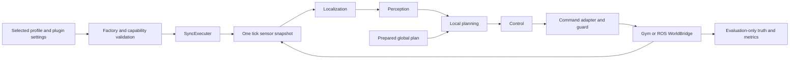

# RoboRacer Community Plugin Research Report

Chinese translation: [简体中文](report.zh-CN.md).

Latest execution, 2026-10-05: full PRE before S1 remains confirmed. SIM0-01/02/03 and LNX-01–04 pass. SIM0-B06 (passive ~3 mm/min creep, also present in the installed vendor player) was closed by user decision with an amended 10 mm P0 bound; both 60-second neutral runs passed. See the [SIM0 report](../stages/SIM0-completion.md). Next gate: SIM0-04 stage review and SIM1 entry.

Date: **2026-09-28**. Stage: **original research handoff**. Target platform: the AVLite checkout at `/home/a2rl/Workspace/avlite`. The body below preserves the findings and pending status at that handoff; it is not an approved development plan or an implementation-completion claim.

**Current status update:** the user has since confirmed B, Humble and a physical-racing design goal, and approved the bounded probe, which has now run. The workspace Git state and linked Master BOM were also rechecked. See the [decision follow-up and new evidence](decision-follow-up.md) and [approved v1.0 plan](../planning/development-plan.md). Those documents supersede the pending-decision and unexecuted-probe statements below; continuous control and plugin integration remain unverified; bounded live observation and recorded-message transport now have evidence.

**Local simulator supplement, updated 2026-09-29:** [PRE](../stages/PRE.md) verifies isolated Humble/AVLite sensor delivery, static Reset/reconnect and installed geometry extraction. Source/toolchain acquisition and fresh Editor startup are verified. SIM0-B01 is resolved for the recorded private dependency configuration. After the approved six-asset preparation, required `.skp` track mesh objects remain unavailable on Linux (SIM0-B03). No source player, new neutral trials, instrumentation, motion or closed-loop acceptance follows. Acquisition timing, downstream expiry/stop and full scoring remain open.

**User-confirmed backend revision:** AutoDRIVE is the first closed-loop backend. Gym is a later candidate, with no mandatory first-release implementation or acceptance. This supersedes the original Gym-first recommendation in the historical body below. Humble transport/command supervision move into S1; S2 covers unattended episodes, recording and recovery. Required reset, maps, runtime mode and timing need local qualification. The user subsequently approved v1.0 and PRE + S1; motion and later-stage gates remain.

**Further decisions reflected in approved plan v1.0:** reuse/extend AVLite's built-in ICP; use imported maps/reference paths, initial Pure Pursuit tracking, target-speed/steering commands and an independent command-supervision process. Dynamic obstacles and multi-car interaction are not mandatory first-release acceptance. The earlier native-PF/AMCL choice is superseded. The user also confirmed simulation-only first-release acceptance, avoidance of passable static obstacles with stopping when fully blocked, and operator/configuration initial pose with stop/manual recovery after localization loss. The user has now confirmed one qualified track, five reproducible initial conditions, left-pass/right-pass/fully-blocked static cases, and unattended operation using a graphical session or virtual display. Multi-track generalization and display-free operation are not required for release 1. All R2 scope choices and final-plan approval are settled. Current PRE evidence is summarized above. PRE-01/02 passed; 32 todos remain unchecked. PRE is incomplete and S1 feature implementation has not started. No simulator-build or acceptance change is approved by these observations.

## 1. Executive assessment

**Recommendation — design judgment:** develop a native AVLite community plugin around a modular, map-based racing stack, with a range-based reactive controller as an integration baseline and fallback candidate. Keep a direct Gym backend for repeatable, fast simulation and a ROS 2 backend for driver-stack integration. Share algorithms, typed observations, command semantics, configuration validation and result definitions across both. Keep simulator truth available to evaluation, with a separate, explicit policy governing what the driving stack receives.

Three materially different approaches are compared in section 8: reactive LiDAR driving; map/localization/raceline tracking with local obstacle handling; and model-predictive joint trajectory/control optimization. The second offers the best provisional balance of race relevance, inspectability, implementation effort and migration risk. This is not a measured performance ranking.

The most consequential findings are:

1. **Repository identity is established.** The two AVLite paths are separate repositories; A2RL is a third, nested repository with existing changes. Their relationship cannot be inferred from their names. The new workspace is not currently a usable Git repository.
2. **The AVLite extension points are sufficient for a plausible plugin-only design, but integration is not yet proven.** Settings documentation, bridge methods and the reactive-control description disagree with current source in several places. No core interface change is proposed.
3. **The official simulator recommendation has moved beyond the legacy default branches.** The current IROS 2026 preparation guide recommends the Jazzy/JAX pair and explicitly offers a Humble pair. The local host is Ubuntu 22.04/Python 3.10/ROS Humble; choosing an environment is a substantive decision. [Official multi-car guide](https://iros2026-race.roboracer.ai/multi_car_sim.html)
4. **Physical racing and the virtual league have different contracts.** A simulator used for physical-race practice is not automatically the simulator required for a virtual competition. The target event and category remain unknown.
5. **No race performance or closed-loop success has been demonstrated.** Source inspection and environment inventory are complete enough to compare directions. No simulator was installed or run, no RoboRacer plugin was loaded, and no lap, latency or resource benchmark was performed.

## 2. Evidence model and local baseline

Evidence labels used throughout:

| Label | Meaning |
| --- | --- |
| **Observed** | A read-only local command returned the stated repository/environment fact. |
| **Source** | The behavior is supported by inspected code; it has not necessarily been executed. |
| **Documented** | An official page describes the behavior; installation or runtime success is not implied. |
| **Judgment** | A proposed engineering decision or qualitative comparison. |
| **Unknown / unverified** | A decision or behavior needs user input or an explicitly scoped experiment. |

The main agent read the official plugin guide and independently checked the critical delegated findings in AVLite discovery/settings/execution/sensor code, A2RL bridge/executor code, and official simulator pages/source. The raw source, rather than the delegated conclusion, is the basis for the findings below.

### Repository and convention findings

| Location | Observed identity and state |
| --- | --- |
| `/home/a2rl/Workspace/avlite` | Clean `dev`, HEAD `50dcd0043db0cc17efbe82bda81cd0e8875810a0`, origin `AV-Lab/avlite`. Authoritative research checkout. |
| `/home/a2rl/avlite` | Separate `dev` checkout, HEAD `f1fac2c24c7b97943ca6dcbed6ae9604439ad8e3`; ahead 17 of its stored tracking ref; untracked local environment/plugin directories. |
| `/home/a2rl/avlite/community_plugins/a2rl` | Separate nested `dev` repository, HEAD `ae5436d80d909bd04808107f0bafe58956da817b`, origin `AV-Lab/a2rl`; tracked and untracked user changes. References below concern its inspected working tree. |
| `/home/a2rl/Workspace/roboracer` | Initially empty apart from protected empty `.agents`, `.codex` and `.git` directories. `git rev-parse` fails. Documentation can be written here; a normal Git initialization cannot be assumed to work with the present protected `.git`. |

The two AVLite checkouts resolve to distinct directories and Git common directories. Nevertheless, their **committed final trees differ only by one `.gitignore` line**. The workspace commit is an ancestor of the reference parent's commit. This does not establish identical installed environments or user profiles. No source checkout, branch or existing profile was changed.

No applicable `AGENTS.md` was found in the inspected ancestors or project/reference trees. The governing project material is the full [plugin guide](/home/a2rl/Workspace/avlite/docs/plugin-development.md), plus README, architecture, settings conventions, package metadata and current source. The guide's SHA256 is recorded in [local inventory](evidence/local-inventory.json).

**Version discrepancy:** HEAD's commit message says release 0.6.4; `pyproject.toml` says 0.6.3. A no-bytecode, lazy top-level import under system Python reported 0.6.3 from the target checkout. The existing reference virtual environment has installed distribution metadata 0.6.1. AVLite's version helper prefers installed distribution metadata, so a version string alone cannot identify the imported source. Record commit, import path and distribution metadata independently. [Version implementation](/home/a2rl/Workspace/avlite/avlite/__init__.py:20)

### Available development environment

Observed: Ubuntu 22.04.5 LTS, x86_64, Python 3.10.12, 16 logical CPUs and approximately 31.3 GiB RAM; `/opt/ros/humble` exists and `ROS_DISTRO=humble`. Docker/colcon/nvidia-smi executables were found; the Docker socket exists. No `/dev/nvidia0` or `/dev/dri` was visible in this execution environment. `DISPLAY` is set. These are availability observations, **not successful Docker, GPU, GUI or ROS operation checks**.

System Python has NumPy 1.24.2, SciPy 1.10.1 and pytest 6.2.5, below this AVLite checkout's declared minima, and no Pydantic. The reference venv has NumPy 2.2.6, SciPy 1.15.3, Pydantic 2.13.5 and pytest 9.1.1, but stale AVLite metadata; Gym/Gymnasium were not found in either surveyed interpreter. Neither result establishes that no simulator exists elsewhere. Do not reuse or mutate the A2RL environment as the project's production environment. [Inventory and exact command results](evidence/local-inventory.json)

## 3. RoboRacer requirements and competition boundary

### Official resource map

The [official entry point](https://roboracer.ai/) links the ROS 2 Build documentation, course material, official GitHub organization and IROS 2026 event site. Build and Learn are useful technical starting points; the event's rules take precedence for eligibility. All research access dates are 2026-09-28; a website's “last updated” footer does not certify every embedded instruction as current.

**Build — documented reference, not a hardware requirement.** The build/BOM pages use a Traxxas Slash 4x4 and Jetson Xavier NX reference, while the current FAQ mentions Orin Nano and permits other supported computers and scanners. Consequently, no exact Jetson model, RAM size, GPU requirement or purchasing list is selected here. The reference chain is onboard computer → VESC → drive motor/steering servo, with USB/Ethernet LiDAR and a remote operator controller. [Build](https://f1tenth.readthedocs.io/en/main/getting_started/build_car/index.html), [BOM](https://f1tenth.readthedocs.io/en/main/getting_started/build_car/bom.html), [FAQ](https://f1tenth.readthedocs.io/en/main/getting_started/faq.html), [system connections](https://f1tenth.readthedocs.io/en/main/getting_started/software_setup/index.html)

The native driver guide uses ROS 2 Humble and separates native versus older-JetPack container instructions. Its broad Ubuntu/JetPack wording is not proof of compatibility with every Jetson image. Hardware image, Python ABI, ROS distribution and driver revisions need a matched installation record. No firmware, OS flashing, udev or driver change is included in this research. [Driver setup](https://f1tenth.readthedocs.io/en/main/getting_started/firmware/drive_workspace.html)

The inspected Humble driver README exposes `/scan` (`LaserScan`), `/odom` (`Odometry`), `/sensors/imu/raw` and `/drive` (`AckermannDriveStamped`), with VESC, joystick and Ackermann-mux dependencies. Topic names and frame names must remain configurable. The official calibration procedure derives odometry from motor ERPM and servo state and calls for vehicle-specific speed/steering calibration. Such odometry is an estimate, not simulation truth. [Driver repository](https://raw.githubusercontent.com/f1tenth/f1tenth_system/humble-devel/README.md), [odometry calibration](https://f1tenth.readthedocs.io/en/main/getting_started/driving/drive_calib_odom.html)

**Learn — documented algorithm progression.** The latest course covers ROS 2, emergency braking, wall following, Follow the Gap, SLAM/Pure Pursuit, motion planning and perception. Its reactive and map-based tracks provide useful baselines; teaching exercises do not establish race-grade robustness. The latest SLAM material references `slam_toolbox` and particle filtering. Old `stable` pages use different lab numbering and older packages, so they should not silently define dependencies. [Labs](https://f1tenth-coursekit.readthedocs.io/en/latest/assignments/labs/index.html), [Follow the Gap](https://f1tenth-coursekit.readthedocs.io/en/latest/assignments/labs/lab4.html), [SLAM tutorial](https://f1tenth-coursekit.readthedocs.io/en/latest/lectures/ModuleC/tutorial5.html)

**Race — documented reference event.** The 31st RoboRacer competition at IROS 2026 is an in-person event dated September 27–30, 2026. It uses time-trial seeding followed by up to four-car racing. The site separately links the 6th Sim Racing League. This event is contemporaneous with the research, not the unspecified future target. [Event overview](https://iros2026-race.roboracer.ai/)

### Rule versions and selected constraints

The retrieved general rules identify **3.2026-draft**, are subject to change, and give event-specific competition rules precedence. The event-specific page states it applies only to this competition; it has no explicit version identifier in the retrieved text. An immutable rules-repository revision was not established. A future event must be checked afresh. [General rules](https://iros2026-race.roboracer.ai/rules.html), [event rules](https://iros2026-race.roboracer.ai/competition_rules.html)

Selected general-rule facts, limited to this research reference:

| Area | Published constraint |
| --- | --- |
| Vehicle envelope | Width 296 mm ±10%; length 568 mm ±10%; height ≤400 mm; mass ≤5 kg; soft front bumper. |
| Compute | Racing computation onboard, powered onboard; no off-vehicle compute offload. |
| LiDAR | Planes/range unrestricted; frequency ≤40 Hz; angular resolution ≥0.125°. Cameras unrestricted; other sensors declared. |
| Localization | GPS and similar external indoor localization prohibited for competitors. |
| Propulsion | Electric, single drivetrain motor; torque and battery limits apply. Hardware list requires full rule inspection. |
| Safety | Immediate remote stop and an attentive operator required. |
| Future cost | The page mentions an approximate 2027 cost cap estimate; this is not a confirmed future budget rule. |

These constraints do **not** mean only planar LiDAR is legal, or that a build-guide component is automatically legal. [Vehicle specifications and safety](https://iros2026-race.roboracer.ai/rules.html#vehicle-specifications)

Selected IROS 2026 event-specific facts: smooth concrete, barriers at least 30 cm high, minimum track width 1 m; qualification includes a crash-free lap plus static/dynamic obstacle avoidance and kill-switch checks. Time trial has two five-minute heats. Multi-car racing allows up to four vehicles. Yellow flags prohibit overtaking, and operators may stop their vehicles. Configuration changes are restricted to stopped states in time trial and more narrowly after crashes during racing; violation can disqualify a team. Some final heat details remain organizer announcements. [Competition rules](https://iros2026-race.roboracer.ai/competition_rules.html)

**Design implications:** parameterize vehicle geometry and sensor limits; make race configuration immutable while armed; support explicit arm/start/stop/rearm states; retain local operation without race-time internet; validate static and moving obstacles, blocked track, restart and lost sensing. A physical remote-stop path must remain independent of a Python loop. A course completion or solo lap is insufficient evidence for multi-car competition readiness. These are proposed engineering responses to the reference constraints, not a claim of future-event compliance.

## 4. AVLite integration contract

### Architecture and data flow

AVLite separates perception/localization/mapping (`c10`), planning (`c20`), control (`c30`), execution/bridges/tasks (`c40`), shared data/capabilities (`c50`), and apps/settings/discovery (`c60`). Strategies register on subclass import. A community plugin supplies selected strategies rather than a replacement platform.

This diagram combines the existing synchronous flow with proposed plugin adapter/guard and evaluation boundaries. Empty strategy slots are supported, but actuation has additional constraints below. Global planning is not automatically recomputed every tick; the runner must load or explicitly prepare a valid global plan. [Factory](/home/a2rl/Workspace/avlite/avlite/c60_apps/c62_factory.py:76), [synchronous execution](/home/a2rl/Workspace/avlite/avlite/c40_execution/c44_sync_executer.py:74)

### Discovery, configuration and distribution

The official structure requires root `__init__.py` exports; optional root `settings.py` with `PluginSettings`, README, `requirements.txt`, and root `<registry_name>.yaml`. No shipped `config/` directory, `plugin_*.yaml` files or committed virtualenv. A recommended profile lists only this plugin under `c69_apps.c62_community_plugins`. A development checkout may be registered by absolute path; publishing is a separate public registry PR. Community parameters use unprefixed snake_case. These structure rules will govern any implementation. [Guide](/home/a2rl/Workspace/avlite/docs/plugin-development.md:98)

**Source:** registration maps plugin names to install directories and imports them under `avlite.plugins.<name>`. Base registries use class names; unique names avoid overwriting other plugins. Discovery scans recursively, excluding test/tests and common vendor/cache directories, but **not tools/scripts/experiments**. Every Python module in those directories must be safe to import and defer optional imports and execution. Package/module failures are logged and can leave partial registration; selected unknown strategies fail during factory construction. [Loader](/home/a2rl/Workspace/avlite/avlite/c60_apps/c63_plugins.py:326)

The factory does not inject arbitrary constructor arguments. For example, it builds controllers without arguments, localization/perception with `perception_model`, local planners with `global_plan` and `env`, and bridges with explicitly named supported parameters such as `ego_state` and `pm`. Unit-test dependency injection can be added without breaking the constructor path used by the factory. [Construction](/home/a2rl/Workspace/avlite/avlite/c60_apps/c62_factory.py:187)

### Guide/source discrepancies and current disposition

| ID | Discrepancy | Adopted research basis and verification status |
| --- | --- | --- |
| D01 | Plugin guide describes separate `plugin_<name>.yaml` persistence; settings guide and code store `plugins.<name>` within `<profile>.yaml`. | Prefer current profile APIs; isolated save/load probe prepared, not yet authorized. Preserve official package structure. |
| D02 | Architecture page still names split sensor/mount fields; current source and plugin guide use named sensor snapshots. | Use `frame.lidars`, explicit primary name, and `frame.lidar.points`; field probe pending. |
| D03 | Guide describes `WorldBridge.control_type(agent)`; current class has no such method. | Do not call it. Existing `control_type_for_agent` helper is a different API. Attribute probe pending. |
| D04 | Sensor-to-control is described as possible without other stages; executor requires available `LOCALIZATION`. | Supply real odometry/localization, or explicitly labelled simulation truth for interface checks. Gate probe pending; never advertise fake localization. |
| D05 | Guide describes confirmation before `launch.sh`; headless code warns and starts it automatically. | Avoid implicit launch scripts; use explicit process ownership. Source verified; no launch behavior exercised. |
| D06 | Plugin unload omits localization/mapping and several sub-strategy registries. | Fresh process per evaluation run; dummy-registry probe pending. Full reload behavior remains unverified. |
| D07 | General “extendable apps” description does not prove a community CLI command is imported before argument parsing. | Prefer a guarded standalone evaluation entrypoint until CLI discovery is demonstrated. Source-only. |

Evidence: [settings persistence](/home/a2rl/Workspace/avlite/avlite/c60_apps/c65_setting_utils.py:100), [settings conventions](/home/a2rl/Workspace/avlite/docs/settings-naming.md:5), [sensor datatypes](/home/a2rl/Workspace/avlite/avlite/c50_common/c52_world_sensor_datatypes.py:235), [world bridge](/home/a2rl/Workspace/avlite/avlite/c40_execution/c41_world_bridge.py:30), [actuation gate](/home/a2rl/Workspace/avlite/avlite/c40_execution/c42_execution_strategy.py:248), [headless launch](/home/a2rl/Workspace/avlite/avlite/plugins/p60_headless_mode/p61_headless.py:397), [unregister](/home/a2rl/Workspace/avlite/avlite/c60_apps/c63_plugins.py:196), [app bootstrap](/home/a2rl/Workspace/avlite/avlite/c60_apps/c61_app_strategy.py:62).

The user requires behavior verification for discrepancies. That work is **outstanding**, not silently replaced by source inspection. The exact bounded request and script are in [validation request](validation-request.md). No compatibility certification is made before those results and later integration checks.

### Sensors, units, commands and clocks

| Boundary | Source-supported contract | Proposed handling |
| --- | --- | --- |
| Planar scan | AVLite `Lidar.points`: Nx4 float32 sensor-frame `[x,y,z,intensity]`, metres. | Preserve calibrated mount; pad z/intensity. Preserve ranges, beam order, invalid/no-return semantics and timing in a plugin-owned typed extension/preprocessing boundary. Do not discard missing beams and assume the resulting cloud is an equivalent LaserScan. |
| Snapshot | Named dictionaries; explicit primary; per-sensor acquisition stamps and frame assembly stamp in one clock domain. | Copy driver-reused buffers; freeze one coherent observation; retain sequence/age diagnostics. |
| Frames | Body x forward, y left, z up; heading CCW. `p_body = base_to_sensor @ p_sensor`. | Explicit map/odom/body/LiDAR transforms, plus simulator CoG/rear-axle conversion where required. |
| Ego estimate | Pose and scalar heading speed; wheel odometry carries forward m/s and yaw rad/s. | Independent estimated state; simulator truth only when deliberately enabled. |
| Core command | `AckermannControlCommand`: steering plus **acceleration**, not target speed. | Do not put acceleration into a ROS/Gym speed field. Choose one command policy before implementation. |
| Time | Sensor stamps may use sim time; command timestamp defaults to wall time. | Stamp commands explicitly; use sim time for physics and monotonic wall time for liveness; never subtract unlike clocks. |

[Sensor source](/home/a2rl/Workspace/avlite/avlite/c50_common/c52_world_sensor_datatypes.py:67), [command source](/home/a2rl/Workspace/avlite/avlite/c30_control/c31_control_model.py:11). The ROS messages independently specify angular/range/timing fields and speed/steering units; ROS Ackermann acceleration is also a limit semantic, not an automatic match to AVLite's signed acceleration command. [LaserScan definition](https://raw.githubusercontent.com/ros2/common_interfaces/humble/sensor_msgs/msg/LaserScan.msg), [Ackermann definition](https://raw.githubusercontent.com/ros-drivers/ackermann_msgs/ros2/msg/AckermannDrive.msg)

An additional geometric boundary needs an explicit decision: AVLite's default footprint is centered on `(x, y)`, whereas the newer simulator bridge documents rear-axle `base_link`. Reusing the same coordinates without an offset can misplace collision geometry even when the heading is correct. Define the footprint center, tracking reference point, CoG and sensor mounts together; validate them with known poses. [Footprint implementation](/home/a2rl/Workspace/avlite/avlite/c10_perception/c11_perception_model.py:166)

**Command recommendation — judgment:** use a plugin-owned, explicit target-speed/steering command subtype through the existing `ControlCommandBase` extension, subject to GUI/factory compatibility tests. Retain compatible steering/acceleration telemetry where consumers expect it, with unambiguous semantics. An alternative is a bounded acceleration-to-speed adapter using measured speed and elapsed control time; it preserves built-in controllers but adds conversion dynamics and anti-windup/calibration work. Neither is implemented or proven. No core datatype edit is required to explore these choices.

### Lifecycle, failures and safety ownership

Stock synchronous execution obtains one snapshot for due stack stages and applies the held command through `control_ego_state`; it does not call the future `world.step()` hook. Fixed `sim_dt` with `pace_sim=True` can support deterministic stepping when an outer runner omits wall sleeps. Setting `pace_sim=False` uses wall-derived dt and is not a deterministic speedup setting. Controller dt is the simulation step argument, which needs special attention when control runs less frequently than physics. [Tick implementation](/home/a2rl/Workspace/avlite/avlite/c40_execution/c44_sync_executer.py:145)

`ExecutionStrategy.stop()` sets a flag and notifies tasks; it does not itself brake, publish zero speed or close the bridge. Reset delegates to world/modules, but the base world reset does nothing. Tasks normally run inline after actuation, so an instrumentation task cannot serve as the sole pre-actuation guard. The headless runner catches step errors and continues; asynchronous execution has distinct shared-state/scheduling behavior. Detached launch processes persist after stack stop. [Stop/reset](/home/a2rl/Workspace/avlite/avlite/c40_execution/c42_execution_strategy.py:129), [headless loop](/home/a2rl/Workspace/avlite/avlite/plugins/p60_headless_mode/p61_headless.py:423)

**Judgment:** give one component command ownership, reject stale/non-finite/out-of-limit commands before publication, and make stop/reset/rearm explicit. On a vehicle, downstream command expiry and remote stop must cover process crashes where Python cleanup cannot run. Validate stop behavior independently of algorithm quality. Constructor readiness, reset command clearing, exception termination and process cleanup must be acceptance topics in the future plan.

GT filters also matter: the synchronous executor may copy world pose when the localization GT filter is enabled; the default filter can enable all. Built-in `MappingTask` obtains another snapshot after actuation and passes `world.get_ego_state()` to the mapper. A realistic profile must disable unintended truth paths and ensure mapping uses the estimated pose at the intended sensor time. [GT selection](/home/a2rl/Workspace/avlite/avlite/c40_execution/c44_sync_executer.py:74), [mapping task](/home/a2rl/Workspace/avlite/avlite/c40_execution/c47_execution_tasks.py:81)

### Reuse, additions and limits

Reuse candidates: strategy registries, factory, capability declarations, GUI/profile machinery, sensor transforms, plan/trajectory datatypes, synchronous scheduling, trajectory tracking and collision utilities. Each remains subject to targeted contract tests and correct 1:10 geometry.

New work likely required: Gym/ROS bridge adapters; ordered scan preservation; truthful pose/velocity integration; command conversion/guard; episode/reset/termination management; map-to-corridor/raceline preparation; parameterized evaluation/provenance; race-specific local obstacle handling.

Do not assume stock algorithms are ready for this application. The inspected Follow-the-Gap implementation selects angular gaps between returns and returns zero acceleration on missing scans; that is neither a range-based safety bubble implementation nor a stop guarantee. `LidarLocalization` aligns to a fixed first-scan reference and does not consume the required occupancy map or update velocity. Built-in full-size geometry, wheelbase and lookahead defaults need replacement with confirmed vehicle values. [FTG](/home/a2rl/Workspace/avlite/avlite/c30_control/c35_pure_pursuit.py:234), [ICP](/home/a2rl/Workspace/avlite/avlite/c10_perception/c16_localization_algs.py:101), [control defaults](/home/a2rl/Workspace/avlite/avlite/c30_control/c39_settings.py:138)

Official development commands are `pip install -e ".[dev]"`, `pytest` and, when required, `pytest -m ""` to include slow/data tests. Headless is `python -m avlite headless -p <profile>`; perception requires attention to `--perceive`. The dashboard has no complete scenario/seed/episode/result CLI. These commands are documented, not executed here. [README](/home/a2rl/Workspace/avlite/README.md:342), [headless parser](/home/a2rl/Workspace/avlite/avlite/plugins/p60_headless_mode/p61_headless.py:39)

## 5. Bounded lessons from A2RL

The reference is useful integration evidence, not a template to copy or a proven RoboRacer dependency.

| Criterion | Useful pattern | Problem to avoid / proposed improvement |
| --- | --- | --- |
| Responsibilities | Typed native contracts and a transport adapter separate from algorithms. | Keep RoboRacer transport, conversion, algorithms, supervision and evaluation focused; do not inherit engine/gear/CAN race semantics. |
| Dependencies | Bridge accepts injected transport/API clients. | Preserve test injection while maintaining AVLite factory constructors; avoid start-on-import and eager tooling imports. |
| Testability | Fake transport/process tests and input-snapshot boundaries. | Test actual command publication, freshness and teardown; file-count tests or test presence cannot prove those behaviors. |
| Configuration | Explicit settings and launch validation exist. | Follow current root settings/profile conventions; avoid legacy `config/`, global settings mutation and hidden environment overrides. |
| Reproducibility | Manifest records Git/config/trajectory/dependency identities. | Use one parameterized runner; isolated output directories and resolved configurations, with no experiment branches in the default runtime. |

Concrete checks: `AutoVerseBridge.control_ego_state()` only stores a command; its custom executor separately calls `apply_a2rl_command()` to publish. That bridge is not established as a standard-executor drop-in. Its custom tick accesses name-mangled `SyncExecuter` fields; copying it would bind RoboRacer to private scheduling internals. The reference contains large activation/execution modules and eagerly imported experiment modules. These are specific dependency and maintenance concerns, not a claim that all A2RL behavior is defective. [Bridge](/home/a2rl/avlite/community_plugins/a2rl/integration/autoverse_bridge.py:1408), [publication](/home/a2rl/avlite/community_plugins/a2rl/execution/executer.py:3733), [private scheduling](/home/a2rl/avlite/community_plugins/a2rl/execution/executer.py:3659), [imports](/home/a2rl/avlite/community_plugins/a2rl/_exports.py:5), [manifest](/home/a2rl/avlite/community_plugins/a2rl/analysis/experiment_manifest.py:161)

No A2RL test, simulator or lap result was reproduced. Its local changes were preserved.

## 6. Official simulators and version decision

### Recommendation chain and reproducible identity

The dedicated physical-event guide identifies `f1tenth_gym_ros/dev-jazzy` + `f1tenth_gym/dev-jax` and offers paired `dev-humble` branches for Ubuntu 22.04/Humble. Its older getting-started page still emphasizes Humble; the Build site's generic simulator introduction still mentions Kinetic/Melodic. Use the dedicated event guide for current recommendations, then verify the selected implementation. [Event setup](https://iros2026-race.roboracer.ai/multi_car_sim.html), [older event resource page](https://iros2026-race.roboracer.ai/roboracer_resources.html), [stale Build introduction](https://f1tenth.readthedocs.io/en/main/going_forward/intro.html)

Read-only remote-ref queries returned the following on 2026-09-28. These are **advertised revisions**, not installed versions:

| Repository | Ref | Advertised revision |
| --- | --- | --- |
| `f1tenth/f1tenth_gym` | `main` | `4fdb9c7e6fb7c701290f4dc18377d07c1681724f` |
| same | `dev-humble` | `bdaec1420c3b0f103858d289866d0d4e2e597c30` |
| same | `dev-jax` | `ec3b1a4693ed20317e42e57a9454d94b824cec81` |
| `f1tenth/f1tenth_gym_ros` | `main` | `883394df0964c555ee05bea69c3002daf6f2d405` |
| same | `dev-humble` | `08395766c4d9dc5a763381f1dd6fa4a3d68df66e` |
| same | `dev-jazzy` | `2c019810b4098ed82d44cad1d7d282a2dfc12421` |

No Gym/bridge tags were returned by those queries. Both modern Gym branches declare `1.0.0dev`, so package version alone is inadequate. Source-only clones were blocked by the sandbox network policy; immutable-SHA web retrieval was unavailable. Inspected official branch files came from web snapshots, some weeks or months old. **Their contents have not been conclusively matched to the advertised revisions above.** Any apparent source/document discrepancy could reflect cache age. A pinned checkout plus runtime qualification is required before freezing compatibility. [Ref evidence](evidence/remote-refs.txt)

### Installation and environment routes

| Route | Documented/source requirements | Assessment for this workspace |
| --- | --- | --- |
| Legacy default branches | `f110_gym` 0.2.1, Gym 0.19, NumPy ≤1.22; bridge's default README targets Ubuntu 20.04/Foxy. | Poor default for AVLite's NumPy ≥2 requirement; historical comparison only unless separately isolated. |
| Paired Humble branches | Python ≥3.9, Gymnasium 0.29.x, SciPy ≥1.13, Numba ≥0.59 and Qt/OpenGL-related dependencies; Ubuntu 22.04/Humble bridge. | Best provisional host fit. Dependency resolution and display-free imports still unverified. |
| Jazzy/JAX pair | Python ≥3.12, Gymnasium 0.29.x, JAX and renderer dependencies; Ubuntu 24.04/Jazzy. ROS physics runs on CPU; GPU training is optional. | Current primary event route, but requires an isolated/new OS/Python/ROS environment here. |

[Legacy setup](https://raw.githubusercontent.com/f1tenth/f1tenth_gym/main/setup.py), [legacy ROS README](https://github.com/f1tenth/f1tenth_gym_ros), [Humble dependencies](https://raw.githubusercontent.com/f1tenth/f1tenth_gym/dev-humble/pyproject.toml), [Humble bridge](https://raw.githubusercontent.com/f1tenth/f1tenth_gym_ros/dev-humble/README.md), [JAX dependencies](https://raw.githubusercontent.com/f1tenth/f1tenth_gym/dev-jax/pyproject.toml), [Jazzy bridge](https://raw.githubusercontent.com/f1tenth/f1tenth_gym_ros/dev-jazzy/README.md)

Native bridge setup uses a virtual environment exposing system ROS packages, followed by ROS dependency resolution and colcon. Jazzy documentation distinguishes that environment from a standalone Gym `uv sync` environment, which does not automatically see ROS. Its developer groups also constrain pytest below AVLite's dev minimum; do not combine upstream development environments blindly. Runtime packaging and test tooling may need separate environments. This is dependency analysis, not a demonstrated resolver failure.

**Provisional choice — judgment:** qualify the Humble pair first if the target is physical racing and the host/vehicle remain Humble. Adopt Jazzy/JAX if its features or future vehicle baseline justify migration. A simulator adapter should isolate these differences; supporting both branches immediately is not a requirement. No global ROS upgrade or dependency installation is proposed without a confirmed plan.

### Physics, sensors, maps and APIs

The retrieved Humble environment uses typed `EnvConfig`, `reset(seed, options)` returning `(observation, info)`, and a five-value Gymnasium `step` result. Explicit start poses are shaped `(num_agents, 3)`. Its docstrings still describe older return values. The legacy API differs, including reset behavior; copied tutorial calls are not a valid compatibility test. [Humble environment source](https://raw.githubusercontent.com/f1tenth/f1tenth_gym/dev-humble/f1tenth_gym/envs/f110_env.py)

The JAX environment accepts `(num_agents, 2)` actions, steering first, and supports seeded reset, explicit poses/native states and episode limits. Its step-level action interface does not generally clip requested bounds. Results include copied collision, progress, lap and simulation-time information. `DIRECT` versus `DEFAULT` observation meanings differ from other branches, so configuration and schema belong in contract tests. [JAX environment](https://raw.githubusercontent.com/f1tenth/f1tenth_gym/dev-jax/f1tenth_gym/envs/f110_env.py), [observation modes](https://raw.githubusercontent.com/f1tenth/f1tenth_gym/dev-jax/f1tenth_gym/envs/observation/__init__.py)

The inspected Humble ROS bridge selects a planar single-track model, RK4, desired speed and steering angle, 0.01 s physics and disabled rendering. It publishes scans/odometry/TF, with optional `/clock`. Asynchronous publishing uses a 0.004 s timer; command-triggered mode steps on **each ego or opponent command**, not a joint-action barrier. Pose reset resets the environment while requested commands remain stored. Cached README telemetry claims and actual publishers differ. These are snapshot findings requiring qualification. [Humble bridge source](https://raw.githubusercontent.com/f1tenth/f1tenth_gym_ros/dev-humble/f1tenth_gym_ros/gym_bridge.py)

The retrieved Jazzy bridge explicitly converts CoG/rear-axle poses and includes collision/lap publishers. Collision flags are transient and lap topics depend on reference-line availability; an evaluator must define event latching and valid completion. Do not infer Humble parity from similarly named topics. [Jazzy bridge source](https://raw.githubusercontent.com/f1tenth/f1tenth_gym_ros/dev-jazzy/f1tenth_gym_ros/gym_bridge.py)

LiDAR parameters are configurable. One retrieved Humble profile uses 819 beams, 270° FOV, 0.05–25 m ranges and a 0.275 m forward mount; these are profile defaults, not hardware facts or contest requirements. Preserve scan acquisition cadence independently of physics and ROS publication rates. A repeated publication is not a new sensor measurement. [Humble configuration](https://raw.githubusercontent.com/f1tenth/f1tenth_gym_ros/dev-humble/config/sim.yaml)

Maps combine occupancy image/YAML resolution and origin with optional centerline/raceline data. AVLite map/race-corridor types need deliberate conversion; neither an image nor a simulator map name is already an AVLite race plan. Validate image-row inversion, origin yaw, occupied/free thresholds, metric scale and closed-loop topology. Store local assets and hashes to avoid implicit benchmark-time downloads. JAX configuration supports model/delay/noise/randomization choices, but actual perturbation coverage and repeatability are unverified. [JAX configuration](https://raw.githubusercontent.com/f1tenth/f1tenth_gym/dev-jax/f1tenth_gym/envs/env_config.py)

### Headless operation, reset, batching and export

Direct modern Gym has a render-disable path; the ROS bridge disables the Gym renderer. Rendering dependencies may still affect installation/imports and need a clean headless check. Native ROS can be observed through Foxglove; the documented container route needs no GPU or display forwarding for that view. Port 8765 is used for Foxglove; optional noVNC uses 8080. Disabling browser opening does not prove no server is launched. ROS DDS/domain/network behavior needs its own preflight. [Jazzy installation](https://raw.githubusercontent.com/f1tenth/f1tenth_gym_ros/dev-jazzy/README.md), [compose](https://raw.githubusercontent.com/f1tenth/f1tenth_gym_ros/dev-jazzy/docker-compose.yml)

The inspected Humble launch code writes scaled map files next to its launch installation and starts supporting map/visualization services. **Inference:** concurrent runs sharing that installation may contend for temporary map files. Isolate run workspaces or validate an alternative launcher. ROS pose-reset topics do not provide a complete atomic multi-agent episode-management contract. Prefer direct joint-action stepping for deterministic batches, then test ROS parity separately. [Launch source](https://raw.githubusercontent.com/f1tenth/f1tenth_gym_ros/dev-humble/launch/gym_bridge_launch.py)

Upstream reset/step/metrics support provides building blocks, not a complete AVLite benchmark suite. A project runner must own episode limits, stop-on-failure policy, synchronized opponent actions, reset command clearing, summary export and result provenance. JAX batched training is a later scaling option. No upstream throughput claim is adopted as a measurement or acceptance target.

### Virtual league: AutoDRIVE is a separate target

The linked IROS 2026 virtual league uses AutoDRIVE and event assets released as `2026-iros`, rather than the physical preparation Gym environment. Its qualification and unseen-track time attack are distinct from the physical multi-car format. Release contents/container digests were not verified locally. [Virtual event](https://autodrive-ecosystem.github.io/competitions/roboracer-sim-racing-iros-2026/), [release](https://github.com/AutoDRIVE-Ecosystem/AutoDRIVE-RoboRacer-Sim-Racing/releases/tag/2026-iros)

The 2026 technical guide allows only the supplied ROS 2 API and forbids modifying `autodrive_roboracer`. Commands are normalized throttle/steering, not Gym speed/radians. IPS, odometry, TF, reset and lap/collision telemetry are restricted during autonomous racing, although available for debugging/training. Headless `-batchmode -nographics` disables cameras; Xvfb retains camera rendering. The API uses port 4567; reset is a True-then-False pulse. Documented simulator minima include Ubuntu 20.04+, 8 GB RAM and 2 GB graphics memory; local readiness is unverified. [2026 technical guide](https://autodrive-ecosystem.github.io/competitions/roboracer-sim-racing-guide-2026/)

The separate rulebook scores ten racing laps between warm-up/cool-down laps, adds collision penalties and disqualifies excessive collisions. Organizer execution uses prescribed graphics/evaluation conditions. Therefore, a development headless run alone cannot certify a virtual-league submission. [2026 virtual rules](https://autodrive-ecosystem.github.io/competitions/roboracer-sim-racing-rules-2026/)

**Design consequence:** if this is the intended target, AutoDRIVE becomes the acceptance backend, privileged topics must remain outside the deployed stack, and actuator/localization/container work changes materially. It is not included automatically as a third backend in the recommended physical-race scope.

### Limits of simulation evidence

Planar Gym can exercise navigation, noise, delays and traffic scenarios, but cannot establish full motor/battery/servo, suspension, floor reflection, scan-motion, thermal or wireless behavior. Contact/lap models are not physical referee adjudication. A richer simulator also needs parameter and interface validation. No simulator result by itself demonstrates remote-stop performance, hardware deadlines, race compliance or physical lap times. These are engineering limits to the proposed evidence chain; no real-world extrapolation has been made.

## 7. Fast validation and experiment design

**Judgment, subject to direction confirmation:** use the same runtime strategies in two validation paths. A direct Gym path owns reset, a joint action per physics step, simulation time and episode limits. A ROS path tests publication, subscriptions, QoS, clocks, transforms, process restart and the real driver-message boundary. A result from the direct path does not validate middleware timing; ROS connectivity does not validate racing performance.

For direct simulation, first attempt a thin `WorldBridge` that advances Gym at `control_ego_state()` under stock `SyncExecuter`, with fixed dt and a cached initial/reset observation. Opponent commands belong to the simulator scenario harness because stock AVLite drives ego only. The runner must check termination after every step, clear held commands on reset and avoid double stepping. If this proves insufficient, a plugin-owned `ExecutionStrategy` is an available alternative, but its cost and scheduling contract need confirmation; do not copy upstream private fields or patch core silently.

Use ground truth deliberately in isolated adapter tests, then remove it from the driving stack for localization/obstacle benchmarks. The scorer may keep privileged truth without exposing it to the controller. Never label a GT-assisted lap as real-car localization evidence.

A useful validation ladder is: pure adapter/algorithm tests → deterministic one-step/episode tests → map/start/perturbation matrix → ROS integration/fault runs → controlled hardware validation. This is a research proposal for test coverage, not the development-stage plan or permission to proceed.

| Measurement | Proposed definition and evidence | What must be established before an acceptance threshold |
| --- | --- | --- |
| Loading/lifecycle | Selected class identity, settings round trip, reset/stop/reload and expected failure exit. | Chosen AVLite commit, import mode, runner and stop ownership. |
| Data correctness | Known-pose transforms; range masks; signed steering; speed units; stamps; command bounds. | Sensor mount, physical geometry, backend/frame conventions and numerical tolerances. |
| Loop behavior | Actual publication/consumption frequency; p50/p95/p99/max stage time and sensor-acquisition-to-command age; missed deadlines. | Target onboard CPU, clock policy, ROS transport and measured baseline. |
| Resource cost | CPU, peak/resident memory; cold-start versus warmed runtime; simulation seconds per wall second. | CPU affinity/process count, dependency versions and warm-up procedure. |
| Racing | Completed episodes / all attempted episodes; contact events and contact duration; footprint off-track events; valid lap time. | Map/corridor hash, start/finish logic and adjudication definitions. Failed/timeout runs stay in the denominator. |
| Robustness | Sweep starts/headings, friction/model uncertainty, steering delay, LiDAR loss/noise, odometry drift, obstacles/opponents. | Reproducible seeds/ranges supported by the chosen simulator and justified from hardware. |
| Recovery | Stale input, malformed scan, process exit, ROS disconnect, reset while moving, stop and rearm. | Safety owner, downstream timeout and measured stopping behavior. |

Measure wall latency with a monotonic clock, simulation progress with simulation time, and document timestamp synchronization for multi-process age. Report lap distributions only for valid laps alongside failures; distinguish a one-frame collision flag from a deduplicated contact event. Verify off-track with the vehicle footprint/corridor rather than a renderer impression. Prevent reset/finish-line oscillation from creating artificial laps.

A single guarded experiment entrypoint should accept algorithm/backend/scenario/config/seed selections and execute the approved matrix. A/B variants use explicit configurations and shared seeds. Store a manifest (code commits and dirty state, source paths, simulator ref, dependency lock, full resolved settings, map/trajectory hashes, seed, start state, dt/rates, truth policy and invocation), structured per-run results and bounded diagnostic traces. Keep large logs, bags, caches and videos outside version control. Do not log arbitrary environment variables or secrets.

Use isolated processes/profiles to contain registry residue and singleton settings. Load maps once per worker, disable rendering for benchmarks, distinguish JIT warm-up from steady state, and capture detailed traces on failures rather than unbounded every-run logging. Preserve a compact failing scenario for replay. Throughput and lap-time benefits remain hypotheses until measured.

**No numerical performance target is invented here.** Environment, scenario list, run counts, baselines, thresholds, statistical reporting and artifact paths belong in the confirmed plan. Baseline measurements must precede any proposed performance threshold; the user will review those thresholds in the second planning interaction.

## 8. Technical alternatives and recommendation

The following alternatives share plugin discovery, sensors, guard, backend adapters and evaluation infrastructure. Their estimation/planning/control methods are substantively different.

| Dimension | A — reactive LiDAR driving | B — map-based modular racing | C — model-predictive racing |
| --- | --- | --- | --- |
| Method | Ordered scan → clearance/disparity or range-gap target → curvature/speed policy. Genuine odometry/local pose supplies the stock actuation requirement. | Mapping/localization → corridor and reference raceline/speed profile → local obstacle tracking/avoidance → Pure Pursuit/Stanley-style tracking with speed control. | State estimation + calibrated dynamics → receding-horizon trajectory/control optimization, with track and opponent constraints. |
| Race fit | Useful for initial closed loops and unmapped-track baseline; limited anticipation, race-line quality and deliberate overtaking. | Strong fit for time trials and an extensible route to multi-car behavior; obstacle handling must be delivered, not assumed from path tracking. | Strong potential for constraints and joint speed/path decisions; useful at high limits only with valid models and dependable solve times. |
| Compliance | Conditional on event/sensors/onboard compute; no external localization needed for steering logic. | Conditional; map/localization provenance must be legal and onboard. | Same rule boundary; optimizer and all race-time computation onboard. |
| Work/dependencies | Lowest relative effort; array processing, adapters, odometry and guard. | Moderate; map tooling, localization, tracking/planning and calibration. Existing ROS localization is a reuse candidate, not yet selected. | Highest; solver/model integration, tuning, infeasibility handling and profiling. Solver choice/licensing/build support unverified. |
| Compute/closed loop | Expected lowest CPU, short horizon; narrow corners, wall gaps and traffic need careful tests. | Expected moderate CPU, clearer failure isolation; sensitive to localization and map errors. | Expected highest and more variable CPU; possible better dynamic decisions, with deadline and model-mismatch risk. No measured advantage claimed. |
| Simulation cost | Small, quick smoke/A-B loops; many randomized sensor cases. | More setup for maps/localization and fair GT-free evaluation. | Extensive dynamics/latency/solver-failure sweeps; costly identification and real-time validation. |
| Maintainability | Few components, but heuristics can accumulate and limit future behavior. | Explicit contracts and independently replaceable algorithms; best provisional balance. | Clean interfaces possible, but tuning/solver expertise and model ownership persist. |
| Real-car migration | Sensor timing/mounts, speed calibration and braking dominate. | Adds map quality, localization recovery and tracking calibration. | Adds tire/friction/actuator model identification, saturation and worst-case solve-time validation. |

**Recommended direction B**, using A as the first behavioral baseline and regression comparator. This builds an understandable race stack while leaving a controller/planner seam for C later. It avoids committing the initial project to learned-policy training or heavy optimization infrastructure before the platform boundary is proven. Relative effort is qualitative: staffing, hardware and event scope are not fixed, so person-week estimates would be premature.

The provisional scope includes a native plugin, a repeatable AVLite–plugin–simulator loop, robust input/command boundaries, deterministic evaluation, localization-aware map-based driving, and an explicit path to static/dynamic obstacle tests. Whether first-release acceptance includes multi-car racing, full physical-car operation or only simulator readiness requires confirmation. A fallback controller also needs an independently validated switching and stopping policy; its mere existence does not make it a safe fallback.

## 9. Risks, triggers, mitigations and residual exposure

| Risk / trigger | Impact | Proposed mitigation | Residual risk |
| --- | --- | --- | --- |
| Target event/category changes | Wrong simulator, sensor access or acceptance criteria. | Freeze event/version/category decision; review updated rules before competition. | Organizers can still amend rules. |
| AVLite guide/source drift or upgrade | Broken loading/settings/contracts. | Pin commit and imported path; small compatibility probes; keep core unchanged. | Future changes require requalification. |
| Acceleration/speed, sign or frame confusion | Plausible but incorrect motion. | Typed contracts; known-pose/known-command tests; calibrated bounds. | Real actuator response still needs measurement. |
| Simulator truth reaches production estimator/controller | Unrealistically good results. | Explicit truth policy, separate scorer, adversarial no-GT test. | Hidden dependencies can survive incomplete coverage. |
| Control/sim/ROS clocks disagree | Stale commands, variable integration and invalid latency. | Fixed-step direct runs; ROS time audit; monotonic liveness watchdog. | Network/process scheduling remains variable. |
| Missing scan or process crash leaves motion enabled | Safety failure. | Pre-publication guard, command expiry downstream, remote stop, tested rearm. | Mechanical/electrical stop performance is hardware-specific. |
| Dependency/API branch mismatch | Installation or reset/step failure. | Matched pinned pair; separate environments; installed-path audit. | Current branch source correspondence/runtime still unverified. |
| Headless/import side effects | Unexpected launches or polluted runs. | Import-safe tools, explicit launch ownership, fresh run processes. | Host plugin loader still allows partial imports. |
| Reset/lap/collision bookkeeping differs | False success or misleading benchmark. | Independent scorer and adversarial resets/crossings; keep failures. | Simulator contacts do not reproduce referee judgments. |
| Unknown vehicle/friction/sensor profile | Overfit simulation and missed deadlines. | Confirm hardware; calibrate; uncertainty sweeps; staged hardware evidence. | Sim-to-real mismatch remains. |
| Dirty reference and private API coupling | Nonportable behavior; user work damaged if reused. | Read-only reference; new implementation; public extension contracts. | Lessons remain source-level until tested. |
| Restricted filesystem/network/container/device access | Reproducibility or implementation blocked. | Scoped environment preflight after plan approval; writable isolated paths; record exact failures. | Session policy may require an external environment change. |

## 10. Decisions requiring confirmation

| ID | Question | Recommendation / effect |
| --- | --- | --- |
| Q01 | Which future event/year/category is the target: physical RoboRacer or virtual league? | If undecided, use physical racing as a design goal and IROS 2026 only as a provisional reference; no compliance claim. Virtual league changes the simulator and allowed observations. |
| Q02 | What car, compute, LiDAR, other sensors, JetPack/Ubuntu/ROS, and actuator calibration are fixed? | Confirm before selecting sensor rates, CPU budgets, geometry, ROS branch and stop behavior. Host specifications are not vehicle specifications. |
| Q03 | Is B with A as a baseline the preferred direction, and must initial acceptance cover multi-car racing? | Recommend B; include static/dynamic avoidance in any race-readiness claim. MPC/learning remain later candidates. |
| Q04 | Keep Humble on the current host, or adopt isolated Ubuntu 24.04/Jazzy for the newer simulator? | Humble minimizes migration; Jazzy/JAX follows the primary current event recommendation but adds environment work. Choose after hardware and required simulator features are settled. |
| Q05 | May early interface tests use explicitly labelled GT, followed by separate GT-free validation? | Recommended; prohibit hidden truth in race-ready results. |
| Q06 | Approve the prepared isolated AVLite contract probe? | Exact scope in the linked request: existing venv, target source, temporary profile, no simulator/ROS/device launch or installs. Required to resolve selected source/document discrepancies experimentally. |
| Q07 | Where will the standalone plugin Git repository live, and what stable registry name/remote is intended? | `roboracer` is a candidate name only; current `.git` is protected and invalid. Repository setup and publishing are not authorized by this report. |
| Q08 | What physical stop/deadman mechanism and operator workflow will be used? | Keep hardware stop independent, with explicit command ownership and rearm; do not equate executor Stop with stopping a car. |

Q01, Q02 and Q06 were asked through the asynchronous question tool; no answer has been incorporated yet. Their absence does not authorize a default. A simulator/environment choice, safety contract and feature scope cannot be silently finalized.

## 11. Scope boundaries and future ideas

| Idea | Classification | Rationale |
| --- | --- | --- |
| Typed scan/command adaptation, import-safe discovery, profile validation | Current proposed scope | Necessary for a reliable native plugin. |
| One experiment runner with scenario/config selection and replay evidence | Current proposed scope | Reduces iteration time and prevents script proliferation. |
| Map-based stack with reactive comparator and fault handling | Current proposed scope, pending confirmation | Recommended technical direction. |
| Opponent scenarios and dynamic-obstacle validation | Required if multi-car race readiness is claimed | Cannot be replaced by solo time trials. |
| Hardware/ROS parity runs and calibration | Current design boundary; implementation scope pending hardware | Essential evidence before real-car claims. |
| MPC/MPCC; learned residuals or full policies | Later candidate | Requires resource/model/training evidence and a separately reviewed safety policy. |
| JAX batched curriculum/domain randomization | Later candidate | Useful when experiment scale justifies dependencies and GPU work. |
| Camera/3D LiDAR fusion | Later candidate | Rules/hardware dependent; no current evidence it is needed. |
| Automatic flag recognition or competition signaling integration | Later candidate | Confirm event/operator semantics first. |
| Additional simulators, fleet-wide AVLite actuation, core API redesign | Outside current proposed scope | Not needed to establish the initial ego-plugin boundary; core changes require explicit approval. |

## 12. Verification record and stage handoff

| Activity | Status | Evidence / limitation |
| --- | --- | --- |
| Paths, repository relationships, working states and instructions | Observed | [Local inventory](evidence/local-inventory.json); no applicable AGENTS.md found. |
| Official plugin guide and critical core/A2RL source | Source reviewed | Linked files/lines above; no A2RL code run or copied into a plugin. |
| Official Build/Learn/Race/Rules and simulator documentation | Documented/source reviewed | [Source register](source-register.md); event/version/cache limitations retained. |
| AVLite top-level identity import | Observed, narrow | No-bytecode lazy import only; does not construct the stack. |
| Settings/gate/registry behavior probe | Prepared; unverified | [Scope](validation-request.md), [script](evidence/avlite_contract_probe.py); authorization pending. |
| Simulator installation | Not performed | No dependency installation authorized or attempted. |
| Plugin discovery/GUI/headless integration | Not performed | No plugin implementation exists. |
| Simulator interface and closed loop | Not performed | No ROS/Gym step or vehicle command sent. |
| Benchmarks / race acceptance / real-car safety | Not performed | No performance numbers or compliance certification. |

The development log is [here](../DEVELOPMENT_LOG.md). Only research documentation, inventory and a proposed bounded validation script have been added to this workspace. The next user interaction is **technical-direction confirmation**. Only after that will a development plan be drafted. That plan still requires the requested two substantive review rounds and explicit final approval before implementation. Every later implementation stage will end with evidence and another explicit stage gate.
