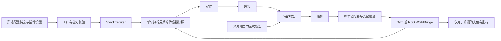

# RoboRacer 社区插件研究报告

日期：**2026-09-28**。阶段：**研究**。目标平台：位于 `/home/a2rl/Workspace/avlite` 的 AVLite 工作副本。状态：**技术方向及限定范围的运行验证仍待确认**。本报告为后续开发计划提供研究依据，不代表计划已经批准，也不代表实现已经完成。

译文说明：本文件是 [英文研究报告](report.md) 的完整中文版本，保留原报告的技术内容、证据边界和待确认状态。本次翻译未新增研究或运行验证；资料清单、原始证据及开发日志仍使用英文。

## 1. 执行摘要与评估

**建议——设计判断：**围绕模块化、基于地图的竞速软件栈开发原生 AVLite 社区插件，以基于测距数据的反应式控制器作为集成基线和降级候选。保留直接调用 Gym 的后端，用于可重复的快速仿真；同时保留 ROS 2 后端，用于接入车辆驱动栈。两个后端共享算法、带类型的观测数据、控制指令语义、配置验证和结果定义。评测侧可以使用仿真真值，但必须通过独立、明确的策略限定驾驶软件栈能够获得哪些数据。

第 8 节比较了三种具有实质差异的方案：反应式 LiDAR 驾驶；地图、定位、竞速线跟踪与局部障碍物处理；以及基于模型预测的轨迹与控制联合优化。当前判断是，第二种方案在比赛适用性、可检查性、实现工作量和迁移风险之间具有最好的综合平衡。这不是基于实测性能得出的排名。

最重要的发现如下：

1. **仓库身份已查明。**两个 AVLite 路径对应独立仓库；A2RL 是第三个嵌套仓库，且存在已有修改。不能根据名称推断它们之间的关系。新工作区目前不是可用的 Git 仓库。
2. **AVLite 的扩展点支持一种合理的纯插件设计，但集成尚未得到验证。**配置文档、桥接方法及反应式控制的描述，在多处与当前源码不一致。本报告未提出修改核心接口。
3. **官方模拟器建议已不再局限于旧版默认分支。**当前 IROS 2026 准备指南推荐 Jazzy/JAX 组合，并明确提供 Humble 组合。本地主机为 Ubuntu 22.04/Python 3.10/ROS Humble，因此环境选择是需要认真确认的技术决策。[官方多车仿真指南](https://iros2026-race.roboracer.ai/multi_car_sim.html)
4. **实车比赛与虚拟联赛的接口和约束不同。**用于实车比赛训练的模拟器，并不自动等于虚拟比赛要求使用的模拟器。目标赛事和类别仍未确定。
5. **尚未证明比赛性能或闭环运行成功。**源码检查和环境盘点已足以支持技术方向比较，但尚未安装或运行模拟器，未加载 RoboRacer 插件，也未开展圈速、延迟或资源占用基准测试。

## 2. 证据分类与本地基线

本报告使用以下证据标签：

| 标签 | 含义 |
| --- | --- |
| **已观察（Observed）** | 本地只读命令返回了所述仓库或环境事实。 |
| **源码依据（Source）** | 已检查的代码支持所述行为，但该行为不一定经过实际执行。 |
| **文档支持（Documented）** | 官方页面描述了该行为；不代表已经安装成功或运行成功。 |
| **设计判断（Judgment）** | 提议的工程决策或定性比较。 |
| **未知／未验证（Unknown / unverified）** | 某项决策或行为仍需用户输入，或需要范围明确的实验。 |

主 agent 阅读了官方插件指南，并独立检查了子 agent 提出的关键发现所对应的 AVLite 发现、配置、执行及传感器源码，A2RL 桥接与执行器源码，以及官方模拟器页面和源码。以下结论以原始资料为依据，而不是直接采信子 agent 的结论。

### 仓库与工作约定

| 位置 | 已观察到的身份与状态 |
| --- | --- |
| `/home/a2rl/Workspace/avlite` | 干净的 `dev` 分支，HEAD 为 `50dcd0043db0cc17efbe82bda81cd0e8875810a0`，origin 为 `AV-Lab/avlite`。这是本研究的权威工作副本。 |
| `/home/a2rl/avlite` | 独立的 `dev` 工作副本，HEAD 为 `f1fac2c24c7b97943ca6dcbed6ae9604439ad8e3`；相对于本地保存的远端跟踪引用领先 17 个提交；存在未跟踪的本地环境和插件目录。 |
| `/home/a2rl/avlite/community_plugins/a2rl` | 独立的嵌套 `dev` 仓库，HEAD 为 `ae5436d80d909bd04808107f0bafe58956da817b`，origin 为 `AV-Lab/a2rl`；存在已跟踪和未跟踪的用户修改。下文引用对应本次检查时的工作树内容。 |
| `/home/a2rl/Workspace/roboracer` | 初始状态除受保护且为空的 `.agents`、`.codex` 和 `.git` 目录外没有其他内容。`git rev-parse` 失败。这里可以写入文档，但在当前受保护的 `.git` 条件下，不能假定普通 Git 初始化能够成功。 |

两个 AVLite 工作副本解析到不同目录和不同 Git 公共目录。不过，它们的**已提交最终文件树仅相差 `.gitignore` 中的一行**。Workspace 中的提交是参考插件所在父仓库提交的祖先。这不能证明两者安装环境或用户配置相同。本次未修改任何源码工作副本、分支或已有配置。

在已检查的祖先目录、项目及参考目录树中，未发现适用的 `AGENTS.md`。项目依据是完整的 [插件指南](/home/a2rl/Workspace/avlite/docs/plugin-development.md)，以及 README、架构文档、配置约定、包元数据和当前源码。指南的 SHA256 已记录在 [本地盘点](evidence/local-inventory.json) 中。

**版本不一致：**HEAD 的提交说明称发布 0.6.4；`pyproject.toml` 声明 0.6.3。使用系统 Python、不生成字节码的顶层惰性导入，从目标工作副本报告的版本为 0.6.3。已有参考虚拟环境中的安装分发元数据则为 0.6.1。AVLite 的版本辅助函数优先采用已安装分发的元数据，因此仅凭版本字符串不能识别实际导入的源码。应分别记录提交、导入路径和分发元数据。[版本实现](/home/a2rl/Workspace/avlite/avlite/__init__.py:20)

### 可用开发环境

已观察到：Ubuntu 22.04.5 LTS、x86_64、Python 3.10.12、16 个逻辑 CPU 和约 31.3 GiB 内存；`/opt/ros/humble` 存在，且 `ROS_DISTRO=humble`。发现了 Docker、colcon、nvidia-smi 可执行文件，Docker socket 也存在。当前执行环境内未看到 `/dev/nvidia0` 或 `/dev/dri`。`DISPLAY` 已设置。这些仅是可用性观察，**不是 Docker、GPU、GUI 或 ROS 已成功运行的验证结果**。

系统 Python 中的 NumPy 1.24.2、SciPy 1.10.1 和 pytest 6.2.5 低于该 AVLite 工作副本声明的最低版本，且缺少 Pydantic。参考 venv 中有 NumPy 2.2.6、SciPy 1.15.3、Pydantic 2.13.5 和 pytest 9.1.1，但 AVLite 元数据陈旧；两个被调查的解释器中均未发现 Gym/Gymnasium。这些结果不能证明其他位置不存在模拟器。不要将 A2RL 环境直接作为本项目的正式环境复用或修改。[盘点与原始命令结果](evidence/local-inventory.json)

## 3. RoboRacer 需求与比赛边界

### 官方资料梳理

[官方入口](https://roboracer.ai/) 链接了 ROS 2 Build 文档、课程材料、官方 GitHub 组织和 IROS 2026 赛事网站。Build 和 Learn 是有效的技术起点；比赛资格以具体赛事规则为优先依据。所有资料访问日期均为 2026-09-28；网页页脚的“最后更新”日期不能证明其中每条指令都是最新的。

**Build——官方文档中的参考方案，不是强制硬件要求。**Build/BOM 页面以 Traxxas Slash 4x4 和 Jetson Xavier NX 为参考，而当前 FAQ 提到 Orin Nano，并允许使用其他受支持的计算机和扫描仪。因此，本报告没有选定具体 Jetson 型号、内存容量、GPU 要求或采购清单。参考连接链路是车载计算机 → VESC → 驱动电机／转向舵机，并配有 USB／以太网 LiDAR 和操作员遥控器。[Build](https://f1tenth.readthedocs.io/en/main/getting_started/build_car/index.html)、[BOM](https://f1tenth.readthedocs.io/en/main/getting_started/build_car/bom.html)、[FAQ](https://f1tenth.readthedocs.io/en/main/getting_started/faq.html)、[系统连接](https://f1tenth.readthedocs.io/en/main/getting_started/software_setup/index.html)

原生驱动安装指南使用 ROS 2 Humble，并区分原生安装与旧版 JetPack 的容器安装说明。其对 Ubuntu／JetPack 的宽泛表述，不能证明与所有 Jetson 镜像兼容。硬件系统镜像、Python ABI、ROS 发行版和驱动修订版本需要形成配套的安装记录。本次研究不包含固件、操作系统刷写、udev 或驱动修改。[驱动安装](https://f1tenth.readthedocs.io/en/main/getting_started/firmware/drive_workspace.html)

已检查的 Humble 驱动 README 列出 `/scan`（`LaserScan`）、`/odom`（`Odometry`）、`/sensors/imu/raw` 和 `/drive`（`AckermannDriveStamped`），并依赖 VESC、手柄和 Ackermann-mux。话题名和坐标系名称必须可配置。官方标定流程根据电机 ERPM 和舵机状态估计里程计，并要求针对具体车辆标定速度和转向。这种里程计属于估计值，不是仿真真值。[驱动仓库](https://raw.githubusercontent.com/f1tenth/f1tenth_system/humble-devel/README.md)、[里程计标定](https://f1tenth.readthedocs.io/en/main/getting_started/driving/drive_calib_odom.html)

**Learn——文档支持的算法学习路线。**最新课程覆盖 ROS 2、紧急制动、沿墙行驶、Follow the Gap、SLAM/Pure Pursuit、运动规划和感知。反应式及基于地图的课程路线可作为基线，但教学练习不能证明比赛级鲁棒性。最新 SLAM 材料引用 `slam_toolbox` 和粒子滤波。旧版 `stable` 页面使用不同的实验编号和较旧的软件包，不能未经核实就据此确定依赖。[实验课程](https://f1tenth-coursekit.readthedocs.io/en/latest/assignments/labs/index.html)、[Follow the Gap](https://f1tenth-coursekit.readthedocs.io/en/latest/assignments/labs/lab4.html)、[SLAM 教程](https://f1tenth-coursekit.readthedocs.io/en/latest/lectures/ModuleC/tutorial5.html)

**Race——文档支持的参考赛事。**IROS 2026 的第 31 届 RoboRacer 比赛为线下赛事，日期为 2026 年 9 月 27—30 日。赛事先通过计时赛确定种子顺位，再进行最多四车同场竞速。网站另外链接第 6 届 Sim Racing League。该赛事与本次研究处于同一时期，不等于尚未指定的未来目标赛事。[赛事概览](https://iros2026-race.roboracer.ai/)

### 规则版本与部分约束

检索到的通用规则标记为 **3.2026-draft**，允许后续变更，并明确具体赛事规则优先。赛事专用规则页说明其仅适用于本届比赛；检索到的文本中没有明确版本标识。本次未确定不可变的规则仓库修订版本。未来赛事必须重新核查。[通用规则](https://iros2026-race.roboracer.ai/rules.html)、[赛事专用规则](https://iros2026-race.roboracer.ai/competition_rules.html)

以下是通用规则中的部分事实，仅作为本次研究的参考：

| 领域 | 已发布约束 |
| --- | --- |
| 车辆外形 | 宽 296 mm ±10%；长 568 mm ±10%；高 ≤400 mm；质量 ≤5 kg；配备软质前保险杠。 |
| 计算 | 比赛计算必须在车载设备上进行，由车载电源供电；不得卸载到车外计算设备。 |
| LiDAR | 扫描平面数和量程不限；频率 ≤40 Hz；角分辨率 ≥0.125°。相机不限；其他传感器需申报。 |
| 定位 | 参赛者不得使用 GPS 及类似的外部室内定位系统。 |
| 动力 | 电驱动，单个动力传动电机；适用扭矩与电池限制。硬件清单仍须对照完整规则检查。 |
| 安全 | 必须能够立即遥控停车，并有操作员持续关注车辆。 |
| 未来成本 | 页面提到预估的 2027 年成本上限；这不是已经确定的未来预算规则。 |

这些约束**不意味着只允许平面 LiDAR，也不意味着 Build 指南中的部件自动符合比赛规则**。[车辆规格与安全](https://iros2026-race.roboracer.ai/rules.html#vehicle-specifications)

部分 IROS 2026 专用规则事实：赛道为光滑混凝土地面，边界物高度至少 30 cm，赛道最小宽度为 1 m；资格要求包括无碰撞完成一圈，以及静态／动态避障和遥控急停检查。计时赛有两轮，每轮五分钟。多车赛最多允许四辆车同场。黄旗期间禁止超车，操作员可以停车。计时赛中仅允许停车时修改配置；正式竞速期间的修改条件更严格，进一步限定为碰撞后停车时，违规可能被取消资格。部分最终比赛细节仍以组织者公告为准。[比赛规则](https://iros2026-race.roboracer.ai/competition_rules.html)

**设计影响：**车辆几何与传感器限制应参数化；车辆处于使能状态时，比赛配置应保持不变；明确支持使能、启动、停车和重新使能状态；比赛期间无需互联网也应能够本地运行；验证静态与运动障碍物、赛道阻塞、重新启动和传感器丢失。实车遥控停车链路必须独立于 Python 循环。完成课程或单车单圈不足以证明已具备多车比赛能力。这些是针对参考约束提出的工程设计建议，不是对未来赛事合规性的声明。

## 4. AVLite 集成契约

### 架构与数据流

AVLite 将感知/定位/建图（`c10`）、规划（`c20`）、控制（`c30`）、执行/桥接/任务（`c40`）、共享数据/能力（`c50`）以及应用/设置/发现机制（`c60`）分离。策略在其子类被导入时注册。community plugin 提供所选策略，而不是替换整个平台。

此图结合了现有同步数据流与拟议的插件适配器、安全检查及评测边界。允许将策略槽位留空，但执行控制还受到下文所述的额外约束。全局规划不会在每个执行周期自动重新计算；运行器必须加载或显式准备有效的全局规划。[工厂](/home/a2rl/Workspace/avlite/avlite/c60_apps/c62_factory.py:76)、[同步执行](/home/a2rl/Workspace/avlite/avlite/c40_execution/c44_sync_executer.py:74)

### 发现、配置与分发

官方结构要求在根目录的 `__init__.py` 中导出类；可选文件包括根目录下包含 `PluginSettings` 的 `settings.py`、README、`requirements.txt` 以及 `<registry_name>.yaml`。不得随插件交付 `config/` 目录、`plugin_*.yaml` 文件或已提交到版本库的虚拟环境。推荐配置档案只能在 `c69_apps.c62_community_plugins` 下列出本插件。开发检出目录可以通过绝对路径注册；发布则需要单独向公共注册表提交 PR。社区插件参数采用无前缀的 snake_case 命名。后续实现将遵循这些结构规则。[指南](/home/a2rl/Workspace/avlite/docs/plugin-development.md:98)

**源码事实：**注册将插件名称映射到安装目录，并以 `avlite.plugins.<name>` 路径导入插件。基类注册表使用类名作为键；采用唯一名称可避免覆盖其他插件。发现机制递归扫描文件，排除 test/tests 和常见的第三方依赖及缓存目录，但**不会排除 tools/scripts/experiments**。这些目录中的每个 Python 模块都必须能够安全导入，并延迟可选依赖的导入与执行。包或模块加载失败时会记录日志，并可能留下部分注册状态；所选策略名称未知时，工厂构建会失败。[加载器](/home/a2rl/Workspace/avlite/avlite/c60_apps/c63_plugins.py:326)

工厂不会注入任意构造函数参数。例如，它以无参数方式构建控制器；向定位/感知模块传入 `perception_model`；向局部规划器传入 `global_plan` 和 `env`；向桥接器传入构造函数中显式命名且受支持的参数，如 `ego_state` 和 `pm`。可以增加用于单元测试的依赖注入，同时保持工厂使用的构造路径兼容。[构建过程](/home/a2rl/Workspace/avlite/avlite/c60_apps/c62_factory.py:187)

### 指南与源码差异及当前处理方式

| 编号 | 差异 | 本次研究采用的依据与验证状态 |
| --- | --- | --- |
| D01 | 插件指南描述了独立 `plugin_<name>.yaml` 文件的持久化方式；设置指南与代码则将 `plugins.<name>` 存储在 `<profile>.yaml` 内。 | 优先采用当前配置档案 API；已准备隔离的保存/加载验证，尚未获得授权。保留官方包结构。 |
| D02 | 架构页面仍使用分离的传感器/安装位姿字段名称；当前源码与插件指南则使用具名传感器快照。 | 使用 `frame.lidars`、显式主传感器名称和 `frame.lidar.points`；字段验证待执行。 |
| D03 | 指南描述了 `WorldBridge.control_type(agent)`；当前类中没有此方法。 | 不调用此方法。现有 `control_type_for_agent` 辅助函数是另一项 API。属性验证待执行。 |
| D04 | 文档描述了不依赖其他阶段的传感器到控制路径；执行器却要求具备可用的 `LOCALIZATION`。 | 提供真实的里程计/定位，或在接口检查中使用明确标注的仿真真值。控制执行门控验证待执行；绝不虚报定位能力。 |
| D05 | 指南描述了运行 `launch.sh` 前需要确认；无界面运行代码则发出提示后自动启动。 | 避免隐式启动脚本；明确进程归属与管理责任。已核实源码，未实际执行启动行为。 |
| D06 | 插件卸载遗漏了定位/建图以及若干子策略注册表。 | 每次评测使用新进程；虚拟注册表验证待执行。完整重载行为仍未验证。 |
| D07 | “可扩展应用”的一般描述无法证明社区插件 CLI 命令会在参数解析前被导入。 | 在证实 CLI 发现机制之前，优先采用带执行保护的独立评测入口。仅有源码依据。 |

证据：[设置持久化](/home/a2rl/Workspace/avlite/avlite/c60_apps/c65_setting_utils.py:100)、[设置约定](/home/a2rl/Workspace/avlite/docs/settings-naming.md:5)、[传感器数据类型](/home/a2rl/Workspace/avlite/avlite/c50_common/c52_world_sensor_datatypes.py:235)、[世界桥接器](/home/a2rl/Workspace/avlite/avlite/c40_execution/c41_world_bridge.py:30)、[控制执行门控](/home/a2rl/Workspace/avlite/avlite/c40_execution/c42_execution_strategy.py:248)、[无界面启动](/home/a2rl/Workspace/avlite/avlite/plugins/p60_headless_mode/p61_headless.py:397)、[取消注册](/home/a2rl/Workspace/avlite/avlite/c60_apps/c63_plugins.py:196)、[应用初始化](/home/a2rl/Workspace/avlite/avlite/c60_apps/c61_app_strategy.py:62)。

用户要求对这些差异进行实际行为验证。此项工作**尚未完成**，不能悄然以源码检查替代。范围明确的请求与脚本见[验证请求](validation-request.md)。在获得这些结果并完成后续集成检查前，不作兼容性认证。

### 传感器、单位、命令与时钟

| 边界 | 源码支持的契约 | 拟议处理方式 |
| --- | --- | --- |
| 平面扫描 | AVLite `Lidar.points`：传感器坐标系中的 Nx4 float32 `[x,y,z,intensity]`，单位为米。 | 保留标定后的安装位姿；补齐 z/intensity。在插件自有的类型化扩展或预处理边界内，保留距离值、光束顺序、无效/无回波语义以及时间信息。不得丢弃缺失光束后，假定所得点云与 LaserScan 等价。 |
| 快照 | 具名字典；显式主传感器；各传感器采集时间戳与帧组装时间戳处于同一时钟域。 | 复制驱动复用的缓冲区；固定一份一致的观测；保留序列号与数据年龄诊断信息。 |
| 坐标系 | 车体 x 向前、y 向左、z 向上；航向角逆时针为正。`p_body = base_to_sensor @ p_sensor`。 | 显式处理 map/odom/body/LiDAR 变换，并在需要时进行模拟器质心/后轴参考点转换。 |
| 自车估计 | 位姿和沿航向的标量速度；轮式里程计包含前向速度（m/s）和偏航角速度（rad/s）。 | 使用独立的估计状态；仅在有意启用时使用仿真真值。 |
| 核心命令 | `AckermannControlCommand`：转向加**加速度**，不是目标速度。 | 不得将加速度写入 ROS/Gym 的速度字段。在实施前确定一种命令策略。 |
| 时间 | 传感器时间戳可以采用仿真时间；命令时间戳默认采用系统实时时钟（wall clock）。 | 显式设置命令时间戳；物理推进使用仿真时间，存活性检测使用单调时钟；绝不对不同时钟域的时间做减法。 |

[传感器源码](/home/a2rl/Workspace/avlite/avlite/c50_common/c52_world_sensor_datatypes.py:67)、[命令源码](/home/a2rl/Workspace/avlite/avlite/c30_control/c31_control_model.py:11)。ROS 消息另行规定了角度、距离、时间字段以及速度/转向单位；ROS Ackermann 的 acceleration 字段还具有约束限值语义，并不自动等同于 AVLite 的有符号加速度命令。[LaserScan 定义](https://raw.githubusercontent.com/ros2/common_interfaces/humble/sensor_msgs/msg/LaserScan.msg)、[Ackermann 定义](https://raw.githubusercontent.com/ros-drivers/ackermann_msgs/ros2/msg/AckermannDrive.msg)

另一个几何边界需要明确决策：AVLite 默认以 `(x, y)` 为车辆占地轮廓的中心，而较新的模拟器桥接文档将 `base_link` 定义在后轴处。即使航向角正确，不考虑偏移而复用同一组坐标，也可能导致碰撞几何位置错误。应一并定义轮廓中心、跟踪参考点、质心和传感器安装位姿，并通过已知位姿验证。[轮廓实现](/home/a2rl/Workspace/avlite/avlite/c10_perception/c11_perception_model.py:166)

**命令建议——设计判断：**通过现有 `ControlCommandBase` 扩展机制，使用插件自有、语义明确的目标速度/转向命令子类型，前提是通过 GUI/工厂兼容性测试。在使用方依赖相应字段的地方，保留兼容的转向/加速度遥测，并确保语义清晰。另一方案是使用测得速度与实际经过的控制时间，构建有界的加速度到速度适配器；它能够保留内置控制器，但会引入转换动态特性以及积分抗饱和和标定工作。两种方案均未实施或验证。探索这些选项不需要修改核心数据类型。

### 生命周期、故障与安全责任

现有同步执行器为到期执行的栈内阶段获取一份快照，并通过 `control_ego_state` 应用保持中的命令；它不会调用面向未来的 `world.step()` 钩子。当外层运行器不按实际时间休眠等待时，固定 `sim_dt` 且设置 `pace_sim=True` 可以支持确定性步进。设置 `pace_sim=False` 会采用由实际经过时间推导的 dt，并不是确定性加速选项。控制器接收到的 dt 是仿真步长参数；当控制频率低于物理推进频率时，需要特别处理。[执行周期实现](/home/a2rl/Workspace/avlite/avlite/c40_execution/c44_sync_executer.py:145)

`ExecutionStrategy.stop()` 设置标志并通知任务；它本身不会制动、发布零速度或关闭桥接器。Reset 将重置委托给世界与各模块，但世界基类的 reset 不执行任何操作。任务通常在控制执行之后内联运行，因此不能仅依靠一个观测任务充当控制执行前的安全检查。无界面运行器捕获执行周期错误后会继续运行；异步执行则具有不同的共享状态与调度行为。脱离父进程运行的启动进程会在栈停止后继续存在。[停止/重置](/home/a2rl/Workspace/avlite/avlite/c40_execution/c42_execution_strategy.py:129)、[无界面循环](/home/a2rl/Workspace/avlite/avlite/plugins/p60_headless_mode/p61_headless.py:423)

**设计判断：**由单一组件负责命令，在发布前拒绝过期、非有限值或超限命令，并明确停止、重置及重新使能流程。在实车上，下游命令超时失效机制和远程停止必须覆盖 Python 清理逻辑无法执行的进程崩溃情况。停止行为应独立于算法质量进行验证。构造阶段的就绪状态、重置时清除命令、异常终止和进程清理都必须列为后续计划的验收内容。

GT（真值）过滤设置同样重要：启用定位真值过滤项时，同步执行器可能复制世界位姿；默认过滤设置可能启用全部真值路径。内置 `MappingTask` 在控制执行后获取另一份快照，并将 `world.get_ego_state()` 传给建图器。贴近实车的配置档案必须禁用非预期的真值路径，并确保建图使用与目标传感器时刻对应的估计位姿。[GT 选择](/home/a2rl/Workspace/avlite/avlite/c40_execution/c44_sync_executer.py:74)、[建图任务](/home/a2rl/Workspace/avlite/avlite/c40_execution/c47_execution_tasks.py:81)

### 复用、新增与限制

可复用候选包括：策略注册表、工厂、能力声明、GUI/配置档案机制、传感器变换、规划/轨迹数据类型、同步调度、轨迹跟踪和碰撞工具。每一项仍需针对性的契约测试，并采用正确的 1:10 车辆几何参数。

可能需要新增的工作包括：Gym/ROS 桥接适配器；有序扫描信息保留；基于真实来源的位姿/速度集成；命令转换与安全检查；单次仿真运行、重置及终止管理；从地图到赛道走廊/竞速线的准备流程；参数化评测与溯源；比赛特定的局部障碍物处理。

不得假定现有算法已适合此应用。所检查的 Follow-the-Gap 实现选择回波之间的角度间隙，并在扫描缺失时返回零加速度；它既不是基于距离的安全气泡实现，也不保证停车。`LidarLocalization` 对齐到固定的首帧扫描参考，不读取其所要求的占据地图，也不更新速度。内置的全尺寸车辆几何、轴距和前视距离默认值，需要替换为已确认的车辆数值。[FTG](/home/a2rl/Workspace/avlite/avlite/c30_control/c35_pure_pursuit.py:234)、[ICP](/home/a2rl/Workspace/avlite/avlite/c10_perception/c16_localization_algs.py:101)、[控制默认值](/home/a2rl/Workspace/avlite/avlite/c30_control/c39_settings.py:138)

官方开发命令为 `pip install -e ".[dev]"`、`pytest`，以及在需要包含慢速/数据测试时使用的 `pytest -m ""`。无界面运行命令为 `python -m avlite headless -p <profile>`；启用感知时需要关注 `--perceive`。该仪表板没有完整的场景、随机种子、单次仿真运行和结果管理 CLI。这些命令有文档依据，但本次未执行。[README](/home/a2rl/Workspace/avlite/README.md:342)、[无界面参数解析器](/home/a2rl/Workspace/avlite/avlite/plugins/p60_headless_mode/p61_headless.py:39)

## 5. 对 A2RL 的有限借鉴

该参考插件提供了有用的集成依据，但不是应直接复制的模板，也不是已验证的 RoboRacer 依赖。

| 评估标准 | 有用模式 | 应避免的问题 / 拟议改进 |
| --- | --- | --- |
| 职责 | 类型化的原生接口契约，以及独立于算法的传输适配器。 | 保持 RoboRacer 的传输、转换、算法、监督与评测职责聚焦；不要继承发动机、挡位或 CAN 赛车语义。 |
| 依赖 | 桥接器接受注入的传输/API 客户端。 | 在保持 AVLite 工厂构造函数兼容的同时保留测试注入；避免导入即启动和提前导入工具模块。 |
| 可测试性 | 模拟传输/进程测试，以及输入快照边界。 | 测试实际命令发布、数据新鲜度与资源释放；文件数量测试或测试文件的存在，不能证明这些行为正确。 |
| 配置 | 具有显式设置和启动校验。 | 遵循当前根目录设置/配置档案约定；避免遗留 `config/`、全局设置修改以及隐藏的环境变量覆盖。 |
| 可复现性 | 清单记录 Git、配置、轨迹及依赖的身份信息。 | 使用统一的参数化运行器；隔离输出目录并记录解析后的完整配置，默认运行流程中不包含实验分支。 |

具体检查结果：`AutoVerseBridge.control_ego_state()` 只保存命令；其自定义执行器另行调用 `apply_a2rl_command()` 才进行发布。因此尚不能确认该桥接器可以直接接入标准执行器。其自定义执行周期访问了 `SyncExecuter` 经名称改写的私有字段；复制这种实现会使 RoboRacer 依赖私有调度内部细节。参考插件包含较大的激活/执行模块，并会提前导入实验模块。这些是具体的依赖与维护问题，并不意味着 A2RL 的所有行为都有缺陷。[桥接器](/home/a2rl/avlite/community_plugins/a2rl/integration/autoverse_bridge.py:1408)、[命令发布](/home/a2rl/avlite/community_plugins/a2rl/execution/executer.py:3733)、[私有调度](/home/a2rl/avlite/community_plugins/a2rl/execution/executer.py:3659)、[导入](/home/a2rl/avlite/community_plugins/a2rl/_exports.py:5)、[清单](/home/a2rl/avlite/community_plugins/a2rl/analysis/experiment_manifest.py:161)

本次没有复现任何 A2RL 测试、模拟器运行或圈速结果。其本地修改均已保留。

## 6. 官方模拟器与版本决策

### 推荐依据与可复现的版本标识

实体赛事的专项指南指定使用 `f1tenth_gym_ros/dev-jazzy` + `f1tenth_gym/dev-jax`，同时为 Ubuntu 22.04/Humble 提供配套的 `dev-humble` 分支。较早的赛事入门页面仍侧重 Humble；Build 网站的通用模拟器介绍仍提及 Kinetic/Melodic。应以赛事专项指南作为当前推荐依据，再验证所选实现。[赛事配置指南](https://iros2026-race.roboracer.ai/multi_car_sim.html)、[较早的赛事资源页面](https://iros2026-race.roboracer.ai/roboracer_resources.html)、[过时的 Build 介绍](https://f1tenth.readthedocs.io/en/main/going_forward/intro.html)

2026-09-28 的只读远程引用查询返回了以下结果。这些是**远程公布的修订版本**，不是已安装版本：

| 仓库 | 引用 | 远程公布的修订版本 |
| --- | --- | --- |
| `f1tenth/f1tenth_gym` | `main` | `4fdb9c7e6fb7c701290f4dc18377d07c1681724f` |
| 同上 | `dev-humble` | `bdaec1420c3b0f103858d289866d0d4e2e597c30` |
| 同上 | `dev-jax` | `ec3b1a4693ed20317e42e57a9454d94b824cec81` |
| `f1tenth/f1tenth_gym_ros` | `main` | `883394df0964c555ee05bea69c3002daf6f2d405` |
| 同上 | `dev-humble` | `08395766c4d9dc5a763381f1dd6fa4a3d68df66e` |
| 同上 | `dev-jazzy` | `2c019810b4098ed82d44cad1d7d282a2dfc12421` |

上述查询未返回 Gym/bridge 的任何标签。两个现代 Gym 分支均声明为 `1.0.0dev`，因此仅凭软件包版本不足以确定兼容性。仅获取源码的克隆操作被沙箱网络策略阻止；也无法通过网页获取固定 SHA 对应的源码。检查的官方分支文件来自网页快照，其中一些已有数周或数月之久。**尚未确证这些文件的内容与上述远程公布的修订版本一致。** 任何表面上的源码与文档差异都可能由缓存时间差造成。在固定兼容性基线前，必须获取固定修订版本的检出副本并完成运行验证。[引用查询证据](evidence/remote-refs.txt)

### 安装与环境路线

| 路线 | 文档或源码所示要求 | 对当前工作区的评估 |
| --- | --- | --- |
| 旧版默认分支 | `f110_gym` 0.2.1、Gym 0.19、NumPy ≤1.22；bridge 的默认 README 面向 Ubuntu 20.04/Foxy。 | 不适合作为默认选择，因为 AVLite 要求 NumPy ≥2；除非单独隔离，否则仅用于历史对比。 |
| 配套 Humble 分支 | Python ≥3.9、Gymnasium 0.29.x、SciPy ≥1.13、Numba ≥0.59 及 Qt/OpenGL 相关依赖；Ubuntu 22.04/Humble bridge。 | 暂定最匹配当前主机的路线。依赖解析和无显示环境下的导入仍未验证。 |
| Jazzy/JAX 组合 | Python ≥3.12、Gymnasium 0.29.x、JAX 及渲染器依赖；Ubuntu 24.04/Jazzy。ROS 物理仿真在 CPU 上运行；GPU 训练为可选项。 | 当前赛事的主要推荐路线，但在本环境中需要隔离或新建 OS/Python/ROS 环境。 |

[旧版安装配置](https://raw.githubusercontent.com/f1tenth/f1tenth_gym/main/setup.py)、[旧版 ROS README](https://github.com/f1tenth/f1tenth_gym_ros)、[Humble 依赖](https://raw.githubusercontent.com/f1tenth/f1tenth_gym/dev-humble/pyproject.toml)、[Humble bridge](https://raw.githubusercontent.com/f1tenth/f1tenth_gym_ros/dev-humble/README.md)、[JAX 依赖](https://raw.githubusercontent.com/f1tenth/f1tenth_gym/dev-jax/pyproject.toml)、[Jazzy bridge](https://raw.githubusercontent.com/f1tenth/f1tenth_gym_ros/dev-jazzy/README.md)

原生 bridge 安装使用可访问系统 ROS 软件包的虚拟环境，随后解析 ROS 依赖并使用 colcon。Jazzy 文档区分了该环境与独立的 Gym `uv sync` 环境，后者不会自动获得 ROS 软件包的访问能力。其开发依赖组还将 pytest 版本限制在 AVLite 开发依赖的最低版本之下；不能盲目合并上游开发环境。运行时打包与测试工具可能需要分属不同环境。这是依赖分析结论，并非已经复现的依赖解析失败。

**暂定选择——设计判断：**如果目标是实体赛车，且主机和车辆继续使用 Humble，则先验证 Humble 组合。如果 Jazzy/JAX 的功能或未来车辆基线足以支持迁移，再采用该组合。模拟器适配器应隔离这些差异；当前不要求立即支持两个分支。在计划得到确认之前，不提出全局 ROS 升级或依赖安装。

### 物理模型、传感器、地图与 API

获取到的 Humble 环境使用带类型的 `EnvConfig`；`reset(seed, options)` 返回 `(observation, info)`，Gymnasium 的 `step` 返回五个值。显式初始位姿的数组形状为 `(num_agents, 3)`。其文档字符串仍描述旧版返回值。旧版 API 存在差异，包括复位行为；复制教程中的调用方式不能构成有效的兼容性测试。[Humble 环境源码](https://raw.githubusercontent.com/f1tenth/f1tenth_gym/dev-humble/f1tenth_gym/envs/f110_env.py)

JAX 环境接受形状为 `(num_agents, 2)` 的动作数组，第一列为转向；支持指定随机种子的复位、显式位姿或模型原生状态，以及回合限制。其 step 层动作接口通常不会将请求值裁剪到边界内。结果包含碰撞、进度、圈数及仿真时间信息的副本。`DIRECT` 与 `DEFAULT` 的观测含义不同于其他分支，因此配置与数据结构应纳入接口契约测试。[JAX 环境](https://raw.githubusercontent.com/f1tenth/f1tenth_gym/dev-jax/f1tenth_gym/envs/f110_env.py)、[观测模式](https://raw.githubusercontent.com/f1tenth/f1tenth_gym/dev-jax/f1tenth_gym/envs/observation/__init__.py)

检查的 Humble ROS bridge 选择平面单轨模型、RK4、目标速度与转向角，物理仿真步长为 0.01 s，并禁用渲染。它发布扫描、里程计和 TF，可选发布 `/clock`。异步发布使用 0.004 s 定时器；命令触发模式会在**每一条自车或对手车辆命令**到达时推进仿真，而不会等待各车动作齐备。位姿复位会重置环境，但已请求的控制命令仍保留在存储中。缓存 README 对遥测的描述与实际发布器存在差异。这些均为快照检查所得结论，仍需验证。[Humble bridge 源码](https://raw.githubusercontent.com/f1tenth/f1tenth_gym_ros/dev-humble/f1tenth_gym_ros/gym_bridge.py)

获取到的 Jazzy bridge 显式转换质心（CoG）与后轴位姿，并包含碰撞和圈数发布器。碰撞标志是瞬时状态，圈数话题依赖参考线是否可用；评测器必须定义事件锁存与有效完赛条件。不能仅凭话题名称相似就推定 Humble 具有相同功能。[Jazzy bridge 源码](https://raw.githubusercontent.com/f1tenth/f1tenth_gym_ros/dev-jazzy/f1tenth_gym_ros/gym_bridge.py)

LiDAR 参数可配置。获取到的一份 Humble 配置使用 819 束激光、270° FOV、0.05–25 m 量程及向前偏移 0.275 m 的安装位置；这些是配置默认值，并非硬件事实或赛事要求。应将扫描采集节奏与物理仿真频率、ROS 发布频率分别保留。重复发布不等于新的传感器测量。[Humble 配置](https://raw.githubusercontent.com/f1tenth/f1tenth_gym_ros/dev-humble/config/sim.yaml)

地图由占据图像、YAML 中的分辨率和原点，以及可选的中心线或竞速线数据组成。AVLite 的地图和赛道走廊类型需要经过明确设计的转换；图像或模拟器地图名称本身并不是 AVLite 的赛车规划。需要验证图像行方向翻转、原点偏航角、占据与空闲阈值、米制比例以及赛道闭环拓扑。应保存本地资源及哈希，避免 benchmark 运行期间发生隐式下载。JAX 配置支持模型、延迟、噪声与随机化选项，但实际扰动覆盖范围及可重复性尚未验证。[JAX 配置](https://raw.githubusercontent.com/f1tenth/f1tenth_gym/dev-jax/f1tenth_gym/envs/env_config.py)

### 无界面运行、复位、批量测试与导出

直接使用现代 Gym 时可以禁用渲染；ROS bridge 也会禁用 Gym 渲染器。渲染依赖仍可能影响安装或导入，需要在干净的无界面环境中检查。原生 ROS 可以通过 Foxglove 观察；文档中的容器路线在使用该视图时不需要 GPU 或显示转发。Foxglove 使用端口 8765，可选 noVNC 使用端口 8080。禁用浏览器自动打开并不能证明没有启动服务端。ROS DDS、域与网络行为需要单独预检。[Jazzy 安装](https://raw.githubusercontent.com/f1tenth/f1tenth_gym_ros/dev-jazzy/README.md)、[compose 配置](https://raw.githubusercontent.com/f1tenth/f1tenth_gym_ros/dev-jazzy/docker-compose.yml)

检查的 Humble 启动代码会在启动文件的安装位置旁写入缩放后的地图文件，并启动配套地图及可视化服务。**推断：**共享同一安装位置的并发运行可能争用临时地图文件。应隔离各次运行的工作区，或验证替代启动器。ROS 位姿复位话题并不提供完整且具备原子性的多智能体回合管理契约。确定性批量测试应优先使用直接联合动作步进，再单独测试 ROS 路线的行为一致性。[启动源码](https://raw.githubusercontent.com/f1tenth/f1tenth_gym_ros/dev-humble/launch/gym_bridge_launch.py)

上游的复位、步进和指标支持提供了基础能力，并非完整的 AVLite benchmark 套件。项目运行器必须负责回合限制、失败时停止策略、对手动作同步、复位时的命令清除、摘要导出及结果溯源。JAX 批量训练是后续的扩展选项。任何上游吞吐量宣称都不会被直接用作实测结果或验收目标。

### 虚拟联赛：AutoDRIVE 是独立目标

链接中的 IROS 2026 虚拟联赛使用 AutoDRIVE 和以 `2026-iros` 发布的赛事资源，而不是用于实体赛事准备的 Gym 环境。其资格赛与未知赛道计时赛不同于实体多车竞赛形式。发布内容和容器摘要尚未在本地验证。[虚拟赛事](https://autodrive-ecosystem.github.io/competitions/roboracer-sim-racing-iros-2026/)、[发布版本](https://github.com/AutoDRIVE-Ecosystem/AutoDRIVE-RoboRacer-Sim-Racing/releases/tag/2026-iros)

2026 技术指南仅允许使用提供的 ROS 2 API，并禁止修改 `autodrive_roboracer`。命令是归一化的油门与转向值，不是 Gym 使用的速度和弧度值。IPS、里程计、TF、复位及圈数和碰撞遥测在自主竞速期间受到限制，但可用于调试或训练。无界面的 `-batchmode -nographics` 会禁用摄像头；Xvfb 会保留摄像头渲染。API 使用端口 4567；复位需要先设为 True、再设为 False 的脉冲。文档所列模拟器最低要求包括 Ubuntu 20.04+、8 GB RAM 和 2 GB 显存；本地运行条件尚未验证。[2026 技术指南](https://autodrive-ecosystem.github.io/competitions/roboracer-sim-racing-guide-2026/)

独立的规则手册对热身圈与冷却圈之间的十个比赛圈计分，施加碰撞罚时，并在碰撞次数过多时取消资格。组织方运行时采用规定的图形与评测条件。因此，仅凭开发阶段的无界面运行，不能认定虚拟联赛提交物已通过验证。[2026 虚拟赛事规则](https://autodrive-ecosystem.github.io/competitions/roboracer-sim-racing-rules-2026/)

**设计影响：**如果这是预期目标，AutoDRIVE 将成为验收后端，特权话题必须隔离在部署的软件栈之外，执行机构、定位及容器方面的工作也会发生实质变化。它不会自动作为第三个后端纳入推荐的实体赛事范围。

### 仿真证据的局限

平面 Gym 可以测试导航、噪声、延迟与交通场景，但无法证实完整的电机、电池、舵机、悬架、地面反射、扫描期间运动、热行为或无线通信表现。接触与圈数模型不等同于实体赛事的裁判判定。更丰富的模拟器同样需要参数和接口验证。任何模拟器结果都不能单独证明远程停车性能、硬件时限满足情况、比赛合规性或实体车辆圈速。这些是所提证据链的工程边界；尚未进行任何向真实世界表现的外推。

## 7. 快速验证与实验设计

**设计判断，仍待技术方向确认：**在两条验证路径中使用相同的正式运行策略。直接 Gym 路径负责复位、每个物理步的联合动作、仿真时间和每次运行的终止条件。ROS 路径验证发布、订阅、QoS、时钟、坐标变换、进程重启和真实驱动消息边界。直接调用路径的结果不能验证中间件时序；ROS 通信成功也不能证明竞速性能。

直接仿真首先尝试采用轻量 `WorldBridge`，在原有 `SyncExecuter` 下通过 `control_ego_state()` 推进 Gym，使用固定 dt，并缓存初始／复位观测。由于原有 AVLite 仅控制自车，对手车辆的指令由仿真场景执行框架负责。运行器必须在每个步进后检查终止条件，复位时清除保持中的指令，并避免重复步进。如果这种方式不够用，可以考虑插件自有的 `ExecutionStrategy`，但其成本和调度契约需要确认；不得复制上游私有字段或擅自修改核心。

在隔离的适配器测试中有意使用真值，然后在定位／避障基准测试中将其从驾驶软件栈移除。评分器可以保留特权真值，但不得将其暴露给控制器。绝不能把借助 GT 完成的圈速结果当作实车定位能力的证据。

建议的验证层次为：纯适配器／算法测试 → 确定性单步／单次运行测试 → 地图／起点／扰动矩阵 → ROS 集成与故障测试 → 受控硬件验证。这是测试覆盖范围的研究建议，不是开发阶段计划，也不是继续实施的授权。

| 测量项 | 建议定义与证据 | 制定验收阈值前必须明确的事项 |
| --- | --- | --- |
| 加载／生命周期 | 所选类的身份、配置保存读取往返、复位／停止／重新加载和预期的失败退出。 | 选定的 AVLite 提交、导入方式、运行器以及停车责任归属。 |
| 数据正确性 | 已知位姿变换；测距掩码；带符号转向；速度单位；时间戳；指令边界。 | 传感器安装位姿、车辆几何、后端／坐标系约定和数值容差。 |
| 循环行为 | 实际发布／消费频率；各阶段耗时的 p50/p95/p99/最大值，以及传感器采集到控制指令的时间间隔；截止时间违约次数。 | 目标车载 CPU、时钟策略、ROS 传输和实测基线。 |
| 资源成本 | CPU、峰值／常驻内存；冷启动与预热后运行；每秒实际时间内推进的仿真秒数。 | CPU 亲和性／进程数、依赖版本和预热流程。 |
| 竞速 | 完成的运行次数／全部尝试次数；接触事件和持续时间；车体轮廓越界事件；有效圈速。 | 地图／赛道走廊哈希、起终点逻辑和判定定义。失败／超时运行仍计入分母。 |
| 鲁棒性 | 扫描不同起点／航向、摩擦／模型不确定性、转向延迟、LiDAR 丢失／噪声、里程计漂移、障碍物／对手条件。 | 所选模拟器支持的可重复随机种子和扰动范围，并有硬件依据。 |
| 恢复 | 过期输入、畸形扫描、进程退出、ROS 断连、运动中复位、停车和重新使能。 | 安全责任归属、下游超时机制和实测停车行为。 |

使用单调时钟测量实际运行延迟，使用仿真时间衡量仿真进度；跨进程测量数据年龄时，应记录时间戳同步方式。有效圈速分布必须与失败情况一同报告；区分单帧碰撞标志和去重后的接触事件。通过车体轮廓与赛道走廊判断越界，不能仅凭渲染画面。防止复位或在终点线附近往返触发虚假圈数。

统一且具有执行保护的实验入口应接受算法、后端、场景、配置和随机种子选择，并执行经批准的实验矩阵。A/B 变体采用显式配置和相同随机种子。保存 manifest，包含代码提交及工作区修改状态、源码路径、模拟器引用、依赖锁定、完整解析配置、地图／轨迹哈希、随机种子、初始状态、dt／频率、真值策略和调用方式；同时保存结构化的逐次运行结果及受控大小的诊断轨迹。大体积日志、bag、缓存和视频不进入版本控制。不得记录任意环境变量或敏感信息。

采用隔离进程和配置，限制注册表残留与单例配置的影响。每个工作进程只加载一次地图；基准测试关闭渲染；区分 JIT 预热和稳定运行；在失败时采集详细轨迹，避免每次运行都无限制记录。保存能够重放的最小失败场景。吞吐率和圈速收益在测量前都只是待验证假设。

**本报告不虚构任何数值性能目标。**测试环境、场景清单、运行次数、基线、阈值、统计报告方式和产物路径应写入经确认的计划。提出任何性能阈值前必须先测量基线；用户将在第二轮计划互动中审阅这些阈值。

## 8. 技术方案比较与推荐

以下方案共享插件发现、传感器、指令防护、后端适配器和评测基础设施，但在估计、规划和控制方法上具有实质差异。

| 维度 | A——反应式 LiDAR 驾驶 | B——基于地图的模块化竞速 | C——模型预测竞速 |
| --- | --- | --- | --- |
| 方法 | 有序扫描 → 基于净空／测距突变或测距间隙的目标 → 曲率／速度策略。真实里程计／局部位姿满足原有执行器的运动控制要求。 | 建图／定位 → 赛道走廊和参考竞速线／速度曲线 → 局部障碍物跟踪／避让 → Pure Pursuit／Stanley 类跟踪与速度控制。 | 状态估计与已标定动力学 → 带赛道和对手约束的滚动时域轨迹／控制优化。 |
| 比赛适用性 | 适用于初始闭环和无地图赛道基线；前瞻能力、竞速线质量和主动超车能力有限。 | 适合计时赛，并可扩展到多车行为；必须实际交付避障能力，不能因为有路径跟踪就假定已经具备。 | 在约束处理及速度／路径联合决策上有较大潜力；只有模型有效且求解时间可靠时，才适合接近性能极限运行。 |
| 合规性 | 取决于赛事、传感器和车载计算；转向逻辑不需要外部定位。 | 有条件成立；地图／定位数据来源必须合法，计算在车载完成。 | 规则边界相同；优化器及比赛期间全部计算在车载完成。 |
| 工作量／依赖 | 相对最低；数组处理、适配器、里程计和防护。 | 中等；地图工具、定位、跟踪／规划和标定。现有 ROS 定位属于复用候选，尚未选定。 | 最高；求解器／模型集成、调参、无可行解处理和性能分析。求解器选择、许可证及构建支持尚未验证。 |
| 计算／闭环 | 预计 CPU 需求最低、决策时域短；狭窄弯道、边界缺口和交通交互需要重点测试。 | 预计 CPU 需求中等，较易隔离故障；对定位和地图误差敏感。 | 预计 CPU 需求最高且波动更大；可能改善动态决策，但有截止时间违约及模型失配风险。没有声称实测优势。 |
| 仿真成本 | 较低，适合快速冒烟／A/B 测试；需要大量随机化传感器案例。 | 地图／定位设置和公平的无 GT 评测需要更多准备。 | 需要广泛的动力学、延迟和求解失败测试；系统辨识与实时验证成本高。 |
| 可维护性 | 组件少，但启发式规则可能持续累积并限制后续行为。 | 契约明确，算法可独立替换；当前综合平衡最佳。 | 可以形成清晰接口，但长期需要求解器／调参经验和明确的模型维护责任。 |
| 实车迁移 | 主要涉及传感器时序／安装位姿、速度标定和制动。 | 进一步增加地图质量、定位恢复和跟踪标定要求。 | 进一步增加轮胎／摩擦／执行机构模型辨识、饱和处理和最坏情况求解时间验证。 |

**推荐方向 B**，并以 A 作为首个行为基线和回归比较对象。这样能够建立易于理解的竞速软件栈，同时为以后接入 C 保留控制器／规划器替换边界。在平台接口尚未得到证明前，不必先投入学习策略训练或重型优化基础设施。工作量比较仅为定性判断：人员配置、硬件和赛事范围尚未确定，此时给出人周估算为时过早。

暂定范围包括原生插件、可重复的 AVLite—插件—模拟器闭环、稳健的输入／指令边界、确定性评测、结合定位的基于地图驾驶，以及明确的静态／动态障碍物测试路径。首版验收是否包含多车竞速、完整实车运行或仅包含仿真准备就绪，仍需确认。降级控制器还需要独立验证切换和停车策略；存在一个候选控制器，不代表它已经是安全的降级方案。

## 9. 风险、触发条件、缓解措施与剩余风险

| 风险／触发条件 | 影响 | 建议缓解措施 | 剩余风险 |
| --- | --- | --- | --- |
| 目标赛事／类别变化 | 选错模拟器、传感器访问范围或验收标准。 | 确认并固定赛事／版本／类别决策；比赛前复核更新后的规则。 | 组织者仍可能修改规则。 |
| AVLite 文档／源码漂移或升级 | 加载、配置或接口契约失效。 | 固定提交和导入路径；开展小范围兼容性验证；保持核心不变。 | 后续变化仍需重新验证。 |
| 加速度／速度、符号或坐标系混淆 | 产生表面合理但实际错误的运动。 | 带类型契约；已知位姿／已知指令测试；已标定边界。 | 真实执行机构响应仍需测量。 |
| 仿真真值进入正式估计器／控制器 | 得到不现实的优异结果。 | 明确真值策略、独立评分器、刻意检测真值泄漏的无 GT 测试。 | 测试覆盖不足可能遗漏隐式依赖。 |
| 控制／仿真／ROS 时钟不一致 | 指令过期、积分步长波动、延迟指标无效。 | 固定步长直接运行；审查 ROS 时间；使用单调时钟的存活看门狗。 | 网络与进程调度仍具有波动。 |
| 扫描缺失或进程崩溃后运动仍保持使能 | 安全失效。 | 发布前防护、下游指令过期机制、遥控停车、经测试的重新使能。 | 机械／电气停车性能取决于硬件。 |
| 依赖／API 分支不匹配 | 安装、复位或步进失败。 | 固定匹配的分支提交组合；隔离环境；检查实际安装路径。 | 当前分支与已读源码的对应关系、运行行为仍未验证。 |
| 无界面运行／导入产生副作用 | 意外启动进程或污染实验。 | 工具导入安全、明确启动责任、每次运行使用新进程。 | 平台插件加载器仍允许部分导入。 |
| 复位／圈数／碰撞记账行为不同 | 虚假成功或误导性基准结果。 | 独立评分器、异常复位／过线案例测试；保留失败结果。 | 模拟器接触判定无法复现裁判判断。 |
| 车辆／摩擦／传感器配置未知 | 仿真过拟合、无法满足时限。 | 确认硬件、标定、不确定性扫描、分阶段硬件验证。 | 仿真与实车差异仍然存在。 |
| 参考仓库有本地修改且耦合私有 API | 行为不便移植；复用时可能破坏用户工作。 | 只读参考、独立实现、使用公开扩展契约。 | 参考经验在测试前仍仅有源码依据。 |
| 文件系统／网络／容器／设备访问受限 | 阻碍可复现性或实施。 | 计划批准后进行范围明确的环境预检；采用可写隔离路径；记录具体失败。 | 会话策略可能要求外部调整环境。 |

## 10. 需要确认的决策

| ID | 问题 | 建议／影响 |
| --- | --- | --- |
| Q01 | 目标是哪个未来赛事、年份和类别：实车 RoboRacer 还是虚拟联赛？ | 若尚未确定，建议以实车竞速为设计目标，IROS 2026 仅作为暂定参考，不声称合规。虚拟联赛将改变模拟器和允许观测。 |
| Q02 | 哪些车辆、计算平台、LiDAR、其他传感器、JetPack／Ubuntu／ROS 版本以及执行机构标定已经固定？ | 在选择传感器频率、CPU 预算、几何参数、ROS 分支和停车行为前确认。开发主机规格不等于车辆规格。 |
| Q03 | 是否优先采用 B，并以 A 为基线？初始验收是否必须覆盖多车竞速？ | 推荐 B；任何“具备比赛能力”的声明都应包含静态／动态避障。MPC／学习方法保留为后续候选。 |
| Q04 | 保留当前主机的 Humble，还是为较新的模拟器采用隔离的 Ubuntu 24.04／Jazzy？ | Humble 可减少迁移；Jazzy/JAX 符合当前赛事的主要推荐，但增加环境工作。待硬件和必要模拟器功能确定后选择。 |
| Q05 | 是否允许早期接口测试使用明确标记的 GT，再进行独立的无 GT 验证？ | 建议允许；具备比赛能力的结果不得隐式依赖真值。 |
| Q06 | 是否批准已准备好的隔离 AVLite 接口契约验证程序？ | 具体范围见所链接申请：已有 venv、目标源码、临时配置，不启动模拟器／ROS／设备，也不安装依赖。需要此验证来通过实际运行解决部分源码／文档差异。 |
| Q07 | 独立插件 Git 仓库将放在哪里？计划使用什么稳定的注册名称和远端仓库？ | `roboracer` 仅为候选名；当前 `.git` 受保护且无效。本报告不构成仓库设置和发布授权。 |
| Q08 | 将使用什么实车停车／失能即停（deadman）机制，以及什么操作员流程？ | 硬件停车保持独立，明确指令所有权与重新使能；不能把执行器 Stop 等同于车辆停止。 |

Q01、Q02 和 Q06 已通过异步提问工具提出，尚未纳入任何答复。没有答复不等于授权采用默认选项。模拟器／环境选择、安全契约和功能范围不能被静默定稿。

## 11. 范围边界与后续思路

| 思路 | 分类 | 原因 |
| --- | --- | --- |
| 带类型的扫描／指令适配、导入安全的发现机制、配置验证 | 当前建议范围 | 可靠原生插件的必要基础。 |
| 统一实验运行器，支持场景／配置选择和可重放证据 | 当前建议范围 | 缩短迭代周期，避免脚本不断复制增加。 |
| 基于地图的软件栈，配备反应式比较基线与故障处理 | 当前建议范围，待确认 | 推荐的技术方向。 |
| 对手场景和动态障碍物验证 | 若声称具备多车比赛能力则必须包含 | 不能用单车计时赛替代。 |
| 硬件／ROS 一致性运行和标定 | 当前设计边界；实施范围待硬件确定 | 作出实车能力声明前的必要证据。 |
| MPC／MPCC；学习型残差或完整策略 | 后续候选 | 需要资源、模型和训练证据，以及单独审阅的安全策略。 |
| JAX 批量课程学习／域随机化 | 后续候选 | 实验规模足以支持其依赖与 GPU 工作成本时有价值。 |
| 相机／3D LiDAR 融合 | 后续候选 | 取决于规则和硬件；目前没有证据表明必需。 |
| 自动旗语识别或赛事信号接入 | 后续候选 | 先确认赛事与操作员语义。 |
| 更多模拟器、AVLite 全车队控制、核心 API 重设计 | 当前建议范围之外 | 建立初始自车插件边界不需要这些内容；核心修改必须得到明确批准。 |

## 12. 验证记录与阶段交接

| 活动 | 状态 | 证据／限制 |
| --- | --- | --- |
| 路径、仓库关系、工作区状态与工作约定 | 已观察 | [本地盘点](evidence/local-inventory.json)；未发现适用的 AGENTS.md。 |
| 官方插件指南与关键核心／A2RL 源码 | 已完成源码审查 | 上文所链接文件／行号；未运行 A2RL 代码，也未将其复制到新插件。 |
| 官方 Build／Learn／Race／Rules 与模拟器文档 | 已审查文档／源码 | [资料清单](source-register.md)；保留赛事、版本及缓存限制。 |
| AVLite 顶层身份导入 | 已观察，范围有限 | 仅进行不生成字节码的惰性导入；没有构造软件栈。 |
| 配置／运动控制前置条件／注册表行为验证 | 已准备；未验证 | [范围](validation-request.md)、[脚本](evidence/avlite_contract_probe.py)；授权待确认。 |
| 模拟器安装 | 未执行 | 未授权或尝试安装依赖。 |
| 插件发现／GUI／无界面集成 | 未执行 | 尚无插件实现。 |
| 模拟器接口与闭环 | 未执行 | 未执行 ROS／Gym 步进或发送车辆指令。 |
| 基准测试／比赛验收／实车安全 | 未执行 | 没有性能数据或合规认证。 |

开发日志见 [此处](../DEVELOPMENT_LOG.md)。当前工作区仅新增研究文档、盘点记录和拟执行的限定范围验证脚本。下一次用户互动应是**确认技术方向**，之后才编写开发计划。该计划仍需按要求经过两轮实质性审阅，并在用户明确批准最终版后才能开始实现。后续每个实施阶段都必须提交证据，并再次经过明确的阶段确认。
