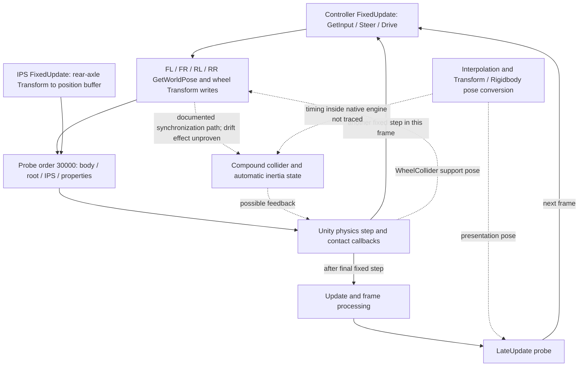

# SIM0 — Pose-update source and retained-trace review

Date: **2026-10-01**. Review: `20261001T114229Z-pose-review`.

**The approved read-only review is complete. The drift cause is not yet proven, and SIM0/PRE remains blocked by SIM0-B06.** The strongest lead is the repeated update of physical wheel-mesh transforms and the resulting synchronization with the Rigidbody. The four retained runs show about one float32 Z-position increment per physics callback; integrating the sampled Z velocity accounts for only **0.287–0.299%** of their displacement. This warrants locating the change inside the controller callback before choosing a physics repair.

The user's “approve” authorized the review proposed in the [Floor-only A/B report](SIM0-floor-contacts.md). This review used existing source, compiled assets, four retained traces and official Unity 2021.3 documentation. It introduced no build, simulator/Editor launch, physics change, live trial or plugin feature. Analysis helpers and evidence copies are local review artifacts. [Scope and context](../../artifacts/simulator-build/20261001T114229Z-pose-review/context.json), [approved proposal](../../artifacts/simulator-build/20261001T114229Z-pose-review/approved-proposal.md).

## 1. Evidence and certainty

The inspected player is the existing Floor-study build from AutoDRIVE source `635dbb6d86ec98e25ea845a97188f7bbe85a09e8`, using Unity **2021.3.9f1 / ad3870b89536**. The retained tests ran Ubuntu 22.04, Humble/domain 87, localhost transport, RTX 3080/Vulkan, display `:1`, Manual mode, Driver's Eye and the existing **1 ms** fixed timestep. This review did not rerun that environment.

| Evidence level | What this review establishes | Limit |
| --- | --- | --- |
| Verified source/compiled configuration | 120 serialized script identities, including 29 vendor instances; five selected script field layouts; physics/time settings; physical wheel-parent bindings. | Serialized flags are startup state, not a runtime history. Native engine implementation is unavailable. |
| Verified retained observations | Four complete sequences of fixed callbacks within the original 60-second host-clock windows; position increments, velocity integrals, COM-offset estimates and phase-transition sums. | Existing observation phases do not bracket individual controller statements or native solver substeps. |
| Documented semantics | FixedUpdate precedes its physics simulation; automatic Transform synchronization, interpolation, collider-derived inertia and WheelCollider support behavior. | Online documentation identifies the 2021.3 series, not an immutable 2021.3.9f1 patch snapshot. |
| Design judgment | Investigate wheel-pose writes and synchronization first; retain WheelCollider/solver behavior as a competing explanation. | Neither a diagnosed engine defect nor an approved repair. |

Sources: [compiled/source inventory](../../artifacts/simulator-build/20261001T114229Z-pose-review/source-inventory.json), [consistency checks](../../artifacts/simulator-build/20261001T114229Z-pose-review/source-consistency-checks.json), [trace derivation](../../artifacts/simulator-build/20261001T114229Z-pose-review/trace-analysis.json), [official-source URLs, retrieval dates and hashes](../../artifacts/simulator-build/20261001T114229Z-pose-review/official-sources.json).

## 2. Actual pose writers and configuration

**Controller.** `VehicleController.Start` assigns the configured local COM. Its `FixedUpdate` calls `GetInput`, then `Steer` and `Drive`, then `UpdateWheelPoses`. Four calls, in FL/FR/RL/RR order, read `WheelCollider.GetWorldPose` and assign the corresponding wheel Transform's world position and rotation. These are the parents of the four enabled wheel **MeshColliders**, not merely detached display objects. The separate actuator WheelColliders remain under `F1TENTH/Actuators`. See the retained [controller source](../../artifacts/simulator-build/20261001T114229Z-pose-review/source-snapshots/Assets/Scripts/VehicleController.cs), especially lines 76, 138–159 and 249–280.

**Zero-input path.** The actual serialized drivetrain is CAWD (`driveType=5`), Manual (`DrivingMode=0`), with `MotorTorque=85.599998474 Nm`. Zero input clears both rear motor torques and applies that brake torque to all four wheels. All four retained runs record zero motor torque, RPM, throttle and steering. All actuator-wheel ground hits remain on Floor, including the mesh-contact-filtered treatments. Braking and zero wheel rotation do not lock the chassis pose or disable suspension support. Unity documents a raycast/spring/damper and separate tire-friction model for WheelCollider. [WheelCollider API](https://docs.unity3d.com/2021.3/Documentation/ScriptReference/WheelCollider.html).

**Synchronization.** Both source settings and compiled `globalgamemanagers` have automatic simulation and `autoSyncTransforms` enabled. The body's serialized interpolation value is 1, corresponding to **Interpolate** in the pinned Editor's API assembly; mass is 3.4700000286 kg, gravity is enabled, it is nonkinematic and has no axis constraints. [Enum disassembly check](../../artifacts/simulator-build/20261001T114229Z-pose-review/physics-enum-review.json). Unity documents automatic propagation of changed Transforms to physics components and automatic inertia calculation from attached colliders when no custom inertia is supplied. This supplies a plausible connection from the wheel-parent writes to body properties; it does not prove that this connection causes drift. [Automatic synchronization](https://docs.unity3d.com/2021.3/Documentation/ScriptReference/Physics-autoSyncTransforms.html), [inertiaTensor](https://docs.unity3d.com/2021.3/Documentation/ScriptReference/Rigidbody-inertiaTensor.html).

**Other candidates.** The relevant source and binding review gives the following boundaries:

| Component | Actual role / write target | Interpretation for the retained trials |
| --- | --- | --- |
| IPS | Reads `F1TENTH/Transforms/Rear Axle Center`, mapping Unity `(z, −x, y)` into its position buffer. | A reader, not a body pose writer. Socket telemetry rounds this buffer to three decimals; full-precision probe values bypass that rounding. |
| LIDAR | Its optional animation rotates `F1TENTH/Sensors/LIDAR/Scanner`. | `AnimateScanner=false` in both decoded player and source scene. Raycasts still execute; do not confuse a disabled animation with a disabled sensor. |
| FollowTarget / TrackTarget / FocusTarget | Bird's Eye/Trackcam positions, God's Eye rotation/field of view. | Separate camera objects, initially inactive in the compiled scene. None is bound to write the vehicle root. TrackTarget is present in a namespace and is included in this review. |
| DataRecorder | Temporarily writes vehicle root poses and resets velocity while exporting recorded samples. | A real root writer, but gated by recording/save actions. `Start` clears its private state, and no recording action was part of the trials. Those flags were not logged live, so source inspection alone cannot prove they stayed inactive. |
| SceneReset | Reloads the scene after its UI pointer-click callback. | No reset was requested during these observation windows; a reset is not an ordinary fixed-loop operation. |
| Socket | Writes autonomous throttle/steering only when the controller reports Autonomous mode. | The retained mode/zero guards verified Manual operation. No root-pose setter in this path. |
| Diagnostic probes | Read body/root/axle/properties; the prior treatment additionally filters four collision pairs. | Probe reads, logging and engine queries may affect timing/synchronization. Existing data cannot certify an observation-free physics trajectory. |

Retained sources: [IPS](../../artifacts/simulator-build/20261001T114229Z-pose-review/source-snapshots/Assets/Scripts/IPS.cs), [LIDAR](../../artifacts/simulator-build/20261001T114229Z-pose-review/source-snapshots/Assets/Scripts/LIDAR.cs), [DataRecorder](../../artifacts/simulator-build/20261001T114229Z-pose-review/source-snapshots/Assets/Scripts/DataRecorder.cs), [Socket](../../artifacts/simulator-build/20261001T114229Z-pose-review/source-snapshots/Assets/Scripts/Socket.cs), [probe](../../artifacts/simulator-build/20261001T114229Z-pose-review/source-snapshots/Assets/RoboRacerQualification/Diagnostics/KinematicsProbe.cs). The inventory includes camera/reset sources and matching scene entries. Text review of **226 Assets C# files** found no executable `Physics.SyncTransforms`, `Physics.autoSyncTransforms`, `Physics.Simulate`, `Physics.autoSimulation` or `PlayerLoop` match; the one textual match is a comment. This is not proof about native code, reflection or every package.

**A separate pre-motion concern:** the zero-input branch does not explicitly clear the front motor torques, while the selected CAWD nonzero branch assigns them. A future nonzero→zero transition therefore needs review and live qualification before motion authorization. This cannot explain the four fresh neutral runs, whose front motor torques are recorded as zero. No controller repair was made. Also, the controller's serialized `WheelRadius` is 0.0325 m while the actual WheelCollider radius is 0.059 m; the controller radius belongs to the skid-steer calculation, which the selected CAWD path does not execute. Preserve this distinction for later calibration rather than substituting source defaults for measured geometry.

## 3. Source-linked causal and timing map



The controller and IPS have serialized execution order 0; their relative order is not fixed by that value. The diagnostic's `DefaultExecutionOrder(30000)` places its FixedUpdate after vendor callbacks, **before the next physics simulation**, rather than at the end of that simulation. Its LateUpdate is later in the rendered frame. Thus a FixedUpdate→FixedUpdate interval includes both native physics and the next controller execution. A final FixedUpdate→LateUpdate interval includes physics, contact callbacks and intervening frame work; it is not a pure isolated solver measurement. [Unity execution order](https://docs.unity3d.com/2021.3/Documentation/Manual/ExecutionOrder.html).

`GetWorldPose` includes contact/suspension/steering/rotation effects, while interpolation produces a presentation pose from physics history. These API semantics explain why wheel Transform and Rigidbody samples can differ in time. They do not specify the native internal operation producing the recorded bias. [GetWorldPose](https://docs.unity3d.com/2021.3/Documentation/ScriptReference/WheelCollider.GetWorldPose.html), [interpolation](https://docs.unity3d.com/2021.3/Documentation/Manual/rigidbody-interpolation.html).

The sample timestamp is captured before the probe polls the contact-window request. Its first activation sample can therefore carry a timestamp slightly earlier than the activation timestamp while containing the subsequently updated filter state. The original exact-window selection is retained; no new settling cut, re-zeroing or favorable subwindow was introduced.

## 4. Quantitative findings from the four existing windows

All values below are newly derived from retained JSONL samples, not new simulator measurements. “A” is the unfiltered control, “B” the prior Floor-only treatment. Integration uses successive **simulation fixed-time** differences, rather than assuming wall-clock intervals or integrating the low-rate ROS stream.

| Measurement | A1 | A2 | B1 | B2 |
| --- | ---: | ---: | ---: | ---: |
| Fixed samples | 59,944 | 59,969 | 60,003 | 59,993 |
| Fixed simulation span (s) | 59.943003 | 59.968003 | 60.002003 | 59.992003 |
| Body Z displacement (mm) | 3.431439 | 3.413200 | 3.372014 | 3.413975 |
| Trapezoidal integral of sampled Z velocity (mm) | 0.010194 | 0.010211 | 0.009665 | 0.010214 |
| Integral / displacement (%) | 0.2971 | 0.2992 | 0.2866 | 0.2992 |
| Mean Z increments per fixed interval (float32 ULPs) | 0.960412 | 0.954909 | 0.942852 | 0.954744 |
| Net Z change of rotated COM offset (nm, unnormalized formula) | 4.985 | 3.078 | 3.303 | 1.043 |

One float32 ULP at these Z positions is **0.000000059604644775390625 m**, or **0.059604645 μm**. Every consecutive fixed-sample Z difference is an exact multiple from **−1 to +3 ULPs**. In A1 the counts are −1: 3,712; 0: 11,934; +1: 27,751; +2: 16,107; +3: 439. The average is close to one increment per 1 ms callback. This is a numerical signature, not evidence that floating-point storage alone is defective or that changing the timestep is an approved solution.

The sampled velocity is in world coordinates according to the API. Left-, right- and trapezoidal integration all remain near **0.010 mm**, versus approximately **3.4 mm** of Z change. Missing native substeps, constraint corrections or pose synchronization may invalidate treating those samples as a complete dynamical integral; the discrepancy must not be called an impossible physical result or attributed automatically to a bad sensor. [Rigidbody.velocity](https://docs.unity3d.com/2021.3/Documentation/ScriptReference/Rigidbody-velocity.html).

The body Transform origin and COM are different points. Applying the recorded quaternion to the fixed local COM gives a Z-offset range of only **39.17 nm** across each window; normalizing the quaternion offline also leaves nanometre-scale net changes. This eliminates a simple origin-versus-COM rotational-offset explanation for millimetres of drift in these samples. This is an offline estimate, not a recorded `worldCenterOfMass` value. [COM coordinate semantics](https://docs.unity3d.com/2021.3/Documentation/ScriptReference/Rigidbody-centerOfMass.html).

**Phase localization narrows the next question.** The following sums partition consecutive *interleaved* sample transitions; the sum of all rows equals the first-to-last interleaved body change. A2 ends in LateUpdate, so its sum differs by one ULP from the fixed-only endpoint table.

| Interleaved transition: summed body Z change (mm) | A1 | A2 | B1 | B2 |
| --- | ---: | ---: | ---: | ---: |
| FixedUpdate→FixedUpdate within one rendered frame | +3.246784 | +3.235936 | +3.174663 | +3.212094 |
| Last FixedUpdate→LateUpdate in that frame | −0.169277 | −0.171125 | −0.191033 | −0.189185 |
| LateUpdate→first FixedUpdate of next frame | +0.353932 | +0.348330 | +0.388384 | +0.391066 |

Every recorded final FixedUpdate→LateUpdate body-Z change is **−1 or 0 ULP**, while the same-frame fixed intervals already accumulate substantial positive displacement. A display-only shift once per rendered frame is insufficient to explain the observations. However, the same-frame intervals still contain both native physics and subsequent controller writes; existing samples cannot choose between them. Summing transition classes is descriptive and does not assign causal percentages.

At FixedUpdate, root-minus-body Z lies between **−0.2384 and 0 μm**, far smaller than the accumulated movement. Inertia changes in about 93% of fixed intervals, but positive Z accumulation is also present in the intervals with unchanged inertia. Neither changing inertia nor the small interpolation offset alone proves the root cause. The prior Floor filter removed the selected mesh contacts without removing drift; WheelCollider support and attached collider geometry remained present.

## 5. Ranked hypotheses and remaining uncertainty

| Priority | Hypothesis | Supporting evidence | What is still missing |
| --- | --- | --- | --- |
| 1 | Repeated wheel-parent writes interact with automatic collider/body synchronization, inertia updates and pose conversion, producing a small bias. | Four physical collider parents are rewritten each fixed callback; autosync and interpolation enabled; inertia varies; submicrometre step bias is visible within rendered frames. | A sample immediately before/after those operations. No native round-trip or feedback mechanism has been demonstrated. |
| 2 | WheelCollider support/constraint solving and numerical pose correction produce most of the bias independently of the wheel-parent setters. | All actuator wheels remain grounded on Floor; the body is awake; mesh-contact removal is insufficient; sampled velocity does not integrate to the pose change. | Unobserved solver phases and suspension internals; present callback samples cannot isolate them. |
| 3 | Another pose writer or the observer itself alters the trajectory/synchronization. | DataRecorder has real root setters; probes perform queries and substantial logging; identical execution order values leave some sequencing unspecified. | Recorder state, setter-level traces and observation-cost control. No evidence currently connects a recorder action to these trials. |

Three simple explanations are inadequate **as sole causes in these four windows**: stock telemetry rounding (full-precision body motion is recorded), COM-offset rotation (nanometre estimate), and selected wheel-mesh/Floor contact impulses (drift persists after removal). Interpolation as part of a feedback path remains possible even though a purely visual offset cannot explain the accumulated body motion. This ranking is engineering judgment; there are no estimated causal probabilities.

## 6. One proposed next experiment — not yet authorized

**Recommendation: one statement-level pose-tracing experiment, with one isolated build and at most two fresh 10-second neutral observation windows.** The purpose is to test whether positive body-Z increments occur inside the wheel-pose update operations, before considering any change to vehicle physics. This is a new diagnostic scope, not a shortened P0 qualification or a second A/B treatment.

| Item | Proposed boundary |
| --- | --- |
| Baseline | Fresh derived copy of the qualified authoring baseline, same pinned source/Editor, scene, settings, hardware/display and Humble transport. Four mesh/Floor pairs remain unfiltered. |
| Allowed source change | Add explicitly gated diagnostic reads around controller entry/exit, `GetInput`/`Steer`/`Drive`, and each FL/FR/RL/RR `GetWorldPose`, Transform-position assignment and Transform-rotation assignment. Preserve every original statement, value and order. Retain ordinary pre-physics/LateUpdate samples. Review the exact diff before building. |
| Recorded data | Step/frame/stage identifiers, monotonic and simulation time, body/root pose, body velocity, local COM and inertia; read recorder flags and exact object bindings. Repeat an immediate body-pose read at a checkpoint to expose read/query effects. Preserve raw float values or bits so a one-ULP change survives serialization. |
| Bounds | **One build; at most two fresh runs; 10 seconds each** from complete zero telemetry plus all eight ROS topics, no late settling cut or reference reset. Statement-level recording activates with the requested observation window; retain basic startup probes. Retain 180-second startup, 300-second overall diagnostic lifetime and **1 GiB combined trace cap per run**. Stop on overflow/missing stages rather than dropping samples or increasing the cap. No automatic replacement of a failed run. |
| Guards | Existing exact-zero outbound/feedback/encoder guards, Manual mode and **≥10 mm rounded raw-displacement termination** from the first valid raw reference. Keep the known startup/rounding limitations explicit. Same owned-process cleanup and port-release checks. No nonzero command. |
| Instrumentation cost | Buffer stage data with bounded memory, serialize in batches, retain write cost/CPU/RSS/fixed-step completeness. The fresh runs describe the instrumented system; their rate need not match the prior, differently instrumented 60-second studies. |
| Hypothesis test | Accumulate body-Z changes for each bracketing interval. Positive increments concentrated across wheel-pose operations support a synchronous update-path mechanism. If every such bracket is exactly unchanged while drift occurs between callbacks, that falsifies the **synchronous-in-setter** version and redirects attention to delayed synchronization/physics. A delayed effect or getter-triggered sync can remain unresolved. |
| Diagnostic acceptance | Identical intended scene/physics and original controller statements; exact binding checks; no missing/reordered stage records; transition sums reconcile with sampled endpoints; two interpretable windows or an explicitly retained blocker; all guards and cleanup reviewed. Report measured increments and costs without inventing a drift-improvement threshold. |
| Exclusions | No added `SyncTransforms`, skipped wheel update, interpolation/timestep/constraint/friction/brake change, collider disable/filter, mass/COM/inertia setter, simulator replacement, repair adoption or PRE/S1 acceptance. |

This read instrumentation could itself affect synchronization or runtime cost. Exact repeat reads and endpoint accounting help detect that limitation but cannot certify an unobserved native causal chain. A negative or inconsistent result must be reported as such. One build and two windows are a maximum budget, not permission to retry until a desired explanation appears. The tools should extend the existing parameterized diagnostic entry points; no production-path dependency on this experiment is intended.

Permissions, if this proposal is accepted: write only the isolated `/tmp/roboracer-work` copy and repository diagnostics/evidence; execute the existing pinned build toolchain and owned player/bridge/observer; access the existing display/GPU and localhost port 4567. No dependency installation or broad network permission is proposed. Any actual sandbox escalation would identify the specific command. No such build or run has been performed in this review.

## 7. Verification, reproduction and handoff

The offline derivation verified consecutive sample indices and monotonic timestamps, one fixed timestep between every adjacent fixed sample, the exact prior phase counts/endpoints, integer-ULP increments and telescoping transition sums. Four analytic helper checks cover quaternion identity/90° rotation, a constant-velocity integral and float32 spacing. These check the analysis, not the simulator's physics.

Five selected compiled script schemas consumed their complete byte lengths; numeric/bool/string fields agree with the source scene at float32 precision. An initial LIDAR boolean-alignment decoder error is retained, corrected and checked. An initial partial hierarchy inventory is also retained; the final inventory independently resolves all script/camera paths and matches the previous 662 inspected transforms. No failed decoder result is used for conclusions. [Document checks](../../artifacts/simulator-build/20261001T114229Z-pose-review/document-review.json) verify local links, report values and unchanged checklist counts; the initial checklist-format parser error is retained separately.

All **188** frozen Floor-study evidence files match before and after review. Listed current source **9,404 + 7 files**, current player **605 files**, qualified baseline source/player, selected installed/runtime files and three reference repository states pass the [integrity check](../../artifacts/simulator-build/20261001T114229Z-pose-review/post-review-integrity.json). This is a listed-file audit, not a whole-host guarantee. The eight official documentation pages were archived after a scoped network retry: direct download was initially blocked by the sandbox domain allowlist. No additional dependency was installed.

Offline reproduction, using a fresh output file:

```bash
/tmp/roboracer-work/preflight-20260928T113745Z/avlite-venv/bin/python -I -B \
  artifacts/simulator-build/20261001T114229Z-pose-review/trace-review.py \
  --prior artifacts/simulator-build/20261001T102325Z-floor \
  --output /tmp/roboracer-pose-trace-review.json
```

The source-inspection helper accepts explicit `--project`, `--data`, `--prior-scene` and a fresh `--output-dir`; paths are pinned in `context.json` and the inventory. Both helpers are retained solely with this study for audit and reproduction, outside production and source version control. The final evidence manifest also retains report/status snapshots.

**Stage status remains unchanged:** original plan **2/34**, source amendment **2/10**, Linux recovery **3/4**. LNX-04, SIM0-03/04 and PRE-03/04 remain unchecked. This completes the authorized review, not SIM0/PRE. SIM1 and S1 have not started. Full PRE before S1 and independent hardware stopping remain required.

**Decision requested:** approve the single statement-level tracing experiment in section 6, or retain the current stop. A separate confirmation is required by the user's stage/scope gate because this review authorized no new source instrumentation, build or live trial.
