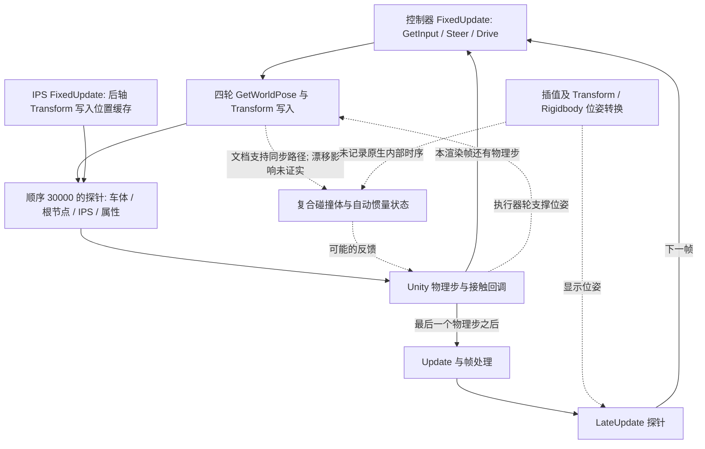

# SIM0 — 位姿更新源码与留存轨迹审查

日期：**2026-10-01**。审查编号：`20261001T114229Z-pose-review`。[English report](SIM0-pose-review.md)。

**本次获批的只读审查已经完成，但尚未证实漂移根因；SIM0/PRE 仍受 SIM0-B06 阻塞。** 当前最值得优先检查的是：控制器持续改写带物理碰撞体的车轮 Transform，以及这些改写与 Rigidbody 的同步过程。四次留存运行中，每个物理回调间隔的 Z 位移平均接近一个 float32 最小间距；对已采样 Z 速度积分，只能对应总位移的 **0.287–0.299%**。下一步应先定位变化发生在哪个语句或回调区间，再选择物理修复方法。

你的 “approve” 批准了[上一份 Floor-only A/B 报告](SIM0-floor-contacts.zh-CN.md)提出的只读审查。本次仅使用已有源码、编译资源、四次轨迹和 Unity 2021.3 官方文档；没有构建或启动模拟器/Editor，没有物理修改、新的模拟器在线试验或插件功能开发。离线分析工具和证据副本属于本次审查产物。[范围与上下文](../../artifacts/simulator-build/20261001T114229Z-pose-review/context.json)、[原批准建议](../../artifacts/simulator-build/20261001T114229Z-pose-review/approved-proposal.md)。

## 1. 依据及确定性

审查对象是既有 Floor 试验播放器，源码提交为 `635dbb6d86ec98e25ea845a97188f7bbe85a09e8`，引擎为 **Unity 2021.3.9f1 / ad3870b89536**。四次历史运行使用 Ubuntu 22.04、Humble/domain 87、本机通信、RTX 3080/Vulkan、显示服务 `:1`、Manual、Driver's Eye，以及既有 **1 ms** 物理步长。本次没有重新运行该环境。

| 证据级别 | 本次确认的内容 | 限制 |
| --- | --- | --- |
| 源码及编译配置事实 | 120 个序列化脚本实例身份，其中 29 个为厂商脚本；五个选定实例的字段；物理/时间配置；车轮父节点与物理碰撞体的绑定。 | 序列化激活状态是启动状态，不等同于完整运行历史；没有原生引擎内部实现。 |
| 留存运行事实 | 原四个 60 秒主机时钟窗口内的完整固定回调序列、位移步进、速度积分、COM 偏移估算、回调转换区间的位移和。 | 原记录没有夹住控制器每条语句，也没有记录求解器内部子步。 |
| 官方文档支持 | FixedUpdate 与物理模拟的顺序、自动 Transform 同步、插值、由碰撞体计算惯量、WheelCollider 支撑机制。 | 在线文档对应 2021.3 系列，并非不可变的 2021.3.9f1 补丁快照。 |
| 设计判断 | 优先检查车轮位姿写入与同步，同时保留 WheelCollider/求解器解释。 | 尚未确认引擎缺陷，也未批准或采用修复。 |

证据：[源码/编译资源清单](../../artifacts/simulator-build/20261001T114229Z-pose-review/source-inventory.json)、[一致性检查](../../artifacts/simulator-build/20261001T114229Z-pose-review/source-consistency-checks.json)、[轨迹推导](../../artifacts/simulator-build/20261001T114229Z-pose-review/trace-analysis.json)、[官方资料 URL、访问日期及哈希](../../artifacts/simulator-build/20261001T114229Z-pose-review/official-sources.json)。

## 2. 实际位姿写入者与配置

**控制器。** `VehicleController.Start` 设置局部 COM。其 `FixedUpdate` 依次调用 `GetInput`、`Steer`、`Drive`、`UpdateWheelPoses`。最后一步按照 FL、FR、RL、RR 顺序读取 `WheelCollider.GetWorldPose`，再分别赋值对应 Transform 的世界位置与旋转。这四个 Transform 是启用中的车轮 **MeshCollider 的父节点**，并非独立于物理模型的纯显示对象。执行器 WheelCollider 则位于另一组 `F1TENTH/Actuators` 节点。见[控制器快照](../../artifacts/simulator-build/20261001T114229Z-pose-review/source-snapshots/Assets/Scripts/VehicleController.cs)，重点为第 76、138–159、249–280 行。

**零输入路径。** 实际序列化配置为 CAWD（`driveType=5`）、Manual（`DrivingMode=0`），`MotorTorque=85.599998474 Nm`。零输入分支清零两后轮电机转矩，并向四轮施加上述制动转矩。四次留存运行的电机转矩、RPM、油门、转向均为零；包括过滤车轮网格接触后的处理组，所有执行器轮仍检测到 Floor 支撑。制动和零轮速并不锁定车体位姿，也没有关闭悬架。官方说明 WheelCollider 使用射线、弹簧/阻尼与独立轮胎摩擦模型。[WheelCollider API](https://docs.unity3d.com/2021.3/Documentation/ScriptReference/WheelCollider.html)。

**同步配置。** 源码设置与编译后的 `globalgamemanagers` 都启用了自动物理模拟和 `autoSyncTransforms`。车体插值值为 1；固定版本 Editor API 程序集确认它对应 **Interpolate**。质量为 3.4700000286 kg，启用重力，非运动学刚体，无坐标轴约束。[枚举反汇编检查](../../artifacts/simulator-build/20261001T114229Z-pose-review/physics-enum-review.json)。官方文档说明 Transform 改变可自动传递到物理组件；未自定义惯量时，惯量由附属碰撞体计算。这构成“车轮父节点写入可能影响车体属性”的依据，但不是漂移因果证明。[自动同步](https://docs.unity3d.com/2021.3/Documentation/ScriptReference/Physics-autoSyncTransforms.html)、[inertiaTensor](https://docs.unity3d.com/2021.3/Documentation/ScriptReference/Rigidbody-inertiaTensor.html)。

**其他候选路径：**

| 组件 | 实际职责或写入目标 | 对本次分析的意义 |
| --- | --- | --- |
| IPS | 读取 `F1TENTH/Transforms/Rear Axle Center`，按 Unity `(z, −x, y)` 写入位置缓存。 | 不改写车体位姿。Socket 输出保留三位小数，但完整精度探针数据绕过了该舍入。 |
| LIDAR | 可选动画旋转 `F1TENTH/Sensors/LIDAR/Scanner`。 | 源场景和编译播放器均为 `AnimateScanner=false`。传感器射线仍运行，不能把动画关闭解释为传感器关闭。 |
| FollowTarget / TrackTarget / FocusTarget | 改变 Bird's Eye/Trackcam 相机位置、God's Eye 相机旋转或视场。 | 是独立相机对象，编译场景中初始未激活；未绑定为车体根节点写入者。带命名空间的 TrackTarget 也已纳入审查。 |
| DataRecorder | 导出记录样本时，临时改写车体根位姿，并重置速度。 | 确实存在直接写入能力，但受录制/保存操作控制；Start 清空内部状态，试验未安排录制操作。历史记录未采样这些标志，不能仅靠源码断言运行中始终未启用。 |
| SceneReset | UI 指针点击回调中重载场景。 | 观测窗口未请求重置；不是普通固定回调的操作。 |
| Socket | 仅在 Autonomous 模式写入自动油门和转向。 | 历史模式/零值守卫确认 Manual；该路径没有车体位姿 setter。 |
| 诊断探针 | 读取车体/根节点/后轴/物理属性；之前的处理组另行过滤四对接触。 | 读取、物理查询和日志可能影响同步与时间开销；历史记录无法证明完全无观测扰动。 |

源码快照：[IPS](../../artifacts/simulator-build/20261001T114229Z-pose-review/source-snapshots/Assets/Scripts/IPS.cs)、[LIDAR](../../artifacts/simulator-build/20261001T114229Z-pose-review/source-snapshots/Assets/Scripts/LIDAR.cs)、[DataRecorder](../../artifacts/simulator-build/20261001T114229Z-pose-review/source-snapshots/Assets/Scripts/DataRecorder.cs)、[Socket](../../artifacts/simulator-build/20261001T114229Z-pose-review/source-snapshots/Assets/Scripts/Socket.cs)、[探针](../../artifacts/simulator-build/20261001T114229Z-pose-review/source-snapshots/Assets/RoboRacerQualification/Diagnostics/KinematicsProbe.cs)。完整清单还包括相机、重置源码和场景绑定。对 **226 个 Assets C# 文件**的文本检索没有发现可执行的 `Physics.SyncTransforms`、`Physics.autoSyncTransforms`、`Physics.Simulate`、`Physics.autoSimulation` 或 `PlayerLoop` 匹配；唯一匹配是一条注释。这不覆盖所有原生代码、反射或包代码的可能行为。

**另一个运动前问题：** 零输入分支没有显式清零前轮电机转矩，而实际 CAWD 非零输入分支会给前轮赋值。因此，未来从非零命令切换回零命令的行为，必须在运动授权前审查并验证。它不能解释这四次初始即为零命令的运行，因为前轮转矩实际记录为零；本次也没有修改控制器。另外，控制器序列化 `WheelRadius=0.0325 m`，而实际 WheelCollider 半径为 `0.059 m`。前者用于 skid-steer 计算，当前 CAWD 路径不执行该计算。后续标定应保留这一区别，不能用源码默认值替代实际几何。

## 3. 因果关系与时间顺序图



控制器与 IPS 的序列化执行顺序均为 0；这不规定二者的相对顺序。诊断探针使用 `DefaultExecutionOrder(30000)`，其 FixedUpdate 在厂商回调之后、**下一次物理模拟之前**，并非该物理步结束之后。LateUpdate 则位于渲染帧的较晚阶段。因此，连续 FixedUpdate 样本之间既包含物理模拟，也包含下一轮控制器执行；最后一个 FixedUpdate 到 LateUpdate 之间还包含接触回调及其他帧处理，不能视为纯求解器测量。[Unity 执行顺序](https://docs.unity3d.com/2021.3/Documentation/Manual/ExecutionOrder.html)。

`GetWorldPose` 包含接触、悬架、转向与轮旋转的影响；插值则依据物理历史生成显示位姿。这些语义解释了不同位姿样本可能不处于同一时刻，但不能指出产生偏置的原生内部操作。[GetWorldPose](https://docs.unity3d.com/2021.3/Documentation/ScriptReference/WheelCollider.GetWorldPose.html)、[插值](https://docs.unity3d.com/2021.3/Documentation/Manual/rigidbody-interpolation.html)。

探针在检查接触窗口请求前取得样本时间戳，因此首次激活样本可能具有略早于激活时刻的时间戳，却已包含随后更新的过滤状态。本次保留原始精确窗口选择，没有重新归零、添加有利的稳定等待段或重新挑选子窗口。

## 4. 从四个既有窗口得到的量化结果

以下是对既有 JSONL 数据的新推导，不是新的模拟器运行测量。A 为未过滤对照，B 为此前的 Floor-only 处理组。积分使用连续样本的**固定模拟时间差**，没有假设主机墙钟等于模拟时间，也没有对低频 ROS 数据进行积分。

| 指标 | A1 | A2 | B1 | B2 |
| --- | ---: | ---: | ---: | ---: |
| FixedUpdate 样本数 | 59,944 | 59,969 | 60,003 | 59,993 |
| 固定模拟时间跨度（s） | 59.943003 | 59.968003 | 60.002003 | 59.992003 |
| 车体 Z 位移（mm） | 3.431439 | 3.413200 | 3.372014 | 3.413975 |
| 已采样 Z 速度的梯形积分（mm） | 0.010194 | 0.010211 | 0.009665 | 0.010214 |
| 积分/位移（%） | 0.2971 | 0.2992 | 0.2866 | 0.2992 |
| 每个固定间隔平均 Z 步进（float32 ULP） | 0.960412 | 0.954909 | 0.942852 | 0.954744 |
| 旋转后 COM 偏移的 Z 净变化（nm，未归一化公式） | 4.985 | 3.078 | 3.303 | 1.043 |

该 Z 数值附近，float32 相邻可表示数的间距（ULP）为 **0.000000059604644775390625 m**，即 **0.059604645 μm**。所有连续固定样本的 Z 差值均严格为 **−1 至 +3 ULP** 的整数倍。A1 分布为：−1 共 3,712 次，0 共 11,934 次，+1 共 27,751 次，+2 共 16,107 次，+3 共 439 次。平均每 1 ms 回调约增加一个最小间距。这是数值特征，不能据此认定浮点存储本身存在缺陷，也不能直接批准修改物理步长。

API 将速度定义为世界坐标速度。左端点、右端点及梯形三种积分都接近 **0.010 mm**，远小于约 **3.4 mm** 的 Z 位移。但未观测的求解器子步、约束修正和位姿同步，可能使边界速度采样不足以还原全部运动；不能把差异称为“不可能的物理结果”或直接归因于传感器错误。[Rigidbody.velocity](https://docs.unity3d.com/2021.3/Documentation/ScriptReference/Rigidbody-velocity.html)。

车体原点与 COM 不是同一点。用记录的四元数旋转固定局部 COM，得到每个窗口的 Z 偏移范围仅 **39.17 nm**；离线归一化四元数后，净变化仍为纳米量级。因此，简单的“原点与质心参考点不同”不足以解释这些样本中的毫米级漂移。该结果是离线估算，不是直接记录的 `worldCenterOfMass`。[COM 坐标语义](https://docs.unity3d.com/2021.3/Documentation/ScriptReference/Rigidbody-centerOfMass.html)。

**回调区间定位进一步缩小了问题。** 下表按连续、交错记录的样本转换分类求和。各行之和等于交错序列首尾的车体位移。A2 最后一个样本为 LateUpdate，因此其总和比上表仅取 FixedUpdate 首尾的结果少一个 ULP。

| 回调转换区间：车体 Z 差值和（mm） | A1 | A2 | B1 | B2 |
| --- | ---: | ---: | ---: | ---: |
| 同一渲染帧内 FixedUpdate→FixedUpdate | +3.246784 | +3.235936 | +3.174663 | +3.212094 |
| 本帧最后一个 FixedUpdate→LateUpdate | −0.169277 | −0.171125 | −0.191033 | −0.189185 |
| LateUpdate→下一帧第一个 FixedUpdate | +0.353932 | +0.348330 | +0.388384 | +0.391066 |

所有已记录的“最后 FixedUpdate→LateUpdate”车体 Z 变化均为 **−1 或 0 ULP**；同一渲染帧内部的固定回调间隔已经积累了显著正向位移。因此，仅每个渲染帧产生一次显示偏移，不足以解释数据。不过，同帧固定回调之间仍同时包含原生物理与下一轮控制器写入，现有记录无法区分二者。分类求和不等于分配因果贡献比例。

在 FixedUpdate 中，根 Transform 相对 Rigidbody 的 Z 偏移范围为 **−0.2384 至 0 μm**，远小于累计位移。约 93% 的固定间隔出现惯量变化，但惯量不变的间隔也存在正向 Z 累积。惯量变化和微小插值偏差都不能单独证明根因。此前过滤已移除选定网格接触，但没有移除漂移；执行器轮支撑以及附属碰撞体几何仍然存在。

## 5. 假设排序与剩余未知

| 优先级 | 假设 | 支持依据 | 尚缺证据 |
| --- | --- | --- | --- |
| 1 | 持续写入车轮父节点，与自动同步、惯量更新及位姿转换共同产生微小偏置。 | 每次固定回调改写四个物理碰撞体父节点；启用 autosync/插值；惯量变化；同帧内部可见亚微米步进偏置。 | 这些操作前后的紧邻样本；尚未证明原生坐标往返或反馈机制。 |
| 2 | WheelCollider 支撑/约束求解及数值位姿修正，独立于车轮父节点 setter 产生主要偏置。 | 执行器轮保持 Floor 支撑，车体未休眠；移除网格接触仍漂移；边界采样速度积分无法还原位移。 | 求解器阶段及悬架内部状态，现有回调样本不能隔离。 |
| 3 | 其他位姿写入者或观测工具影响轨迹/同步。 | DataRecorder 有真实根节点 setter；探针存在物理查询与明显日志开销；部分脚本同序号但先后顺序未规定。 | 运行中的录制状态、语句级位姿记录以及观测开销约束；目前无证据把录制操作与漂移关联。 |

在这四个窗口中，以下解释不足以作为**唯一原因**：原遥测舍入（完整精度车体数据也在移动）、COM 旋转偏移（估算只有纳米级）、选定车轮网格/Floor 接触冲量（移除后漂移仍在）。单纯视觉偏移不足以解释车体累计运动，但插值参与反馈的可能性仍保留。上述排序属于工程判断，没有估计因果概率。

## 6. 唯一建议的下一项试验——尚未批准

**建议进行一次语句级位姿追踪试验：一个隔离构建，最多两个全新进程、每次 10 秒的零命令观测窗口。** 目标是在修改车辆物理之前，检验正向车体 Z 步进是否发生于车轮位姿更新操作内部。这是新的诊断范围，不是缩短 P0 验收，也不是另一项 A/B 处理。

| 项目 | 建议边界 |
| --- | --- |
| 基线 | 从已验证 authoring 基线创建独立副本；保持固定源码/Editor、场景、设置、硬件/显示及 Humble 通信。四对车轮网格/Floor 接触均不进行过滤。 |
| 允许的源码变化 | 在控制器入口/出口、GetInput/Steer/Drive，以及四轮各自 GetWorldPose、Transform 位置赋值、旋转赋值前后加入明确开关控制的只读诊断。原语句、赋值和执行顺序全部保留；继续记录原先物理前/LateUpdate 样本。构建前审核确切差异。 |
| 记录内容 | 物理步/帧/阶段编号、单调时钟与模拟时间、车体/根位姿、速度、局部 COM 与惯量；读取录制状态和确切对象绑定。在检查点连续读取两次车体位姿，以暴露读取/查询本身的影响；保留原始 float 值或位模式。 |
| 数量与时间 | **一个构建，最多两次全新运行，每次 10 秒**，从完整零遥测及八个 ROS 话题就绪起算。不增加稳定等待段、不重置参考点；语句级记录随请求的观测窗口激活，保留基本启动探针。保留 180 秒启动上限、300 秒诊断总寿命及**每次 1 GiB 合并轨迹上限**。溢出或缺少阶段记录时停止，不丢弃样本、不扩大上限，也不自动替换失败运行。 |
| 守卫 | 保留精确零输出/反馈/编码器守卫、Manual，以及从首个有效原始遥测参考点计算的 **≥10 mm 舍入位置变化终止条件**。保留该守卫在启动阶段及舍入方面的既有限制。检查所属进程退出和端口释放；不发送非零命令。 |
| 观测开销 | 有界缓冲并批量序列化，记录写入开销、CPU/RSS 与固定步完整性。新数据描述带新探针的系统，不要求其速率等于旧的 60 秒高日志负载试验。 |
| 假设检验 | 对各夹取区间的车体 Z 变化求和。若正向增量集中在车轮位姿操作前后，则支持同步更新路径解释。若各操作区间严格不变、但回调之间仍漂移，则否定“setter 内同步产生增量”这一版本，转而检查延迟同步/物理。延迟效应或 getter 触发同步仍可能未决。 |
| 诊断交付标准 | 场景/物理配置及原控制器语句符合预期；绑定完全正确；无丢失/乱序阶段；区间和与采样首尾对齐；提供两个可解释窗口或明确保留阻塞；检查守卫与退出。报告实际增量及成本，不杜撰改善阈值。 |
| 不在范围内 | 不新增 SyncTransforms，不跳过车轮更新，不改插值/步长/约束/摩擦/制动，不禁用或过滤碰撞体，不新增质量/COM/惯量 setter，不更换模拟器，不采用修复，也不宣布 PRE/S1 通过。 |

只读插桩本身仍可能影响同步和运行成本。连续重复读取、首尾核对可以暴露部分限制，但不能证明未观测的原生因果链。阴性或不一致结果必须如实报告。一个构建、两个窗口是上限，不是“重试直到得到期望解释”的许可。应扩展既有统一、参数化诊断入口，避免正式运行路径依赖该实验。

若批准，所需权限仅包括：写入独立 `/tmp/roboracer-work` 副本及仓库诊断/证据；执行既有固定版本构建工具链及所属 player/bridge/observer；使用现有显示/GPU 和本机 4567 端口。不计划安装依赖或申请宽泛网络权限。若环境仍要求额外审批，应对应实际命令说明。本次审查没有执行这些构建或运行操作。

## 7. 验证、复现与交接

离线推导检查了连续样本编号、单调时间戳、相邻固定样本恰好相差一个物理步、与此前完全一致的阶段数量/首尾位姿、整数 ULP 步进以及转换区间求和。四个解析自检覆盖单位四元数、绕 Y 轴 90° 旋转、恒速积分和 float32 间距；它们验证分析方法，不验证模拟器物理。

五个选定脚本字段布局完整消耗其序列化字节；数值、布尔和字符串字段与源场景在 float32 精度下吻合。最初的 LIDAR 布尔字段对齐解码失败已保留、修正并检查。最初对象层级不完整的清单也被保留；最终清单独立解析全部脚本/相机路径，并与此前检查的 662 个 Transform 一致。结论不使用失败解码结果。[文档检查](../../artifacts/simulator-build/20261001T114229Z-pose-review/document-review.json)验证了本地链接、报告数值及不变的 checklist 数量；最初的 checklist 格式解析错误另行保留。

Floor 试验冻结的 **188 个文件**在审查前后均保持哈希一致。当前源码 **9,404 + 7 个文件**、当前播放器 **605 个文件**、已验证基线源码/播放器、选定安装/运行时文件，以及三个参考仓库状态均通过[完整性检查](../../artifacts/simulator-build/20261001T114229Z-pose-review/post-review-integrity.json)。这是指定文件清单检查，不是整机保证。八个官方文档页面已归档；直接下载最初被沙箱域名白名单阻止，随后通过限定范围的网络重试完成，没有安装新依赖。

可使用新的输出文件离线复现：

```bash
/tmp/roboracer-work/preflight-20260928T113745Z/avlite-venv/bin/python -I -B \
  artifacts/simulator-build/20261001T114229Z-pose-review/trace-review.py \
  --prior artifacts/simulator-build/20261001T102325Z-floor \
  --output /tmp/roboracer-pose-trace-review.json
```

源码清单工具接受显式 `--project`、`--data`、`--prior-scene` 及新的 `--output-dir`；路径固定在 context 与 inventory 中。两个工具仅随本次证据留存，用于审计/复现，不纳入生产路径或源码版本控制；最终证据清单包含报告和状态快照。

**阶段验收数不变：** 原计划 **2/34**，源码构建修订 **2/10**，Linux 恢复 **3/4**。LNX-04、SIM0-03/04、PRE-03/04 均保持未勾选。本次完成的是获批审查，**不是 SIM0/PRE**；SIM1、S1 尚未开始。完整 PRE 后进入 S1、硬件停车独立的要求保持不变。

**需要确认的决策：** 是否批准第 6 节这唯一一项语句级追踪试验，或保持当前暂停。按照你规定的阶段/范围确认边界，本次只读批准不包含新插桩、构建或在线运行，因此这些后续动作需单独确认。
